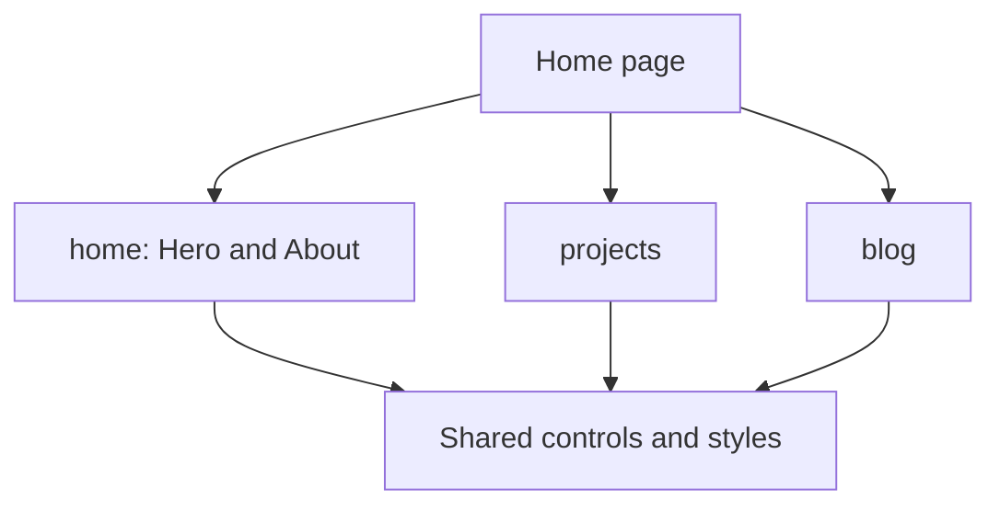

# My Personal Website

[](https://github.com/bingyangchen/bingyangchen.github.io/actions/workflows/deploy.yml)

A React and TypeScript personal website built with Vite and deployed to GitHub Pages. Visit the live site at [byc1999.com](https://byc1999.com/).

## Development

Use Node.js 22.22.2 or newer in the 22.x line and npm, matching CI. Node.js 24.15.0 or newer in the 24.x line is also supported; see `package.json` for the full engine range required by the test tools. Resume PDF builds require Georgia: macOS supplies it, while Ubuntu CI installs the TTF files in [vendor/corefonts](vendor/corefonts/README.md), without downloading or extracting fonts. Noto Serif TC is bundled for the Chinese name, so no system CJK font is needed. `npm run build` rejects missing or substituted PDF fonts; `npm run dev` remains available without the PDF build fonts.

```sh
npm ci
npx playwright install chromium firefox webkit
npm run dev
```

To preview the production site locally:

```sh
npm run build
npm run preview
```

Vite reads the root `index.html`, bundles imported assets, and copies `public/` into a clean `build/` directory. The npm `postbuild` hook then prerenders the homepage and generates `build/resume.pdf` from the shared ResumeSheet. Use the production preview to test homepage downloads; the development server does not generate the PDF.

Brand images ship with the site. Original source URLs for work-experience logos are recorded beside their imports in [`workExperience.ts`](src/data/workExperience.ts). Prerender and PDF generation block non-loopback network requests, so producing the static site does not require third-party services.

Personal names, contact information, destinations, and shared education facts live in [`src/data/profile.ts`](src/data/profile.ts). Home, Footer, Projects, Blog, and ResumeSheet consume those values directly. Names have explicit display forms; change the given and family name constants to update the derived English forms. `public/CNAME` and the deployment URL in `package.json` remain hosting configuration and must be reviewed separately when changing domains.

Shared company names, localized job titles, and employment periods live in [`src/data/career.ts`](src/data/career.ts), keyed by stable work IDs. `src/data/workExperience.ts` supplies homepage order and logo assets; the dictionaries and resume use the same facts without importing those assets. [`src/i18n/workExperience.ts`](src/i18n/workExperience.ts) formats dates by language, using the same month abbreviations, range separator, and tenure parentheses on the website and resume. Completed tenures include both endpoint months, matching the authored durations; current roles retain Present without a changing tenure count. Semester teaching remains a semester rather than an invented employment date range.

Project metadata lives in `src/data/projects.ts`. Career and project IDs define the required keys in both dictionaries and the corresponding asset registries, so display-name edits do not change lookup keys. Projects store calendar years directly, since their periods display no month or day. Keep JSX and artwork composition in the Projects component.

English work narratives and project copy are maintained only in `src/i18n/dictionaries/en.ts`, with Traditional Chinese in `zhtw.ts`. Each dictionary combines its work narratives with formatted shared career facts. The pure resolvers in `src/i18n/content.ts` apply English fallback per field when a translation is missing or blank. Complete production dictionaries remain required by TypeScript, and data-integrity tests reject empty copy and duplicate IDs, so fallback cannot hide incomplete maintained content. Homepage narratives, resume bullets, and education narratives remain independently editable.

[`src/siteMetadata.ts`](src/siteMetadata.ts) produces HTML metadata, manifest, robots, and sitemap from the same serializable profile. The Vite `profile-metadata` plugin resolves the `%PROFILE_*%` placeholders in `index.html`, serves the generated metadata files in development, and emits them into production builds. Keep their routes out of `public/` to avoid competing copies. Sitemap project paths remain explicitly listed pending the ownership investigation in TD-25; generating their origin from the profile does not establish their availability.

[Image assets and loading](docs/image-assets.md) documents responsive renditions, embedded project previews, resource budgets, and before/after measurements. After replacing an original image, run `npm run images:generate` with libwebp's `cwebp` and `dwebp` available; generated assets are committed, so normal builds need neither tool.

Preview serves the build over loopback HTTP without an SPA fallback. `/resume` remains a non-public preview with browser printing, available through `npm run dev`.

### Feature Ownership

[`Home`](src/pages/Main/Home/Home.tsx) composes the four ordered anchor containers and registers one scroll-motion scope around all their content. Feature entry points provide complete behavior without requiring the page to coordinate private events or style internal headings.



[`src/features/home`](src/features/home/index.ts) exports Hero and About. Portrait privately owns its fixed face, pointer tracking, hover suppression, and QR opener. QrCodeDialog owns the portal, native modal, body scroll lock, focus restoration, and cleanup. These implementations stay together because closing a dialog can delay the portrait's hover restoration; the page must not coordinate that interaction. About privately owns Skill and WorkExperience. Hero, About, Portrait, and QrCodeDialog each maintain their own CSS Module.

[`src/features/projects`](src/features/projects/index.ts) owns project selection, artwork composition, responsive images, and period formatting. [`src/features/blog`](src/features/blog/index.ts) owns article presentation and native text-selection handling. Each feature exports only its entry point; private modules and tests remain beside their implementation. `src/components/index.ts` exports shared controls and the site shell without re-exporting feature implementations. Shared facts remain in `data/`, while translations and fallback rules remain in `i18n/`.

Projects and Blog use the shared section patterns and own all their internal typography and spacing. `tests/browser/feature-styles.spec.ts` compares their content styles inside and outside Home in both languages at the supported breakpoints. Native interaction and motion tests continue to exercise the composed production page. The Portrait unit test additionally checks Strict Mode effect replay and disposal without loading About or the other features.

### Scroll Motion

Keep the site's reversible scroll formulas rather than introducing an animation engine: SITE-R13 defines grouped motion, long-content reading regions, and Hero exit delays that must remain consistent at the same position in either scroll direction.

<!-- prettier-ignore -->
| Module | Responsibility |
| --- | --- |
| [`src/motion/calculation.ts`](src/motion/calculation.ts) | Pure pose and timeline calculations from document geometry, viewport position, and numeric parameters; no DOM access or playback state. |
| [`src/motion/parameters.ts`](src/motion/parameters.ts) | Read and validate the complete CSS parameter set, including units and progress ranges, when measurements are invalidated. |
| [`src/motion/useScrollMotion.ts`](src/motion/useScrollMotion.ts) | Collect and measure elements, calculate a frame before writing styles, merge events into one requested frame, and release browser resources and temporary styles. |

Parameter tests compile the actual Sass mixin and compare its emitted names with the reader, including compact overrides. Calculation tests verify reading regions, endpoints, long and short content, stagger, and reverse traversal. Hook tests cover invalidation, preferences, print, hidden pages, Strict Mode, disposal, and delayed font readiness. Browser tests retain the production integration checks; idle style-write checks alone do not establish scrolling performance. Compare frame work under the same browser, viewport, input, and content when changing motion; desktop mobile emulation does not replace physical-device checks.

### Static Output and PDF Validation

`scripts/static-server.mts` owns loopback file serving for both preview and prerender, including MIME types, decoded-path and symlink checks, HEAD requests, stream errors, and shutdown. Preview serves actual files only. Prerender explicitly supplies the compile shell for `/` and `/resume`; all other missing paths return 404, including missing assets. Unexpected file I/O failures return 500 and report their cause.

`scripts/prerender.mts` coordinates browser configuration, homepage capture, resume generation, validation, and output. The modules in `scripts/prerender/` keep those responsibilities separately testable. A 120-second deadline covers the run, errors identify the failing stage, and browser cleanup has a separate five-second limit before terminating the browser process. Server shutdown runs even if browser launch or cleanup fails, and closes active connections. HTML and PDF are written only after both outputs pass validation.

PDF structure is read through [pdf-lib](https://pdf-lib.js.org/docs/api/classes/pdfdocument), including compressed objects, page geometry, document language, embedded font descriptors, and link annotations. [PDF.js](https://github.com/mozilla/pdf.js/tree/master/examples/node) independently extracts the generated text and checks every expected line of resume content, including contact information. Comparison normalizes Unicode ligatures, whitespace, and discretionary line-end hyphens while preserving authored punctuation. DOM bounds remain a separate clipping check; neither extraction nor structural checks establish visual quality or ATS compatibility.

Browser tests inspect PDF metadata, drawing fonts, annotations, and text with PDF.js rather than sharing the build's structure reader. Prerender failure fixtures invoke the actual entry module with a temporary build directory, so adding an internal import cannot turn a fixture into a missing-module failure. Negative PDF fixtures cover compressed objects, corruption, missing text or annotations, unexpected geometry or language, and missing, substituted, or unembedded fonts. Manual checks retain visual layout, reading order, and real browser/OS printing.

The [local design system](src/styles/README.md) documents shared tokens, Sass patterns, and UI controls. Shared tokens, reusable patterns, and global screen and print entry styles live in `src/styles/`; component styles stay in co-located CSS Modules.

## Verification

Run `npm run check` for all automated checks, including a fresh production build. Individual checks are also available:

<!-- prettier-ignore -->
| Command | Purpose |
| --- | --- |
| `npm run format` | Format maintained source, configuration, and documentation with Prettier. |
| `npm run format:check` | Check formatting without modifying files. |
| `npm run lint` | Check source, scripts, and tests with ESLint; warnings fail the check. |
| `npm run lint:fix` | Apply available ESLint fixes. |
| `npm run typecheck` | Check application, Vite configuration, Node tools, and browser tests with separate strict TypeScript projects. |
| `npm run check:scenarios` | Validate spec and scenario coverage links. |
| `npm run test:checker` | Test the scenario checker. |
| `npm run test:unit` | Run Vitest tests in jsdom. |
| `npm run test:browser` | Run the full Chromium suite and Firefox/WebKit core journeys against a fresh production build; run `npm run build` first. |

Prettier owns formatting; the independent `eslint.config.mjs` configures JavaScript, TypeScript, React, hooks, and accessibility rules, with `eslint-config-prettier` disabling conflicting style rules. ESLint uses the latest compatible 9.x release because the React and accessibility plugins do not yet support ESLint 10. Node scripts and tests have Node globals, unit tests have Vitest globals, and browser automation modules also have browser globals for callbacks executed in the page. Formatting excludes archived plans, agent skills, static artwork, generated files, and the lockfile.

React's `jsx-runtime` preset supports the automatic JSX transform; props, JSX text, and accessibility checks remain enabled. The QR dialog has a local exception for backdrop clicks because Escape and the close button already provide keyboard dismissal.

Vitest discovers `src/**/*.{test,spec}.{js,jsx,ts,tsx}` and excludes `fixtures` and `__fixtures__` directories, matching the scenario checker. Playwright Test discovers `tests/browser/**/*.spec.ts`, excluding the same fixture directories. The runner and scenario checker share browser discovery rules in `scripts/test-files.mts`. Tests use literal scenario IDs; suites, `skip`, `fixme`, runtime skip annotations, and examples cannot manufacture coverage, and `only` is rejected. The scenario checker itself remains tested with the Node test runner.

Content component tests use the real LanguageProvider through `src/test-utils/render.tsx` and switch languages through the actual control. Test missing translations and alternate periods at the pure-function boundary with independent fixtures; never modify exported production data. Prefer roles, accessible attributes, or destinations for browser interaction selectors; keep CSS selectors for visual geometry local to those checks.

Browser tests use the production assets without substituting remote images. The build uses `scripts/browser-resources.mts` with Puppeteer; browser tests use `tests/helpers/resources.ts` with Playwright. Both monitors block unexpected external requests and reject HTTP errors, failed requests, undecodable images, console errors, and uncaught JavaScript errors. They share `scripts/image-decoding.mts`: decoding follows current responsive candidates and DOM images, rechecks completed candidates after the full batch, and rejects stable decode failures while restoring loading attributes. Failure tests use isolated pages and explicitly verify their expected errors. External link destinations are checked separately from third-party availability.

Playwright owns per-test pages and contexts through `tests/helpers/fixtures.ts`; extra contexts used for resource, DPR, or JavaScript cases are closed by a fixture. Tests are grouped by behavior instead of sharing module-level page state. Chromium runs every original scenario, including CDP, native touch emulation, clipboard, and PDF checks. `cross-browser.spec.ts` runs homepage, language, anchor/history, tabs, dialog, and reduced-motion journeys in Chromium, Firefox, and WebKit. WebKit automation does not replace real Safari or device checks.

Declare `hasTouch` and `isMobile` through Playwright context options or `test.use`, and use native `locator.tap` and `page.touchscreen`. Resize with `page.setViewportSize` while keeping the input device fixed. Enabling then disabling CDP touch emulation restores host-dependent pointer capabilities: Linux headless Chromium can lose hover while macOS retains it. Separate desktop and touch contexts preserve the intended media queries without manual Blink flags or touch toggles.

Run `npm run test:browser -- --project=chromium` for the full Chromium project, or select `--project=firefox` or `--project=webkit`. `npx playwright test --list` lists the executed tests. Retries are disabled, focused tests fail, and a 15-minute suite deadline leaves time for reporting. Failed tests retain traces, screenshots, and browser error attachments under `test-results/`, with an HTML report under `playwright-report/`; use `npx playwright show-report` to inspect it. CI uploads failure diagnostics for seven days and keeps publishing conditional on successful checks and the main ref.

Node tools are `.mts` modules, executed by the repository's supported Node versions through [native type stripping](https://nodejs.org/docs/latest-v22.x/api/typescript.html). `tsconfig.tools.json` requires erasable syntax and checks tools, checker tests, and JavaScript configuration. `tsconfig.browser.json` separately checks Playwright tests and helpers; the application retains its existing strict configuration. Runtime transformation does not check types, so all three projects run in `npm run typecheck` and gate `npm run check`. Keep `skipLibCheck` while checking maintained code strictly. PDF generation continues to use Puppeteer, separately from the browser test runner.

After same-document changes, wait for the observable result: the full-size responsive image candidate and decoding, the target request's terminal event, or the saved scroll position. An already reached [load state](https://playwright.dev/docs/api/class-page#page-wait-for-load-state) can resolve immediately, so it does not establish completion of later resize or network activity.

Motion checks wait for the rendered hover position and media-query cleanup state. A completed emulation command, a fixed number of animation frames, or an empty animation list does not guarantee that those changes have reached the renderer and event listeners.

Vite's JavaScript targets and PostCSS Autoprefixer use the existing production Browserslist policy. CSS uses Vite's default Lightning CSS minifier. Vite neither bundles nor emits a service worker.

The `@typescript-eslint/typescript-estree` override selects patched `minimatch` 11 for [GHSA-g3hv-75wg-m249](https://github.com/advisories/GHSA-g3hv-75wg-m249). It affects ESLint's project-file matching only. Remove the override once typescript-eslint requires a patched version itself, after checking lint and project matching.

See [manual checks](tests/manual/site.md) for verification methods and coverage requirements, and the [roadmap](docs/roadmap.md) for future requirement goals, known issues, and questions awaiting investigation or product decisions. Record actual execution results in commit bodies and delivery reports.

## Legacy Service Worker Cleanup

The site does not register a service worker or provide offline caching. Registration was enabled in commit `d7afeaf` on January 9, 2023, using CRA's `${PUBLIC_URL}/service-worker.js` without a custom scope, with a root-level homepage. Commit `01ba78c` disabled registration later that day. This establishes the cleanup identity: the current origin's root scope and `/service-worker.js`, rather than every registration on the origin. Old installations on previous domains remain isolated by browser origin.

`src/serviceWorkerRegistration.ts` queries registrations without waiting for an active worker. It unregisters a matching root registration only when at least one active, waiting, or installing worker exists and every present worker has the known script URL. A registration transitioning to a different script is preserved, as are other project scopes, unknown scripts, and registrations with no identifiable worker. Query and unregister failures are reported with their original error and handled without blocking startup or leaving rejected promises unhandled. An already removed registration is harmless.

Cleanup leaves Cache Storage intact and does not force a reload or detach an existing controller. An already controlled page may keep using its old worker until a later navigation or closure. Browser tests seed real active and waiting workers around the production build, check ownership and cache preservation, and verify controller release after reload. The [manual upgrade check](tests/manual/site.md#site-r152-既有-registration-清理) retains verification against an actual historical installation; synthetic fixtures do not establish that an old cached shell can obtain the current release. The [Service Workers specification](https://w3c.github.io/ServiceWorker/#navigator-service-worker-ready) defines why `ready` is unsuitable for enumerating installations without an active worker.

## Spec-Driven Workflow

Read the [design context](docs/design.md) for product and visual direction, the [site spec](docs/specs/site.md) for implemented behavior, and [AGENTS.md](AGENTS.md) for engineering conventions. The [SDD skill](.agents/skills/sdd/SKILL.md) defines the full workflow:

<!-- prettier-ignore -->
| Request | Use for |
| --- | --- |
| `/sdd plan` | Propose new or changed behavior and substantial design changes. |
| `/sdd implement <id>` | Implement an approved plan. |
| `/sdd change` | Fix specified behavior or refactor without changing behavior. |
| `/sdd backfill` | Document existing behavior and verification. |
| `/sdd abandon <id>` | Abandon an unfinished plan. |

This repo uses direct commits to `main`; commit and push each require explicit user instructions.

## CI and Publishing

The [deployment workflow](.github/workflows/deploy.yml) runs `npm run check` on pushes to `main` and manual runs. Successful runs on `main` deploy to GitHub Pages.
