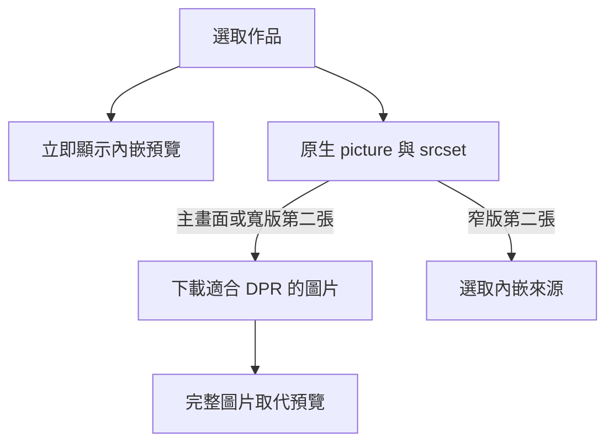

# 圖片資源與載入

## 素材產生方式

原始頭像、作品截圖及 Logo 保留在 [`src/assets/`](../src/assets/)，網站使用 [`src/assets/responsive/`](../src/assets/responsive/) 的縮圖。社群預覽圖的原始檔保留在 [`design/cover-source.png`](../design/cover-source.png)，輸出維持 [`public/cover.png`](../public/cover.png)。

更新原圖後執行 `npm run images:generate`，再檢查實際畫面並執行 `npm run check`。產生腳本使用 [libwebp 的 cwebp](https://developers.google.com/speed/webp/docs/cwebp) 與 dwebp，本次使用 1.6.0；一般開發、CI 與 production build 直接使用已提交的縮圖，不需要安裝這兩個工具。

<!-- prettier-ignore -->
| 素材 | 輸出尺寸與設定 |
| --- | --- |
| 頭像 | 輸出寬度為 160、320、480 px，保留比例，供 160 px 的顯示尺寸及不同 DPR 使用。 |
| 作品大圖 | 輸出寬度為 240、480、720 px，保留比例，對應目前最大約 240 CSS px 的構圖及最高 3 倍 DPR。 |
| 作品預覽 | 輸出寬度為 48 px，品質為 60，透過 Vite 的 `?inline` 放入 JS 與初始作品 HTML。 |
| Logo | 網站 Logo 寬度為 96 px、作品 Logo 為 78 px、需要縮小的公司 Logo 為 64 px，足以顯示目前構圖的 3 倍 DPR。 |
| 社群預覽 | 寬度縮為 1200 px，保留比例，以 lossless WebP 暫存後輸出 PNG；不計入一般首頁圖片 request。 |

除預覽圖外，WebP 品質使用 88、method 使用 6，並啟用 `sharp_yuv`。Alpha 維持 lossless，不裁切介面或頭像。預覽圖增加少量初始 JS 與 HTML，但讓作品在大圖下載期間已有正確的圖像。

## 載入與驗證

作品面板的文字及展示框持續參與高度計算，只掛載選取作品的圖片，因為切換作品時必須保留最大自然高度。頭像與 Hero 品牌圖片立即載入；經歷、技能與教育圖片使用原生 lazy loading 並預留尺寸。

第二張圖片的 media query 由 Sass 的 `$small` 匯出，與顯示規則共用 breakpoint。CSS 隱藏不能阻止下載，因此以原生 `picture` 選取來源。作品大圖的 `sizes` 使用 240 px 的構圖上限，避免圖片尚未完成 layout 時因 `auto` 的暫時尺寸下載多個版本。

Prerender 逐一驗證作品及每個 `srcset` 版本，再還原第一個作品並移除預覽的暫時載入完成標記。資源檢查會暫時載入 lazy 圖片後還原屬性；圖片來源被取代造成的 `ERR_ABORTED` 由目前圖片的 decode 結果判斷，HTTP、連線、解碼及非預期外連錯誤仍使檢查失敗。

## 資源預算

<!-- prettier-ignore -->
| 檢查 | 上限與涵蓋範圍 |
| --- | --- |
| 初始圖片 | [`tests/browser/images.test.mjs`](../tests/browser/images.test.mjs) 檢查 390 到 1440 px、DPR 1 到 3 的指定組合，Resource Timing 的圖片 `decodedBodySize` 合計不得超過 192 KiB。 |
| 單張輸出 | 產生腳本與瀏覽器檢查限制作品大圖及頭像的單張檔案不超過 64 KiB。 |
| 內嵌成本 | 同一個瀏覽器測試檔限制所有 JS 與 CSS 的 gzip 合計不超過 128 KiB，首頁 HTML 的 gzip 不超過 16 KiB，涵蓋內嵌預覽的成本。 |
| 延後載入 | 首次載入不能請求未選作品的大圖，窄版不能請求第二張 App 大圖；直接 hash 與無 JavaScript 也要符合。 |

這些 bytes 是壓縮圖片檔案的 response body 大小，不是圖片在記憶體中的解碼大小。內嵌預覽計入 JS 與 HTML，不能因沒有獨立 request 而忽略其成本。調整構圖、加入新作品或更新圖片時，需重新量測並說明預算調整原因。

## 量測紀錄

2026-11-08，以 Chromium、全新 browser context、production 靜態 server 量測首次開啟首頁且尚未切換作品的結果。修改前的程式來自 `96b1e888870f95c3b92c37a2a3a26f031b5bc088`，修改後為本次工作目錄。

<!-- prettier-ignore -->
| Viewport 與 DPR | 修改前圖片 bytes | 修改後圖片 bytes |
| --- | --- | --- |
| 390 × 844、DPR 1 | 2,189,522 | 85,946 |
| 390 × 844、DPR 2 | 2,189,522 | 116,652 |
| 1440 × 900、DPR 1 | 2,189,522 | 97,102 |
| 1440 × 900、DPR 2 | 2,189,522 | 140,640 |

390 px、DPR 2 的圖片 body 減少約 94.7%。社群預覽另由 1,296,531 bytes 降為 127,076 bytes，尺寸由 3840 × 1924 改為 1200 × 602。

2026-11-09 的圖片預算檢查使用最新素材，相同 390 × 844、DPR 2 的圖片 body 為 117,300 bytes，約 114.6 KiB，比修改前減少約 94.6%。

JS 與 CSS 的 gzip 合計由 117,918 bytes 增為 123,958 bytes，首頁 HTML 的 gzip 由 10,871 bytes 增為 13,144 bytes，這些差異包含預覽及載入處理。

另以相同的 390 × 844、DPR 2、冷 cache、150 ms latency、每秒下載 200 KiB 與 4 倍 CPU throttling，各執行三次。Chromium 版本為 156.0.8078.47，LCP 的中位數由 2,228 ms 改為 1,348 ms，六次的 CLS 均為 0。這些量測屬於桌面 Chromium 模擬，不代表真實手機或行動網路。
