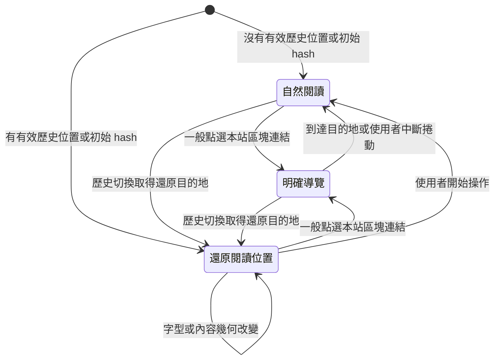

# 計劃 0001：技術債與模組分工

## 目標

讓內容、互動與工具的修改集中在負責的模組，降低跨檔案同步、理解狀態與驗證的成本。本計劃只保留尚未處理的工作，依問題的成因安排批次；各批次可分別核准。

## 核准紀錄

以下保留既有核准紀錄。本次修訂的待辦範圍仍為草稿，修改計劃不代表核准實作。

- 2026-11-09：使用者核准單獨處理 TD-09，授權集中共用事實並驗證雙語、QR code、靜態輸出與 PDF。
- 2026-11-15：使用者核准以 `change` 一併處理 TD-10 的首頁功能分工及 TD-23 的首頁樣式歸屬，保留畫面與互動，涵蓋必要的驗證及工程文件。履歷分工、共用控制與 Token 仍分批處理。

## 範圍

涵蓋 `src/` 的功能分工、導覽、樣式、圖示與靜態資料，以及 Node、npm、依賴維護和相關驗證。維持 React、Vite、GitHub Pages、英文單頁 A4 履歷、雙語、既有區塊順序與視覺方向。此次提案不增加 application server、CMS、全域狀態管理框架或公開頁面，也不改寫職涯成果。

### 判斷原則

- 以責任混合、重複知識、跨功能耦合與修改所需理解的範圍判斷重構收益。檔案長度、目錄深度或使用 HOC 本身不構成缺陷。
- 測試通過與畫面相同是保留行為的基準，不能用來否定結構問題；重構完成還須驗證責任、狀態與樣式的歸屬。
- 選擇能完整消除成因的設計，改動大小只用來安排驗證與拆批。需要跨檔案修改時一併處理，不以保留舊耦合來縮小 diff。
- 效能改善以量測決定優先度，並區分下載量、執行成本與使用者體感；單次安全掃描沒有公告，也不代表維護流程完整。

證據分為「已重現」「程式碼確認」與「待調查」。結構問題的影響可由依賴與修改路徑確認，不必等到產品故障；尚未重現的使用者故障仍須明確區分。

### 優先順序與工作批次

各批次可獨立安排，沒有先完成目錄或工具版本整理的依賴；同一 TD 的不同範圍分批完成時，僅移除已驗證的部分。

<!-- prettier-ignore -->
| 範圍 | 優先順序 | 安排理由 |
| --- | --- | --- |
| TD-12 導覽狀態與事件 | P2，獨立批次 | 降低歷史還原與原生 anchor 互動的推理及驗證成本。 |
| TD-27 圖示語意與替代文字 | P2，獨立批次 | 已在 accessibility tree 確認重複資訊，修正不依賴模組搬移。 |
| TD-21 工具版本選擇 | P2，獨立批次 | 讓新環境與 CI 能選用同一組工具。 |
| TD-22 依賴維護 | P2，獨立批次 | 補上持續發現公告與過時依賴的流程。 |
| TD-25 靜態資料校對 | P3，獨立批次 | 修正已確認的提示及尺寸錯誤，另調查 sitemap 歸屬。 |
| TD-10 履歷功能分工 | P3，獨立批次 | 集中履歷預覽、內容與列印的維護位置。 |
| TD-23 共用控制與 Token | P3，獨立批次 | 依相同用途整理共用值與規則，與首頁樣式分工分開驗收。 |
| TD-26 履歷載入 | P3，獨立批次 | 已確認可減少首頁下載量，但目前量到的收益較小。 |

## 設計稿

無。本計劃保留現有畫面與互動，狀態圖放在對應方案中；若實作需要改變產品行為或視覺方向，另行修訂並核准。

## 檢查發現與調整方案

### TD-10：按功能集中履歷

程式碼確認：履歷預覽及內容在 `pages/Main/Resume`，列印 helper 在 `src/resume`。修改列印及履歷內容時，需跨兩個位置追查。

方案：將 Resume 預覽、ResumeSheet、列印 helper 與專用型別放在 `features/resume`，頁面入口負責接到既有 route。私有 helper、素材組合與型別隨功能維護，跨首頁及履歷的事實仍放在 `data/`，翻譯約定仍由 `i18n/` 負責。此批保留既有載入策略，沒有必要搬動 router 或新增 `app/`。

完成條件：預覽、內容與列印可從同一功能入口追查，私有模組不由全站共用 barrel 匯出，沒有循環 import，並維持既有的單頁 A4 版面、文字、字型、連結與語言還原行為。

### TD-12：讓導覽狀態與原生連結一致

程式碼確認：[導覽 hook](../../src/navigation/useSectionNavigation.ts) 以 `clickedHash`、`pendingDestination`、`restorationDestination` 的組合表達目前階段，歷史資料解析、狀態轉換及 DOM 操作都在同一個 effect 內；[Header](../../src/components/Header/Header.tsx) 另有 section 清單與焦點處理。閱讀一個事件的效果時，需要同時追查其他事件如何更新這些值。

既有 Chromium 導覽情境在 2026-11-15 評估時通過，尚未確認導覽故障；重構目標是讓合法狀態、事件順序與清理更容易理解及驗證。

方案：共用固定 section ID 與型別，以明確的狀態表達自然閱讀、明確導覽、歷史還原，以及該狀態需要的目的地。歷史輸入驗證及不依賴 DOM 的轉換集中在可測函式；hook 負責事件、幾何量測、捲動與 browser 資源，Header 保留選單與控制焦點。Frame、timer、observer 是資源，不另當作導覽狀態。

完成條件：合法狀態與轉換可直接辨認，不需靠多個獨立變數推導互斥關係；純函式涵蓋無效 history 資料及事件轉換，hook 測試涵蓋延遲字型就緒、使用者中斷與卸載。原生 anchor 的修飾鍵、新分頁、history length、閱讀位置及焦點維持 SITE-R2。外站、不同 path 或 query、未知 hash、下載及其他 target 的連結不被當成本頁區塊導覽處理；一般操作仍可結束持續的位置還原。Observer、frame、timer 與延遲 callback 在卸載後不再寫入 DOM 或 history。

IntersectionObserver 只能取得區塊的可見性，無法取代歷史還原與明確導覽所需的狀態。

### TD-21：補上 Node 與 npm 的版本選擇方式

程式碼確認：[package.json](../../package.json) 已有 Node 相容範圍，[README](../../README.md) 與 [CI](../../.github/workflows/deploy.yml) 選擇 Node 22，但沒有版本選擇檔案或明確的 npm 版本。這是環境重現的缺漏，尚未確認現有環境因此執行失敗。

方案：以 `.nvmrc` 提供主要開發及 CI 使用的 Node 版本，CI 讀取同一檔案；`package.json` 的 `packageManager` 記錄 npm 版本，README 提供實際安裝與版本確認指令，CI 明確選用並確認同一 npm 版本。Metadata 不代替工具安裝，也不擅自縮減既有 `engines` 的相容範圍。實作時依官方發布資訊選擇相容版本，保留 `npm ci` 與 lockfile。

完成條件：從未設定專案版本的環境可依 README 選到相同 Node 與 npm，乾淨安裝及 `npm run check` 通過；macOS 與 Ubuntu 依既有方式供應 PDF 字型。版本選擇的修改有單一入口，不要求同步手改 README、CI 與版本檔中的同一個版本數字。

### TD-22：補足依賴安全更新

程式碼確認：部署 workflow 已有最小權限、檢查成功後發布及 main ref 限制，但 repo 尚未記錄完整的依賴維護方式。2026-11-15 的 `npm audit --json` 回報 0 個公告，只代表當次 lockfile 與 registry 的結果，不能據此推論持續監測能力。GitHub repo 與帳號層級的安全設定尚未查核，也不能從 repo 沒有 workflow 推論警示服務未啟用。

方案：先確認 Dependency graph、[Dependabot alerts](https://docs.github.com/en/code-security/how-tos/secure-your-supply-chain/secure-your-dependencies/configure-dependabot-alerts)、通知與既有版本盤點是否可用，並分別記錄實際設定、npm lockfile 的涵蓋情況、引入鏈及報告入口。警示與[自動安全更新 PR](https://docs.github.com/en/code-security/how-tos/secure-your-supply-chain/secure-your-dependencies/configure-security-updates) 可分別設定；本 repo 直接在 main 更新，不妨礙使用唯讀警示。

依盤點結果選擇工具：

<!-- prettier-ignore -->
| 能力 | 選擇條件與方案 |
| --- | --- |
| 持續發現安全公告 | 既有警示能涵蓋目前 lockfile 並提供受影響版本、引入鏈與通知時，直接沿用；未啟用但可使用時，優先提出啟用設定。只有確認無法提供所需能力時，才以獨立唯讀 `npm audit` 查詢補足，記錄不能沿用的原因。 |
| 定期盤點過時版本 | 先確認是否已有不依賴更新 PR 的報告；若沒有，以每週及手動執行 `npm outdated --json` 的唯讀 workflow 作為候選，保留原始結果，不預設自製分類器。 |
| 判讀使用情境 | 由維護者依引入鏈、package scripts 及實際用途判斷 browser runtime、build 或測試工具的暴露情境，將判讀方式記錄在 README；不把自動分類程式當作必要交付。 |

盤點結果與選型理由先補回本計劃，再核准實際需要修改的設定或 workflow；獨立報告不是預設必做項目。更新仍由維護者審查並在 main 處理，部署流程與 `npm run check` 的既有條件保持。

完成條件：每項能力都有可查證的來源、檢查或通知入口與維護方式，選型僅補足已記錄的缺漏。各種方案依下列方式驗證：

- 沿用既有服務時，檢查實際設定、依賴辨識及報告可讀性。
- 新增 CLI 查詢時，驗證無公告、公告、過時版本及查詢失敗的結果有明確區別，且保留原始報告。Registry 失敗不得當成沒有公告，過時版本也不等於安全漏洞。
- 自行解析或轉換輸出時，以 fixtures 驗證處理結果。
- 新增 workflow 時，實際執行確認，僅有必要的唯讀及報告權限。

版本更新的相容性與 browser database 對 CSS、支援環境的影響由實際更新批次驗證。

### TD-23：整理共用控制與 Token

程式碼確認：已有 [design system](../../src/styles/README.md)、semantic tokens 及 section、focus、control mixins，應沿用。

方案：先辨認相同用途的重複，再共用既有 token 或 mixin。RoundButton 的圓形使用 circle token；Button、Header 是否共用尺寸或規則依實際角色判斷，不因數值相等就合併。局部構圖、陰影、光學調整與履歷印刷幾何仍由使用處維護。

完成條件：

- 每個抽出值均能說明共同用途；只在單一構圖使用的數字不因相同而共用。
- Module 規則依 DOM 順序整理，token 依基礎、語意及元件設定的既有規則排列。
- 保留兩種語言及既有 breakpoints 的畫面，並通過一般動態、reduced-motion、鍵盤 focus、forced colors 與單頁 A4 PDF 的既有驗證。

### TD-25：校對 Metadata、Manifest 與 Sitemap

已重現：停用 JavaScript 後的 production 首頁仍有主要區塊與 `/resume.pdf` 連結，但 [HTML shell](../../index.html) 的提示宣稱必須啟用 JavaScript。[Manifest 來源](../../src/siteMetadata.ts) 為同一個 WebP 宣告六組尺寸；`sips -g pixelWidth -g pixelHeight public/logo.webp` 取得的實際尺寸為 805×805，與宣告不符。

待調查：sitemap 的 8 個專案路徑不由本 repo 輸出，但可能由其他 GitHub Pages repo 提供，目前沒有外站失效或歸屬的查證結果。

方案：將 noscript 改為「你仍可閱讀主要內容並下載履歷 PDF；語言切換與互動功能需要啟用 JavaScript。」Manifest 保留現有 icon 與啟動行為，將該圖片的 `sizes` 改為真實的 `805x805`；此批不新增安裝功能或 icon 素材。尺寸宣告依 [Manifest 的影像資源規則](https://www.w3.org/TR/appmanifest/#icons-member) 與實際檔案比對。

Sitemap 調查為同一 TD 的獨立範圍，不阻擋上述已確認問題的修正。每個專案記錄檢查日期、歸屬、HTTP response、最終目的地與實際內容；HTTP 200 若只是 fallback 首頁，不能當成目的地有效。保留或移除理由記錄在 README 的靜態 metadata 說明，再更新由 profile 產生的清單。個人 metadata 仍由共用 profile 維護。

完成條件：無 JavaScript 的提示與可用內容一致；開發與 production manifest 的尺寸、格式及實際可解碼圖檔一致。Sitemap 範圍完成時，每個 URL 都有可追溯的處置理由，非公開 `/resume` 仍不列入；未查完的目的地保留為待調查，不以本 repo 沒有檔案作為刪除理由。

### TD-26：分開履歷載入並記錄啟動方式

程式碼確認：[router](../../src/router.tsx) 直接 import Resume，首頁 JS 與 CSS 含履歷專用內容及規則。[啟動入口](../../src/index.tsx) 對 browser snapshot 使用 `createRoot` 重建 DOM，目前沒有執行 hydration，也沒有已重現的 hydration mismatch。

2026-11-15 在 Node 24.21.0、Vite 8.3.6，以暫存 Vite transform 將 Resume 改為 `lazy` 與 `Suspense`，未修改 repo 程式。以同一個 `gzipSync` 預設設定比較初始資源，重現命令見[履歷 Route 分割量測](0001-codebase-technical-debt/measurements.md#履歷-route-分割)：

<!-- prettier-ignore -->
| 初始資源 | 原本 gzip bytes | Route 分割實驗 gzip bytes |
| --- | --- | --- |
| JavaScript | 113824 | 112254 |
| CSS | 10906 | 9796 |

合計減少 2680 bytes，約 2.6 KiB gzip。原本首頁資源請求沒有履歷字型，不能將字型檔大小算成此方案節省的下載量。這是下載量實驗，尚未驗證實驗版本的完整 PDF 流程，也未建立載入時間或互動速度改善的結論。

方案：保留為較低優先的獨立 route 分割，實作前依當時功能依賴重測。以 [`React.lazy` 與 `Suspense`](https://react.dev/reference/react/lazy) 分開非公開預覽，build 明確等待 ResumeSheet 及其資源就緒後才檢查 PDF。分割範圍包含 Resume、ResumeSheet 與它們的 CSS Modules；[全域 print 入口](../../src/styles/print.scss) 仍由 `src/index.tsx` 載入，保留既有頁面及列印規則。

啟動方式與量測限制記錄在 README；若要導入 hydration，另行設計 snapshot 與 client 的語言、ID、時間及路徑一致性，遵循 [React 的 hydration 要求](https://react.dev/reference/react-dom/client/hydrateRoot)。

完成條件：首頁初始資源不含 Resume、ResumeSheet 的實作、履歷內容及 CSS Modules，全域 print 規則維持原載入方式。預覽與 build PDF 等待 lazy route 完成；缺少 route chunk 時 build 回報失敗而非擷取 placeholder。首頁完整 prerender、公開範圍與既有列印結果維持，交付報告記錄同條件的 gzip 與實際請求差異。

### TD-27：修正圖示語意與重複替代文字

已重現：production accessibility tree 中，公司及技能圖示的名稱與相鄰文字重複，例如先有 `img "Python"`，再有 `text "Python"`。[校名圖片的 alt](../../src/features/home/About.tsx) 又包含科系、學程及個人姓名，超出實際校徽與校名的資訊；相鄰學歷連結已提供校名及學程。

方案：公司、技能與校名已有相鄰文字，圖片使用空 `alt`；現有控制內的裝飾 SVG 由共用 wrapper 預設隱藏於輔助工具，按鈕及連結保留自己的 accessible name。依 [W3C 的裝飾圖片指引](https://www.w3.org/WAI/tutorials/images/decorative/) 檢查相關 caller，確認沒有獨立承載資訊的圖片被隱藏。

介面審查結論：[RoundButton](../../src/components/RoundButton/RoundButton.tsx) 已繼承原生 button props，只有部分屬性重新宣告為必填，目前沒有 caller 因而無法表達需求。[IconLayout](../../src/icons/IconLayout.tsx) 的 HOC 集中 SVG 外框設定，有減少重複的用途；ResumeSheet 的 forwarded ref 也沒有已確認的錯誤。因此本批保留這些結構，原生 SVG props 全面擴充、移除 HOC 或 ref 均不列為完成條件。

完成條件：兩種語言下，公司、技能、校名資訊在 accessibility tree 不因裝飾圖重複出現，控制的名稱、description、原生語意與鍵盤操作保持。以實際螢幕閱讀器確認閱讀順序及沒有資訊遺失，不能只由 DOM 屬性推論朗讀結果。此批沿用現有 SVG paths 與 Tooltip。

## Spec 變更

本節是待核准的修訂，實作對應批次時才同步到現行 spec 與驗證文件。責任分工、工具設定與搬檔不新增產品 scenario；未列出的既有需求維持。

### SITE-R6：內容圖片的替代文字

補充規則：公司 logo、技能圖示及校名圖片已有相鄰文字提供完整資訊時，使用空 `alt`，保留文字的名稱與順序。裝飾圖片不加入無關關鍵字或重複輔助工具取得的資訊；具獨立資訊的圖片仍須提供相符的替代文字。

<!-- prettier-ignore -->
| 情境 | 條件、動作與結果 | 驗證方式 |
| --- | --- | --- |
| SITE-R6.7 圖片與相鄰文字 | 在兩種語言下檢查工作、技能與教育的 accessibility tree，並以螢幕閱讀器依序閱讀，公司、技能與校名由文字完整提供，裝飾圖片不重複加入名稱或無關內容，圖片載入失敗後仍保留同一份資訊。 | browser、manual |

### SITE-R14：無 JavaScript 的提示

補充規則：無 JavaScript 時可閱讀主要內容與使用 PDF 下載連結，noscript 提示只說明語言切換與互動功能需要 JavaScript。

<!-- prettier-ignore -->
| 情境 | 條件、動作與結果 | 驗證方式 |
| --- | --- | --- |
| SITE-R14.2 靜態首頁內容 | 讀取 build 的 HTML，或停用 JavaScript 開啟首頁，仍有主要區塊文字及 PDF 下載；noscript 與可用內容一致，QR code 與語言切換仍依賴 JavaScript。 | browser |

### SITE-R16：Manifest 圖示宣告

補充規則：開發及 production 使用同一份 manifest 來源，圖示的格式及尺寸符合實際提供的檔案；非公開履歷預覽不加入 sitemap。

<!-- prettier-ignore -->
| 情境 | 條件、動作與結果 | 驗證方式 |
| --- | --- | --- |
| SITE-R16.5 Manifest 圖示一致 | 分別讀取開發與 production manifest，圖示能成功載入、解碼，格式與宣告一致，每個 sizes 值均符合實際檔案的尺寸。 | browser |

## 決策

### 工具與共用規則

<!-- prettier-ignore -->
| 決策 | 理由及實作後保存位置 |
| --- | --- |
| 原生 anchor 搭配明確導覽狀態 | 可見性觀察無法處理歷史閱讀位置，瀏覽器仍負責連結與 history 的原生語意；保存於 SITE-R2 及 README 的 navigation 說明。 |
| 依用途共用 Sass Token 與 patterns | 讓用途不同的設定可以分別修改；保存於 [design system](../../src/styles/README.md)。 |
| 保留 SVG wrapper，按現有 caller 修正語意 | Wrapper 集中既有外框設定，已確認的問題在裝飾與資訊的表達；保存於 design system 的圖示及控制說明。 |
| 依能力缺漏選擇依賴維護工具 | 避免重做既有服務已提供的能力，選型條件見 [TD-22](#td-22補足依賴安全更新)，實際維護入口與理由保存於 README。 |
| 履歷載入與 hydration 分開設計 | Route 分割的下載收益已可量測，hydration 還需解決 snapshot 與初次 render 的一致性；保存於 README 的啟動及靜態輸出說明。 |

## 做法要點

實作前先確認當時程式與本計劃的證據仍相符，再建立該批驗證基準。批次與依賴以[優先順序與工作批次](#優先順序與工作批次)為準。

保留下列既有約定：

- `/resume` 是非公開 client route，內部產 PDF 使用該 route 不改變公開 hosting 的嚴格靜態行為。
- 作品 panels 保留最大自然高度，切換作品維持頁面位置與焦點；分工及樣式調整保留目前已實作的 DOM 與 motion 群組結果。
- Prerender 保留完整主要內容、shell metadata、PDF 連結及靜態可讀性，排除 portal、motion 暫存狀態與 loading placeholder。
- PDF 字型、內容、單頁 A4 及獨立解析檢查維持；共用樣式變更必須確認沒有影響列印。
- Native dialog、anchor、文字選取、reduced-motion、focus 與 Tooltip 保留既有 browser 及 manual 情境。

各批實作更新實際受影響的 spec、manual checks、README 與 design system。這次修訂沒有改變產品方向；只有後續經核准的變更涉及目的、區塊、目的地、語言、文案語氣或視覺系統時，才同步修改 design context。

## 驗證方式

### 結構與工程驗收

各 TD 的「完成條件」是工程驗收的完整定義，產品回歸對應如下表，不另重複一份條件。結構與 import 歸屬由 code review 核對，純計算及狀態轉換使用 unit test，涉及 DOM、資源與歷史的結果使用 browser 驗證，需實機或輔助工具判斷的結果另做 manual checks。

### 產品情境回歸

<!-- prettier-ignore -->
| 批次 | 保留的主要情境 |
| --- | --- |
| 導覽 | SITE-R2、R12.4、R13.5、R13.9、R18。 |
| 履歷分工及載入 | SITE-R1.3、R1.4、R10、R11、R13.11、R14。 |
| 共用控制與 Token | SITE-R12.6、R18、R19、R20，以及受影響的控制與 PDF 情境。 |
| 靜態資料 | SITE-R14.2、R16.1、R16.2、R16.5。 |
| 圖示語意 | SITE-R6.7，以及 SITE-R8、R9.6、R19 的控制名稱、描述與操作。 |

新增或修改的 SITE-R6.7、R14.2、R16.5，驗證方式以本計劃的 Spec 變更為準；其餘沿用現行 spec 已宣告的 unit、browser、manual 對應。Browser 回歸使用當次 production build，SITE-R16.5 另比對開發環境；實機、Safari、OS 列印與螢幕閱讀器的人工結果分開回報。

每批程式實作完成後執行 `npm run check`，並完成適用的 manual checks 及獨立 code review。修復且驗證的範圍才從本計劃與 Roadmap 移除；驗證限制記錄在交付報告，不把未執行的人工檢查寫成通過。

### 文件檢查

計劃、量測附件與 Roadmap 的文件變更執行 Markdown、frontmatter 解析、Prettier、中文 lint 與 `npm run check:scenarios`；量測命令另實際執行確認。由不帶規劃對話脈絡的 reviewer 檢查證據、範圍、依賴及驗收是否一致，另依中文寫作規範審稿。

## 還沒定案的問題

TD-22 的實際工具選擇須先完成能力盤點，再依該節條件修訂實作範圍。Sitemap 歸屬依 TD-25 的既定調查範圍處理，TD-26 的排期依當時重新量測決定。
