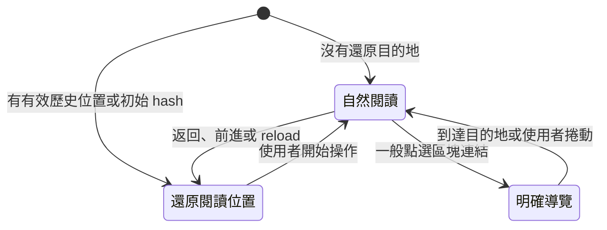
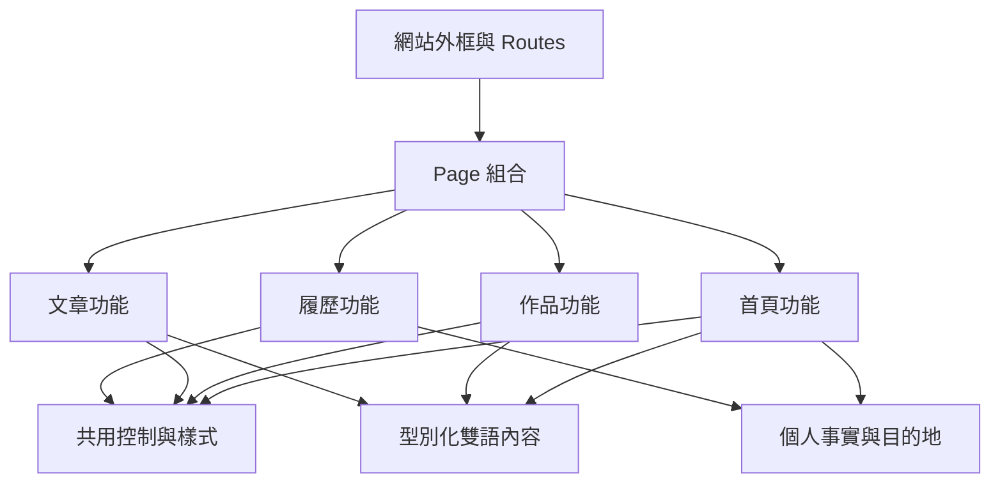
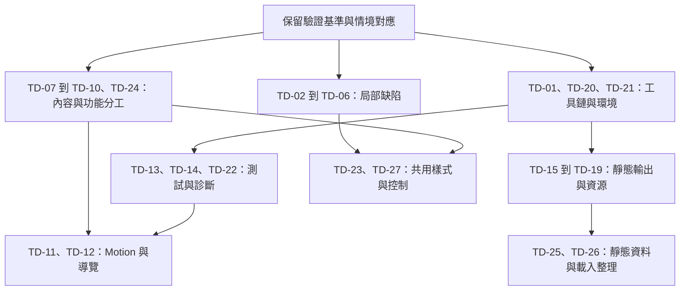

# 計劃 0001：全面檢查與改善技術債

## 目標

讓網站能持續更新內容、依賴與互動，而不必反覆處理過時的工具鏈、跨檔案同步與脆弱的測試。本計劃記錄全面檢查的證據、建議的模組分工、現成工具的取捨，以及每項調整的完成條件。

檢查基準為 `main` 的 `fab1eb4`，日期為 2026-11-08。開始時工作目錄乾淨。本次只新增計劃及更新 [Roadmap](../roadmap.md)，產品程式碼、依賴與現行 [網站規格](../specs/site.md) 維持原狀，沒有 commit。

## 核准紀錄

尚未核准。

本文件是完整的改善提案。優先順序代表建議處理順序，不代表其中任何項目已獲實作授權。

## 範圍

檢查涵蓋 `src/` 的 React、TypeScript、Sass、內容資料與雙語字典，`scripts/`、`tests/`、`public/`、字型與圖片、npm 設定、lockfile、GitHub Actions、工程文件與規格對應。共讀取 79 個 TS、TSX、SCSS 檔案，並檢查相關腳本及測試。

建議維持 React、靜態 hosting、GitHub Pages、英文單頁 A4 履歷、既有首頁區塊順序與視覺方向。此次提案不增加 application server、CMS、全域狀態管理框架或新的公開頁面，也不重新撰寫職涯成果。

檢查結果分為以下種類，避免把推論寫成已重現的故障：

- 已重現：由 production build、瀏覽器操作或計算取得結果。
- 程式碼確認：可直接確認目前的結構、重複或失敗處理方式，尚未宣稱使用者已遇到故障。
- 工具回報：來自 npm 官方 registry 的版本及安全公告，需要依使用方式評估影響。
- 待調查：現有資料不足以判定，例如舊 sitemap 目的地是否仍由其他 repo 提供。

### 現況驗證

<!-- prettier-ignore -->
| 檢查 | 本次結果與限制 |
| --- | --- |
| `npm run check` | 通過。包含格式、lint、103 個規格情境的連結檢查、21 個 checker tests、37 個 unit tests、production build、prerender、PDF 及 67 個 browser tests。Browser tests 約 228 秒。 |
| `npx --no-install tsc --noEmit` | 通過。目前只檢查 `src/`，沒有涵蓋 `.mjs` 腳本與瀏覽器測試。 |
| 指定執行環境 | 完整檢查使用本機 Node 24.21.0、npm 11.19.0。另以已安裝的 Node 22.17.0、乾淨 ESLint cache 與 `CI=true` 驗證 CRA compile 通過；不是完整 Ubuntu CI 重跑。 |
| npm 安全公告 | 官方 registry 回報 52 個受影響的套件項目：2 critical、23 high、10 moderate、17 low。這是依賴樹的統計，不是 52 個可直接從公開網站利用的漏洞。 |
| 額外瀏覽器檢查 | 量測 390 × 844 手機首頁的圖片 request、1440 × 900 桌面控制尺寸、Tooltip 的 Escape 行為，以及閱讀狀態的文字配色。外部圖片以本機 SVG 回應替代。 |
| 未涵蓋 | 本次沒有實測 Safari、Firefox、真實手機、screen reader、OS 列印對話框、正式網站外連可用性或完整 PDF 視覺與文字擷取。現有測試通過不能代替這些結果。 |

最初 CRA compile 出現 `ButtonLink` 的 `jsx-a11y/anchor-has-content` 警告，並在 `CI=true` 時失敗。以兩組 ESLint 設定關閉 cache 重查都沒有警告，清除 cache 後 Node 22 compile 也通過，因此確認是本機舊 cache 的結果，不列為產品缺陷。診斷後已還原原 cache；改用 Vite 後另見 TD-20 的單一 lint 入口。

### 優先順序

P1 優先處理安全工具鏈及已確認的可讀性、操作問題；P2 處理會持續增加修改成本、資料缺漏風險或驗證成本的結構；P3 處理可獨立安排的小型整理與調查。

<!-- prettier-ignore -->
| 編號 | 優先順序 | 調整主題 | 證據種類 |
| --- | --- | --- | --- |
| TD-01 | P1 | 汰換 CRA，處理安全公告與更新阻礙 | 工具回報、程式碼確認 |
| TD-02 | P1 | 修正被編譯成 `719pxpx` 的 media query | 已重現 |
| TD-03 | P1 | 修正文字與品牌按鈕的對比 | 已重現 |
| TD-04 | P1 | 改善 Tooltip 的關閉與游標操作 | 已重現、程式碼確認 |
| TD-05 | P1 | 允許使用者縮放頁面 | 程式碼確認，涉及設計決策變更 |
| TD-06 | P2 | 補齊 Footer 的最小操作高度 | 已重現 |
| TD-07 | P2 | 收緊工作經歷、字典與 fallback 的資料約定 | 程式碼確認 |
| TD-08 | P2 | 用穩定作品 ID 整合作品資料與素材 | 程式碼確認 |
| TD-09 | P2 | 集中聯絡資訊及可共用的職涯事實 | 程式碼確認 |
| TD-10 | P2 | 按實際功能拆分首頁與履歷 | 程式碼確認 |
| TD-11 | P2 | 分開 motion 計算與 DOM 操作 | 程式碼確認 |
| TD-12 | P2 | 整理導覽狀態與原生 anchor 行為 | 程式碼確認 |
| TD-13 | P2 | 採用 Playwright Test 管理瀏覽器測試 | 程式碼確認 |
| TD-14 | P2 | 收緊網路 mock 與資源失敗檢查 | 程式碼確認 |
| TD-15 | P2 | 使用 PDF parser 並補足 PDF 內容驗證 | 程式碼確認 |
| TD-16 | P2 | 共用靜態檔案服務並拆分 prerender 職責 | 程式碼確認 |
| TD-17 | P2 | 讓品牌圖片與 build 不依賴外站 | 程式碼確認 |
| TD-18 | P2 | 降低初始與隱藏圖片的下載成本 | 已重現 |
| TD-19 | P2 | 移除停用的 Workbox 程式並保留精確清理 | 程式碼確認 |
| TD-20 | P2 | 補齊型別、lint 與工具依賴的分工 | 程式碼確認 |
| TD-21 | P2 | 統一 Node、npm 與型別的執行環境 | 程式碼確認 |
| TD-22 | P2 | 補足安全更新與失敗診斷的 CI 流程 | 程式碼確認 |
| TD-23 | P2 | 整理樣式作用範圍與共用 token | 程式碼確認 |
| TD-24 | P2 | 移除測試對正式資料的修改及不必要 mock | 程式碼確認 |
| TD-25 | P3 | 校對靜態 metadata、manifest 與 sitemap | 程式碼確認、待調查 |
| TD-26 | P3 | 分開非公開履歷載入並明確記錄啟動方式 | 程式碼確認 |
| TD-27 | P3 | 簡化圖示及控制元件的介面 | 程式碼確認 |

## 設計稿

無大幅版面或資訊架構變更，因此不新增畫面設計稿。TD-03、TD-04、TD-05、TD-06 涉及局部配色或操作修正，須以修改前後的雙語桌面、窄版畫面及鍵盤狀態驗收。建議配色及縮放政策寫在下方 Spec 變更，核准前不改動現行設計文件。

## 檢查發現與調整方案

### TD-01：汰換 CRA 並處理依賴安全公告

證據：[`package.json`](../../package.json) 使用 `react-scripts@5.0.1`，lockfile 有 1,499 筆 package records。React 官方已在 [CRA 停用公告](https://react.dev/blog/2025/02/14/sunsetting-create-react-app) 建議既有專案遷移。CRA 的 TypeScript peer range 限於 3 或 4，ESLint 也由 CRA 綁定，單獨更新 TypeScript 或 ESLint 無法解除整體維護限制。

本次 `npm audit --json` 的代表性結果如下。公開網站只有靜態檔案，這些結果主要要求檢查開發 server、build 與測試的使用方式，尚無證據證明公開網站存在相同攻擊面。

<!-- prettier-ignore -->
| 套件 | npm 回報 | 目前使用情境與處理方向 |
| --- | --- | --- |
| `proxy-addr` | critical，[GHSA-jqcg-44mw-7w3h](https://github.com/advisories/GHSA-jqcg-44mw-7w3h) | 經間接依賴安裝；確認引入鏈及開發 server 使用方式，隨工具鏈更新移除受影響版本。 |
| `shell-quote` | critical，[GHSA-pqg4-j6r4-53mv](https://github.com/advisories/GHSA-pqg4-j6r4-53mv) | 檢查工具是否將不受信任文字交給 shell，更新引入它的依賴。 |
| `puppeteer` | high，由 `chromium-bidi`、`puppeteer-core` 等間接依賴傳入 | 直接用於 prerender、PDF 及 browser tests；registry 顯示現有 major 內有更新可用，先處理可獨立更新的部分。 |
| `serialize-javascript`、`postcss`、`nth-check` | high 或由依賴鏈傳入 | 主要涉及壓縮、CSS 與 SVG 處理；隨 CRA 汰換檢查是否真正移除。 |
| `webpack-dev-server`、`workbox-build` 等 | high 或由依賴鏈傳入 | 分別隨 Vite 遷移及 TD-19 清理，不能只在 package.json 隱藏直接依賴。 |

建議採用 Vite、獨立 TypeScript check、獨立 ESLint 設定與 Vitest，維持靜態網站架構。[Vite 支援 GitHub Pages](https://vite.dev/guide/static-deploy)，不需要為這個網站導入 application server。CRA 遷移必須一併處理 `public/index.html`、`%PUBLIC_URL%`、資源 import、測試環境、build 目錄及 postbuild 的依賴，不能只更換 `dev` 指令。

完成條件：由乾淨 checkout 以指定 Node 執行 `npm ci` 和共同檢查成功，公開輸出仍包含首頁及英文 A4 PDF，`/resume` 在嚴格靜態 hosting 仍回 404；CRA 依賴鏈實際移除。逐項回報剩餘安全公告的引入原因、使用範圍及處置，不能執行 `npm audit fix --force` 接受工具建議的 `react-scripts@0.0.0`，也不能以改成 devDependency 宣稱漏洞已修復。

### TD-02：修正無效的 Media Query

證據：[`Home.module.scss`](../../src/pages/Main/Home/Home.module.scss) 第 368 行寫成 `@media (max-width: #{_.$medium - 1}px)`。`$medium` 自帶 `px`，production CSS 實際產生 `@media(max-width:719pxpx)`，因此瀏覽器不套用問候文字的窄版字級與行高。

建議使用 Sass 的帶單位運算，例如 `_.$medium - 1px`，保留現行小於 720 px 的條件。同步找出其他「插值後再加單位」的情況，並在 browser test 驗證 719 與 720 px 的 computed font size 和 line height。

完成條件：輸出不含這條無效 media query，719 px 使用預期的窄版問候樣式，720 px 使用原有桌面分區；兩種語言均不裁切。既有測試只驗證內容與可達性，因此目前全數通過仍漏掉這個錯誤。

### TD-03：修正文字與品牌按鈕的對比

證據：[`_tokens.scss`](../../src/styles/_tokens.scss) 的 `$text-muted` 為 `#888`，用在工作日期、公司名稱、技能及部分履歷文字。閱讀狀態下，`#888` 對白色約為 3.545：1，對 `#f5f5f5` 約為 3.252：1。實測工作日期為 14.4 px，未達一般文字 4.5：1 的要求。

[`Button.module.scss`](../../src/components/Button/Button.module.scss) 的品牌按鈕以白字搭配 `#9fa76e`，對比約 2.553：1。實測下載履歷文字為 17.6 px、粗體，連大字標準的 3：1 也未達。[W3C 對比說明](https://www.w3.org/WAI/WCAG22/Understanding/contrast-minimum.html) 分別要求一般文字 4.5：1、大字 3：1。

建議保留橄欖色品牌底，品牌按鈕改用既有深灰文字；正文的 muted role 使用既有 `$text-secondary`，淺灰只保留給裝飾。另檢查 Hero 導覽及社群 hover 改成淺橄欖色時的圖示、文字對比，不以 hover 動畫掩蓋不足。

完成條件：閱讀狀態、一般與 hover 狀態的正常文字均達標，履歷日期和教育資訊保持可讀。圖示與 focus 分別按其用途檢查；現有 SITE-R18 的 focus 對比測試仍保留，不能拿 focus 對比代表文字對比。

### TD-04：使用完整的 Tooltip 互動

證據：[`Tooltip.tsx`](../../src/components/Tooltip/Tooltip.tsx) 以 `cloneElement` 修改任意子元素，並把提示插入控制。其 [樣式](../../src/components/Tooltip/Tooltip.module.scss) 只用 `:hover`、`:focus-visible` 控制顯示，內容設定 `pointer-events: none`。實測 GitHub 控制取得焦點後，按 Escape 仍保持顯示；游標移入提示區也沒有維持顯示的機制。

[W3C 1.4.13](https://www.w3.org/WAI/WCAG22/Understanding/content-on-hover-or-focus.html) 說明額外內容的關閉、可移入及持續顯示條件。建議採用 [Radix Tooltip](https://www.radix-ui.com/primitives/docs/components/tooltip) 的互動與定位能力，外觀繼續使用本站 token。Tooltip 的 accessible name 必須檢查是否重複，不能因 library 自動加入 `aria-describedby` 而讓同一名稱被重讀。

完成條件：滑鼠可從入口移到提示，Escape 能在保留控制焦點下關閉，離開後再次進入可重新開啟；窄版靠邊、Footer、dialog top layer、語言切換及 reduced motion 均正確。修改只限 Tooltip，不把整個元件庫換成 Radix。

### TD-05：解除頁面縮放限制

證據：[`public/index.html`](../../public/index.html) 設定 `maximum-scale=1, user-scalable=0`；[設計方向](../design.md) 也明確要求停用 user scaling。這是既有設計決策，不是誤寫，建議在本計劃核准範圍內修訂政策。

建議保留 `width=device-width`、`initial-scale=1`、`viewport-fit=cover`，移除縮放上限與禁用設定，讓需要放大文字的訪客使用瀏覽器原生操作。[W3C 的 viewport 檢查](https://www.w3.org/WAI/standards-guidelines/act/rules/b4f0c3/) 將這個設定與文字放大需求連結；各瀏覽器是否忽略限制，需要分別實測。

完成條件：200% 放大時可瀏覽、切換語言、操作選單、作品及 QR code，內容可透過頁面捲動讀完。真實手機確認 pinch zoom，不能以縮小桌面 viewport 代替。履歷 PDF 的 A4 幾何尺寸保持原有規則。

### TD-06：讓 Footer 符合既有操作高度

證據：[`Footer.module.scss`](../../src/components/Footer/Footer.module.scss) 的社群連結只有上下 padding，沒有最小高度。實測 GitHub 為 36 px，LinkedIn 與 Cake 為 34.5 px，Footer Logo 為 35 px；網站 SITE-R12 原本要求互動目標至少 44 px 高。

建議社群連結與 Logo 套用現有控制尺寸 token，維持原有圖示與文字大小，藉由控制範圍達到 44 px。修正 Footer service separators 的排列時，避免以多餘空間改變整體視覺節奏。

完成條件：兩種語言、320 px 至桌面畫面中的所有 Footer anchor 均至少 44 px 高，focus 不被裁切，文字仍可選取或依原用途不可選取。補上涵蓋 Footer 的尺寸驗證，避免現有 Hero、Header 測試的覆蓋範圍被誤認為全站。

### TD-07：讓工作與翻譯有完整的資料約定

證據：[`workExperience.ts`](../../src/data/workExperience.ts) 多個必要欄位填空字串，實際內容全靠字典；[`i18n/types.ts`](../../src/i18n/types.ts) 卻用 `Record<string, ...>`，編譯器無法要求每個工作 ID 都有翻譯。Home 及 WorkExperience 又各自維護資料欄位與 props。缺漏時的 fallback 是規格要求，但目前工作資料本身沒有可用的 fallback。

建議由工作資料推導封閉的 `WorkExperienceId`，字典使用 `Record<WorkExperienceId, WorkExperienceCopy>`。將 ID、品牌圖片與日期等事實和顯示文字分開，英文內容只維護一份。缺少或空翻譯時保留有意義的英文 fallback，由共用的內容組合函式處理；正常維護資料有缺漏時，型別或資料檢查先報錯。

完成條件：新增或移除工作時，兩種語言與首頁摘要的需求能在 check 階段被發現；正常內容不靠空字串填滿型別。既有 SITE-R6.1 的 fallback 結果維持，並加入「第一筆工作缺漏翻譯時仍有職稱及公司」的驗證。本站與履歷敘事可各自編輯，見 TD-09。

### TD-08：用穩定 ID 整合作品內容及素材

證據：[`projects.tsx`](../../src/data/projects.tsx) 把 JSX icon 放進資料，`Project.title` 同時擔任畫面標題、React key、翻譯 key 與 [`Projects.tsx`](../../src/components/Projects/Projects.tsx) 的 artwork lookup key。三份設定以任意字串相連，改名可能只在 runtime 才遇到 `Missing artwork`。作品英文說明也同時出現在資料與英文字典，Taigu、Noads 的文字已不完全相同。

建議使用固定的 `taigu`、`noads`、`leechai` ID，由型別約束 copy 與 artwork registry。純資料檔存 URL、圖片來源、年份和產品名稱，JSX 留在作品功能內。期間目前只顯示年份，因此用 `startYear`、可選的 `endYear` 表達，避免為年份建立帶月份與時區語意的 Date tuple。

完成條件：改產品顯示名稱不必同步更改 lookup key；缺少 copy 或 artwork 在檢查階段失敗。兩種語言的期間、fallback、外連及 tab 順序保持 SITE-R7、SITE-R8 的結果；純函式驗證同年、不同年與維護中期間。

### TD-09：集中聯絡資訊與共用事實

證據：email、GitHub、LinkedIn、Cake、網站 URL 分散於 Home、Footer、ResumeSheet、QR code、public metadata。任職公司、職稱、日期也分散在工作資料、兩份字典與 [`ResumeSheet.tsx`](../../src/pages/Main/Resume/ResumeSheet.tsx)。內容差異不一定是錯誤，但更改同一事實需要逐檔搜尋。

建議建立小型 `profile` 資料，維護聯絡資料、社群目的地與網站 URL。職涯共同事實依 ID 共用，首頁長段落與履歷 bullets 保留各自的編輯方式；服務清單與教育敘事不為了共用而改成通用 schema。新增對照檢查，確認兩種語言及履歷的公司、職稱與任職期間一致。

完成條件：更新 email 或任職日期有明確的維護位置，相關畫面、QR code 與 PDF 連結同步。Metadata 若須留在靜態 shell，由 build 讀取同一份可轉為 JSON 的資料，不為這件事引入 CMS。此調整不驗證成果數字真偽，也不把 repo 內重複文案當成獨立證據。

### TD-10：按功能拆分首頁及履歷

證據：Home 有 381 行 TSX 與 701 行 SCSS，同時管理頭像 pointer、QR code dialog、Hero、工作經歷、技能、教育及區塊組合。`components/` 混合只給首頁使用的 Blog、Projects 與一般控制；履歷 TSX 放在 `pages/Main/Resume`，列印 helper 卻在 `src/resume`，全域 `types.ts` 又容納各功能型別。

建議首頁 page 只組合區塊，頭像與 dialog 在首頁功能內擁有各自狀態和樣式，作品與文章的私有元件放在各自功能旁。履歷的內容、預覽、列印 helper 與專用型別放在同一功能內，共用控制維持小而明確的介面。

下方是建議責任位置，不要求一次搬完所有檔案；只有實際依賴的方向改清楚後才搬移，避免為了目錄整齊製造無意義的 diff。

```text
src/
  app/              # 網站外框與 routes
  pages/            # HomePage、ResumePage 的組合
  features/
    home/           # Hero、Portrait、QR code、About
    projects/       # 作品分頁、素材、型別與內容組合
    blog/           # 精選文章與示意
    resume/         # ResumeSheet、列印與履歷專用內容
  components/       # Button、Tooltip 等共用控制
  data/             # 跨功能共用的個人事實與目的地
  i18n/
  navigation/
  motion/
  icons/
  styles/
```

完成條件：修改 QR code 不必同時理解整頁 Home，改履歷不必穿越 Main 的目錄層級，私有功能沒有透過全站 barrel 對外公開。單一 caller 的小函式可留在使用處，維持 co-located SCSS 及現有 token 規則，不額外建立 repository、service、adapter 等分層。

### TD-11：分開 Motion 計算與 DOM 操作

證據：[`useScrollMotion.ts`](../../src/motion/useScrollMotion.ts) 有 325 行，單一 layout effect 包含收集元素、讀取 CSS 參數、量測、進度計算、style 寫入、多個 observer 及清理。幾何公式主要靠 browser tests 間接驗證；`MotionKind` 和 `MOTION_KINDS` 重複列舉，參數以任意字串查找，CSS 的錯名可能到 runtime 才失敗。

建議保留現有按捲動位置更新的設計，抽出無 DOM 的 pose、Hero 與 timeline 計算，再以一個 hook 管理量測及 browser lifecycle。以單一 kind 清單推導型別，明確列出 motion 參數名稱與單位，保留目前先讀後寫、requestAnimationFrame 合併與 reduced-motion cleanup 的優點。

完成條件：純計算涵蓋長短內容、閱讀區、上下界與反向捲動，browser tests 驗證整組位移、resize、字型載入、切換語言、卸載與列印。量測代表性桌面及手機的 frame 工作，不能從目前「停止時沒有 DOM 寫入」的測試推定快速捲動效能已達標。若沒有量測證明，暫不改用另一個動畫引擎。

### TD-12：讓導覽狀態與原生連結一致

證據：[`useSectionNavigation.ts`](../../src/navigation/useSectionNavigation.ts) 的 effect 同時以 `clickedHash`、`pendingDestination`、`restorationDestination`、frame 與 timer 描述導覽階段。Header 又維護 section ID 清單及焦點行為。Footer 的 [`Logo.tsx`](../../src/components/Logo/Logo.tsx) 在每次 click 直接執行 `window.scrollTo`，沒有排除修飾鍵，因此程式碼顯示另開分頁的 click 也會改變原頁捲動。

建議共用固定 section ID 與對應型別，明確區分自然閱讀、明確 anchor 導覽、歷史位置還原。把歷史資料解析與狀態轉換抽成可測函式，hook 負責事件及 DOM。Footer 回首頁改用與其他入口一致的原生 anchor 或同樣完整的修飾鍵判斷，保持原生瀏覽器操作。



完成條件：保持 SITE-R2 的 hash、history length、讀取位置與焦點；新增 Footer 修飾鍵 click 不改變原頁位置、非本網站 anchor 不介入，以及卸載後沒有還原 callback 操作 DOM 的驗證。不要用 IntersectionObserver 取代歷史還原，因為可見區塊判斷無法處理這整組需求。

### TD-13：採用 Playwright Test 管理瀏覽器測試

證據：[`tests/browser/site.test.mjs`](../../tests/browser/site.test.mjs) 有 3,345 行，67 個 browser tests 包含共用 browser/context/page 變數、request interception、下載事件、CDP、字型、PDF parser、fixture 子程序與視覺幾何。Node test runner 可以執行這些測試，但隔離、等待、診斷及跨瀏覽器支援多由專案自行維護。

建議採用 Playwright Test，按導覽、內容與語言、Projects、QR code、motion、accessibility、PDF/build 拆分測試，使用 fixtures、語意 locator、可重試 assertion、trace 與失敗截圖。[官方測試建議](https://playwright.dev/docs/best-practices) 與 [多瀏覽器 projects](https://playwright.dev/docs/test-projects) 可替代目前多項測試基礎設施。

完成條件：原有情境逐項對應，沒有以重試掩蓋穩定失敗。Chromium 維持完整套件；Firefox、WebKit 至少涵蓋首頁、語言、anchor/history、tab、dialog 及 reduced motion。CDP 專用與 PDF 產生只在 Chromium 執行，真實 Safari、手機及 OS 列印仍保留人工驗證。平行執行前移除共享 page 狀態，失敗時可取得 trace、screenshot 與 console。

[`check-scenarios.mjs`](../../scripts/check-scenarios.mjs) 目前只接受直屬 `tests/browser/*.test.mjs`。採用新的 `.spec.ts` 路徑時，runner、checker、checker fixtures、lint、typecheck、README 與驗證文件必須同時更新，明確處理 Playwright 的 `skip`、`fixme`、`only`，不能只改 npm script。

### TD-14：只替換已知的外部網路資源

證據：browser `beforeEach` 將所有非本機、非 data URL 的 request 回應成成功 SVG。這讓測試不依賴外站，卻也會讓意外新增的外部 JS、fetch 或錯誤網址看起來成功。`pageErrors` 只蒐集 `pageerror`，沒有一般性的 `requestfailed`、本機非 2xx 或 console error 檢查。

建議只允許已知圖片以 fixture 替換，其餘意外 request 直接失敗並顯示 URL 及用途。對本機資源建立失敗收集，只有專門驗證失敗情境的測試可個別允許錯誤；外部原生 anchor 的目的地檢查與外站健康狀態維持分開。

完成條件：故意把本機圖片改成不存在的路徑、插入非預期 fetch 或新增外部 script，相關測試會失敗；正常測試全程可在無外網時完成。這項收緊配合 TD-17 的圖片本機化，避免以更廣的 mock 規則保住通過結果。

### TD-15：使用 PDF Parser 並補足內容驗證

證據：[`prerender.mjs`](../../scripts/prerender.mjs) 及 browser tests 都將 PDF 轉為 Latin-1 再用 regex 解析頁數、MediaBox、文件語言、字型和 URL。程式有註明只處理 Chromium 輸出，這個限制合理，但 Chromium 改變物件壓縮或 dictionary 輸出方式時，仍可能出現錯誤判斷。Build 目前驗證紙張範圍內的 DOM 文字，不能證明 PDF 的實際文字擷取完整。

建議用 [pdf-lib 的文件載入與頁面 API](https://pdf-lib.js.org/docs/api/classes/pdfdocument) 處理文件結構，字型、語言及 annotation 由 parser 的物件 API 讀取。將 PDF 產生、結構驗證與測試工具分開，另以獨立文字擷取工具驗證 PDF 文字，避免 build 與測試共享同一段 parser 而一起判錯。

完成條件：保留單頁 A4、英文、指定字型與 PDF 連結的拒絕條件，新增缺少區段文字、缺少 annotation、損壞 PDF、多頁及錯字型的 fixtures。正常 PDF 比較所有預期段落與聯絡資訊，人工判斷閱讀順序與視覺品質；DOM 文字通過不能代替 PDF 文字通過。字型檔、字重、font subsetting 與授權文件維持既有規則。

### TD-16：共用靜態檔案服務並拆分 Prerender 職責

證據：[`serve-build.mjs`](../../scripts/serve-build.mjs) 與 prerender 各自實作 HTTP server、路徑檢查及 MIME table。預覽版有 realpath、symlink、無效 URL、HEAD 與 stream error 處理；prerender 版沒有相同保護，且以「找不到 asset 就回 shell」處理所有未知路徑。兩個 server 都只開 loopback，此處不宣稱存在公開檔案洩漏。

建議共用靜態檔案服務，嚴格模式直接回 404，build 模式只對明確允許的 `/`、`/resume` 提供 shell。MIME、路徑與錯誤處理維持一份；預期 ENOENT 可回 404，讀取權限或其他 I/O 錯誤須回報原因。首頁 snapshot、browser 啟動、履歷 PDF 與驗證拆成可各自測試的腳本模組。

完成條件：缺少圖片不回 HTML 200，無效 URL 不使 process 失敗，既有 traversal、symlink、HEAD 測試保留。Browser 啟動或關閉失敗時也確實關閉 server，設定整體執行期限並記錄失敗階段。現有 failure fixtures 只複製單一 `prerender.mjs`，拆檔後必須同步複製需要的模組或透過明確工作目錄注入測試，不能讓 fixture 因找不到 import 而假裝驗證到預期錯誤。

### TD-17：讓品牌圖片與 Build 不依賴外站

證據：工作資料引用 Swag、Gaia、Pinkoi、Sysfeather、學校等外部圖片，production prerender 又使用真正的 browser 載入首頁，等待 network idle 並把 console error 視為失敗。外站圖片服務的變動或暫時錯誤可能阻止與內容無關的網站發布，現有 browser tests 以 SVG 替換並未驗證這條實際依賴。

建議把首頁必需的公司及學校品牌圖片放在 repo，記錄來源與維護位置，使用固定尺寸與備援顯示。建議 production snapshot 不需連到任何第三方服務，外站僅作為訪客主動開啟的目的地。

完成條件：封鎖所有非 loopback request 時，prerender 與 PDF 仍能完成；首頁公司標誌沒有 layout shift 或失敗圖示，文字不依賴圖片才能理解。品牌圖片可見性及對應內容需人工檢查，不能讓 SVG fixture 成為正式素材。

### TD-18：降低初始圖片下載及解碼成本

證據：390 × 844 首次開啟且尚未選取其他作品時，本機圖片的 decoded response body 共 2,143,144 bytes，約 2.04 MiB，這是資源 bytes，不是記憶體解碼大小或實測行動網路時間。未選取的 Noads、Leechai 圖片仍會下載，窄版隱藏的第二張圖片也一樣。Leechai settings 為 848.0 KiB、accounts 為 425.2 KiB；背面頭像是 3600 × 3600、276.2 KiB，但顯示尺寸遠小於原圖。

建議產出合適尺寸的 WebP 或其他經實測適用的格式，提供 responsive sources。首屏必要頭像維持可立即顯示，非首屏、未選作品與窄版不用的圖延後載入；需要保留版面高度的 panels 保留文字及幾何，不為省圖直接卸載整個 panel。延後來源的策略須避免 prerender 把暫存 URL 或 JS 專用圖片當成唯一可讀內容。

完成條件：相同 viewport 首次載入不請求未選作品的大圖，窄版不下載不用的第二張圖；直接開啟 `#projects` 與快速切換仍即時顯示正確作品，沒有明顯空白、頁面縮短或圖片位移。記錄優化前後 bytes、圖片尺寸及 Lighthouse/瀏覽器量測，再依結果設定可維護的資源預算。`public/cover.png` 另作社群預覽資源優化，不把其 1.24 MiB 算進一般首頁圖片 request。

### TD-19：移除停用的 Workbox 程式並保留精確清理

證據：[`index.tsx`](../../src/index.tsx) 只執行 unregister，但 [`service-worker.ts`](../../src/service-worker.ts) 仍保留 CRA 範例的 app-shell、runtime cache 及 skipWaiting，並安裝 5 個 Workbox 直接依賴。註冊雖停用，CRA 仍處理這個 build 入口，與實際產品能力不一致。

建議移除停用 worker 及直接 Workbox 依賴，保留小型的歷史 registration 清理。現有 helper 等待 `navigator.serviceWorker.ready`；改以 `getRegistrations()` 取得結果後，只處理本網站已知 scope 及 worker script URL，避免同一網域下其他 GitHub Pages 專案的 registration 被刪除。不要全面清空 Cache Storage。

完成條件：新 browser context 不註冊 worker，輸出不包含新 worker；舊版網站的已知 registration 能清理，其他 scope 或 script 保留。拒絕的 Promise 有處理；沒有 active worker 時不無限等待 ready。舊頁面的 controller 可能直到下一次 navigation 才改變，必須保留這項說明及真實升級檢查。

### TD-20：補齊型別與 Lint 的責任

證據：[`tsconfig.json`](../../tsconfig.json) 只 include `src`；TypeScript `strict` 已啟用，是應保留的基礎，但 `.mjs` 腳本和 browser tests 沒有型別檢查。測試、`@types`、Sass、TypeScript、CRA 與 Workbox 都列在 production dependencies，導致安裝與 npm audit 的 prod 分類難以對照實際網站 runtime。

建議共同檢查明確執行 `typecheck`，應用程式與 Node 工具分開 tsconfig，測試依 runner 配置型別。腳本可使用 TypeScript，或先以 `checkJs` 和必要 JSDoc 檢查，選擇能覆蓋 Puppeteer callback、fixture 回傳與檔案 I/O 的方式。[Vite 不做 TypeScript 型別檢查](https://vite.dev/guide/features)，遷移時不能移除 CRA 後順便失去檢查。

完成條件：故意在 app 與工具中放入型別錯誤都會阻止共同檢查。Lint 使用單一 repo 設定，測試、工具及型別套件移到 devDependencies，瀏覽器實際需要的套件才保留 dependencies；分類調整不當成安全修復。先保留 `skipLibCheck`，待相容性驗證後再決定是否調整，避免把所有上游型別問題納入本次工作。

### TD-21：統一 Node、npm 與型別環境

證據：[README](../../README.md) 與 workflow 要求 Node 22，本機實際為 Node 24，repo 沒有 engines 或 `.nvmrc`。Puppeteer 25.5.0 要求 Node 至少 22.12.0，`@types/node` 卻仍為 16.18.3；「使用任意 Node 22」與精確的最低版本不同。

建議明確宣告 Node 22 的相容範圍及最低 patch，提供一致的版本選擇入口，Node 型別配合執行環境。npm 版本透過工程文件或 `packageManager` 明確記錄，保留 `npm ci` 與 lockfile 作為安裝依據。

完成條件：全新環境能依文件選到可執行工具的 Node 與 npm，CI 與本機重現同樣的 compile、測試與 PDF 字型檢查。套件版本在實作時向官方 registry 取得相容版本，不把本次 `npm outdated` 快照當作未來固定的最新版本。

### TD-22：補足依賴安全更新與失敗診斷

證據：[部署 workflow](../../.github/workflows/deploy.yml) 已有最小權限、檢查成功後發布及 main ref 限制，這些應維持。不過目前沒有獨立的依賴安全檢查，瀏覽器失敗時也沒有 trace、screenshot 等 artifact；本次 build 另提示 Browserslist 資料已有 9 個月未更新。

建議在獨立維護流程檢查安全公告與過時依賴，使用 Dependabot 等既有服務建立可 review 的更新，依 React、工具鏈及瀏覽器工具分組。安全處置保留引入鏈與使用情境，不只追求統計歸零。一般 `npm run check` 維持不依賴即時 registry，避免 registry 故障阻止離線驗證。

完成條件：CI 失敗時上傳有保存期限的診斷 artifact，失敗輸出仍不部署；main 與其他 ref 的發布條件維持。實作時依官方發布資訊確認既有 workflow 的 Node 與 Actions 版本相容性，更新 browser database 後重新檢查 CSS 輸出與支援環境。依賴維護流程不改變本 repo 直接在 main 工作的規則。

### TD-23：整理樣式作用範圍及共享 Token

證據：已有 [`styles/README.md`](../../src/styles/README.md)、semantic tokens、section/focus/control mixins，架構方向合理。剩餘問題是 Home 對所有 section 內的 `h2`、`h3` 套樣式，再由 Projects、Blog 覆寫；部分共用間距與圓角仍寫成 10、15、25、30 px 或 100 px，Footer、Button 與 Header 的相同角色沒有完全使用共用規則。

建議將 About 標題等規則放在實際元件根 class，避免父層控制子功能的標題；整理時只把角色相同且多處使用的值移到 token。圓形使用既有 circle token，控制範圍沿用現有 control mixin。履歷印刷幾何、品牌示意構圖、陰影與光學微調仍留在局部。

完成條件：重排 Home 區塊或獨立 render Projects、Blog 時，字級與留白不受不相關的父層規則影響；相同角色共用 token，不因相同數字強制合併。按 DOM 順序整理 module 巢狀規則，保留既有 breakpoint，檢查兩種語言、focus、forced colors 與 PDF。

### TD-24：讓測試使用獨立資料與較少的 Mock

證據：[`Home.test.tsx`](../../src/pages/Main/Home/Home.test.tsx) 用 `Object.assign` 修改正式工作資料，[`Projects.test.tsx`](../../src/components/Projects/Projects.test.tsx) 修改正式作品 Date tuple，再用 `finally` 還原。Fallback 測試需要拿掉翻譯，但目前只能替換整個 context 及操作全域 module。日期格式這類純邏輯仍透過重畫整個 Projects 驗證。

建議以小型 test fixture factory 建立獨立資料，讓內容組合及期間格式函式接受明確輸入；元件測試用真實 LanguageProvider 或專用 render helper，保留必要的儲存錯誤 mock。部分 browser selector 依賴 CSS Module class 子字串，優先改用 role、名稱及穩定的測試定位點。

完成條件：unit tests 不修改正式匯出的資料，不依賴執行順序；日期與 fallback 的組合在純函式層檢查，元件層驗證使用者可觀察結果。保留既有鍵盤與瀏覽器測試，避免逐行照抄實作來寫測試，也不為單純改名新增測試。

### TD-25：校對 Metadata、Manifest 與 Sitemap

證據：public shell 的 `<noscript>` 宣告必須啟用 JavaScript，實際 prerender 已提供主要內容及 PDF 連結，兩種說法不一致。Manifest 在同一個 WebP icon 上宣告多個尺寸，需核對真實尺寸。Sitemap 列出 8 個其他專案路徑，但這個 repo 不提供這些頁面，可能由其他 GitHub Pages repo 提供，尚不能判定失效。

建議 noscript 只說明互動功能需要 JavaScript；manifest 使用真實 icon 尺寸與必要欄位。先建立 sitemap 目的地的歸屬及 response 紀錄，再移除確認失效的項目。Metadata 的任職與教育事實依 TD-09 維護，不以 SEO 名義堆疊圖片 alt 或關鍵字。

完成條件：停用 JavaScript 時的提示與可用內容一致，manifest 的 icon 宣告與檔案相符；sitemap 的每個 URL 都有可追溯的保留或移除理由，非公開 `/resume` 維持不列入。這是待調查工作，不能從本 repo 沒有檔案直接推論外部專案不存在。

### TD-26：分開履歷載入並記錄啟動方式

證據：[`router.tsx`](../../src/router.tsx) 直接 import 非公開 Resume，首頁也載入履歷相關 JS 與 CSS。Production HTML 是 browser snapshot，啟動時卻以 `createRoot` 重建，沒有 hydration。這不是 hydration mismatch 的現存錯誤，因為目前沒有執行 hydrate。

建議先以 route-level lazy loading 分開非公開履歷，確認首頁不再帶入履歷內容與專用字型 CSS。保留可穩定完成的 client 啟動，將目前固定的 DOM 重建成本記在工程文件；本輪不直接換成 `hydrateRoot`。若後續量測顯示有必要，另行設計語言、useId、時間、路徑與樣式一致的 render/hydration 流程，不能只換一個 API。

完成條件：首頁主要 bundle 不含履歷全文，`/resume` 本機預覽與 build PDF 能等待 lazy route 完成，prerender 仍產出完整靜態內容。記錄分割前後的 gzip bytes。後續設計 hydration 流程時，可參考 React 的 [client API 說明](https://react.dev/reference/react-dom/client)。

### TD-27：簡化圖示及控制元件介面

證據：[`IconLayout.tsx`](../../src/icons/IconLayout.tsx) 用 HOC 包裝每個 SVG，暴露少量自訂 props，沒有完整的原生 SVG 屬性。RoundButton 重複宣告原生 props，並強制要求 `className` 和 `onClick`；ResumeSheet 的 forwarded ref 目前主要由測試使用。公司 logo 與技能圖示的 alt 又重複旁邊相同文字，學校圖示的 alt 堆疊多個關鍵字。

建議保留現有 SVG paths，整理成標準 SVG props 與明確的裝飾預設；需要 accessible name 的圖示才提供 title。RoundButton 延用原生 button props，必要參數只保留有產品意義的 hint。移除沒有實際 caller 需求的包裝與樣式選項時，順便處理重複 accessible text；學校替代文字以圖片實際資訊為準。

完成條件：共用控制仍提供原生 button/anchor 語意、名稱與 focus，沒有重複讀取旁邊公司及技能名稱。少量靜態 SVG 不值得為了統一 import 改用整套 icon library；React context 也不因這次整理加入狀態管理套件或無量測依據的 memo。

## 決策

### 現成工具與保留自製程式的取捨

<!-- prettier-ignore -->
| 項目 | 建議 | 原因及決策保存位置 |
| --- | --- | --- |
| CRA 工具鏈 | 改用 Vite、獨立 lint/typecheck、Vitest | 解開過時依賴與工具版本限制；保存於 README、package 設定及工程說明。 |
| Browser runner | 改用 Playwright Test | Fixtures、等待、跨瀏覽器與診斷由現成工具提供；保存於 README、測試設定及驗證文件。 |
| Tooltip | 使用成熟 primitive，優先 Radix Tooltip | 完整的關閉、hover 與定位行為超出目前 CSS 提示能力；保存於 design system 與 SITE-R19。 |
| PDF 結構解析 | 改用 PDF library | PDF 物件與壓縮格式交給 parser，網站只保留自身的字型、紙張與內容要求；保存於 build 工程說明。 |
| QR code | 保留 `qrcode.react` 與原生 dialog | 目前已用現成 QR code encoder 與 browser modal，沒有重造這兩項功能。 |
| 區塊導覽 | 保留原生 anchor，加上小型網站狀態管理 | Hash 與閱讀位置是本站既有需求；不以另一個 scroll library 取代 browser history。保存於 SITE-R2 與 navigation 模組。 |
| Motion | 保留網站公式，分開計算與 DOM | 現有動畫有具體的可逆、整組及長內容規則；先降低耦合，沒有證據支持整套換引擎。保存於 SITE-R13 及 design system。 |
| 雙語 | 保留型別化 context 與兩份字典 | 只有兩種語言與靜態內容，未使用複數、遠端載入或大量插值；先修資料約定，暫無導入 i18next 的必要。 |
| 情境 checker | 保留專案格式與 TypeScript AST | 規格 ID、manual 對應及測試限制是專案流程，沒有可直接替換的通用工具；只調整 runner adapter，避免寫成通用 Markdown 或 JavaScript 解譯器。 |
| Icon 與設計系統 | 保留靜態 SVG、CSS Modules 與 Sass tokens | 現有規模不需要元件庫、CSS 框架或完整 monorepo。 |

### 模組依賴方向



功能私有的素材、型別與 render helpers 隨功能維護，只有真正跨功能共用的資料與控制放到共用位置。這項理由記錄在 README 的模組分工，避免後續把所有內容再次集中到 `components/index.ts` 或 `types.ts`。

## Spec 變更

此節是核准後才實作的提案，目前不修改現行網站規格。沒有產品行為變化的重構沿用既有 scenario IDs；工具設定與資料完整性由工程驗收檢查，不為內部檔案搬移建立產品規格。

### SITE-R12：補足操作高度、問候樣式與縮放

沿用 SITE-R12 的版面、最小操作高度及文字選取規則。新增規則：網站允許瀏覽器原生頁面縮放；放大後可透過頁面捲動使用首頁功能。問候的窄版字級及行高條件在小於 720 px 時有效；Footer anchor 也必須符合既有 44 px 最小高度。

<!-- prettier-ignore -->
| 情境 | 條件、動作與結果 | 驗證方式 |
| --- | --- | --- |
| SITE-R12.7 問候樣式分界 | 在兩種語言分別以 719 與 720 px 開啟首頁，問候的 computed font size 與 line height 符合各自樣式，文字完整且沒有無效 media query。 | browser |
| SITE-R12.8 頁面放大 | 頁面未禁止原生縮放；200% 放大及真實手機 pinch zoom 後，能讀完文字並操作選單、語言、作品、QR code 與履歷下載，沒有新增只能水平捲動才可讀完的正文。 | browser、manual |
| SITE-R12.9 Footer 操作尺寸 | 在雙語及窄版、桌面畫面量測所有 Footer 社群與 Logo 連結，均至少 44 px 高，focus 完整可見且目的地維持。 | browser |

設計文件的完整替代文字為：「Keep native browser zoom available. Enlarged content remains readable through page scrolling, and navigation, language selection, project controls, the QR code dialog, and resume download remain operable.」取代目前停用 user scaling 的規則，其他文案政策維持。

### SITE-R14：讓靜態輸出規則適用於新工具鏈

以下完整文字取代現行規格中指定 CRA compile 與 postbuild 的兩段規則，其他 snapshot 與失敗檢查規則保持：

Production build 在前端 compile 成功後執行首頁 prerender，使用繁中、台北時區及減少動態設定擷取 `#root` 的內容，保留原 shell head，排除 body portal。HTML 不包含滾動動態的啟用標記或暫存視覺狀態，首頁產生可在 JavaScript 啟動前讀取的文字；需要操作的功能仍依賴 JavaScript。

前端 compile 後的產檔流程同時完成首頁 prerender 與履歷 PDF。產檔可在內部使用 `/resume` 的 client route，但公開輸出仍只有首頁 HTML 與 PDF，不新增 `/resume/index.html`。共同檢查必須使用當次 compile 的乾淨輸出，不依賴上次殘留的 HTML 或 PDF。

沿用原有 SITE-R14.1 編號，替換條件中的 CRA 名稱，並保留其餘 SITE-R14 情境：

<!-- prettier-ignore -->
| 情境 | 條件、動作與結果 | 驗證方式 |
| --- | --- | --- |
| SITE-R14.1 完整 Build | 從乾淨的前端 compile 輸出完成 build 與後續產檔，同時產生首頁靜態內容與當次 ResumeSheet 的 PDF；不能以既有輸出檔案代替當次產檔。 | browser |

### SITE-R15：移除新 Worker 並清理已知舊版 Registration

網站維持不提供離線 cache 或更新 UI。Build 不產生新的 service worker，啟動時只清理屬於本網站已知 scope 與 script URL 的歷史 registration，保留其他網站功能的 registration 及 Cache Storage。

<!-- prettier-ignore -->
| 情境 | 條件、動作與結果 | 驗證方式 |
| --- | --- | --- |
| SITE-R15.2 既有 Registration 清理 | 取得 registrations 後只 unregister 本網站已知 scope 與 script URL 的紀錄；沒有 active worker 也能完成檢查，不能宣稱立即移除既有 controller 或清空 cache。 | unit、browser、manual |
| SITE-R15.3 Registration 查詢失敗 | Service worker API 不存在或查詢被拒絕時，首頁仍啟動且沒有未處理的 Promise rejection；其他 scope 與其他 script URL 的 registrations 保留。 | unit |

### SITE-R19：可關閉並可移入的 Tooltip

Tooltip 保留既有深底、白字、圓角、控制下方位置、靠邊對齊、雙語及 accessible name 規則，增加以 Escape 關閉與游標移入的行為。提示內不新增可操作項目。

<!-- prettier-ignore -->
| 情境 | 條件、動作與結果 | 驗證方式 |
| --- | --- | --- |
| SITE-R19.2 Escape 關閉提示 | 入口 hover 或鍵盤 focus 顯示提示後，按 Escape 關閉提示，原控制焦點及操作不變；離開再進入入口可重新顯示。 | browser、manual |
| SITE-R19.3 游標移入提示 | 游標從入口移到提示文字時，提示維持可讀，移出入口及提示後才隱藏；靠邊與 dialog 狀態沒有遮住必要操作，提示不重複加入控制名稱。 | browser、manual |

### SITE-R20：文字與操作圖示的對比

閱讀狀態的普通文字與背景至少為 4.5：1，符合大字條件的文字至少為 3：1。品牌按鈕保留橄欖底並使用既有深灰文字；正文次要資訊使用足夠對比的文字 token。可辨認操作所必要的圖示也須有足夠對比，focus 框沿用 SITE-R18。

<!-- prettier-ignore -->
| 情境 | 條件、動作與結果 | 驗證方式 |
| --- | --- | --- |
| SITE-R20.1 正文與按鈕對比 | 在雙語的閱讀狀態、一般及 hover 狀態檢查工作日期、公司、技能、下滑提示、履歷下載及內容控制，普通文字達 4.5：1、大字達 3：1，必要操作圖示可辨識。 | browser、manual |
| SITE-R20.2 履歷次要資訊 | 預覽與產生的 PDF 中，工作日期、職稱分隔及教育次要資訊維持可讀對比，內容、字型、A4 及單頁規則保持。 | browser、manual |

設計文件新增文字為：「Use the existing dark text colors on olive button fills. Keep secondary reading text at a contrast ratio of at least 4.5:1 against its background; reserve lighter gray for decoration.」Design system 同時記錄 token 的文字與裝飾用途。

### 其他需求的修訂原則

SITE-R2、R6、R7、R9、R10、R11、R13、R16、R17 的現有結果維持。TD-25 的 noscript 若更新，新增說明「無 JavaScript 仍可閱讀主要內容及取得 PDF；需操作狀態的功能需要 JavaScript」，連結到 SITE-R14.2 的既有情境，不把舊 sitemap 是否存活寫成已確認需求。

## 做法要點

### 建議的工作批次與依賴

以能獨立驗證及回復的工作批次安排實作，不將全站搬檔、工具鏈、測試 runner 與畫面修正合成一次難以判斷的重寫。下圖表達依賴，並非要求逐行執行的 checklist。



工具鏈遷移以原有測試與輸出作為比較基準，Playwright 取代 runner 時再移交完整情境；可以短期同時保留兩組 runner，確認對應後刪除舊的測試基礎設施，避免長期維護重複套件。P1 的小修正可先完成，不能等整個目錄重構才處理。

### 需要特別保留的規則

- `/resume` 是非公開 client route，build 內部使用該 route 產 PDF 不代表公開 hosting 應提供 SPA fallback。
- 作品所有 panels 保留最大自然高度，圖片載入策略不得使切換時頁面縮短或更動 focus。
- 首頁 prerender 保留完整內容、原 shell metadata 與 PDF 下載，不能擷取 browser portal、motion 暫存狀態或 loading placeholder。
- PDF 字型及內容規則有跨平台原因，不能以移除檢查的方式讓 build 通過。
- Native dialog、anchor、文字選取與 reduced motion 已有明確規格，重構時保留對應 browser/manual 情境。

## 驗證方式

### 新增與修改情境的對應

<!-- prettier-ignore -->
| 情境 | 驗證方式 |
| --- | --- |
| SITE-R12.7 問候樣式分界 | browser，量測 719 與 720 px 的 computed styles，涵蓋兩種語言。 |
| SITE-R12.8 頁面放大 | browser、manual，檢查 viewport 設定與放大版面，另測真實手機 pinch zoom。 |
| SITE-R12.9 Footer 操作尺寸 | browser，量測所有 Footer anchor 的矩形與 focus。 |
| SITE-R14.1 完整 Build | browser，以新工具鏈的乾淨 compile 輸出驗證當次首頁及 PDF 產檔，保留原有失敗 fixtures。 |
| SITE-R15.2 既有 Registration 清理 | unit、browser、manual，涵蓋目標、非目標、waiting、沒有 active worker 及舊 controller。 |
| SITE-R15.3 Registration 查詢失敗 | unit，涵蓋 API 不存在、查詢拒絕及不屬於本站的紀錄。 |
| SITE-R19.2 Escape 關閉提示 | browser、manual，涵蓋 hover、focus、重新進入與焦點維持。 |
| SITE-R19.3 游標移入提示 | browser、manual，涵蓋游標移動、靠邊、Footer、QR code dialog 與雙語。 |
| SITE-R20.1 正文與按鈕對比 | browser、manual，在不透明閱讀狀態計算實際 foreground/background，再判斷視覺層級。 |
| SITE-R20.2 履歷次要資訊 | browser、manual，檢查預覽 computed color 與 PDF 視覺，重跑既有 PDF 規則。 |

### 工程驗收

以下是改善工作本身的驗收，不新增產品 scenario ID；各 TD 的詳細完成條件仍以對應段落為準。

<!-- prettier-ignore -->
| 工作範圍 | 工程驗收 |
| --- | --- |
| 工具鏈與安全 | 乾淨安裝、獨立 typecheck/lint、unit tests、情境 checker、build、browser tests 通過；記錄依賴安全差異及剩餘處置。 |
| 內容與模組 | ID 缺漏在檢查階段失敗，共用事實有單一維護位置，fallback、雙語與履歷共享事實保持一致；沒有循環 import 或功能私有模組對外公開。 |
| Motion 與導覽 | 純函式驗證與既有 browser 情境通過，桌面及實機快捲、反轉、歷史還原、focus、resize、reduced motion 另有實測紀錄。 |
| PDF 與 Prerender | 阻擋外網仍能產檔，失敗 fixtures 確實測到預期原因；PDF parser、獨立文字擷取及人工版面檢查分別回報。 |
| 資源及載入 | 記錄同 viewport 的圖片 request 與 bundle gzip 差異，隱藏及未選作品的大圖不提前下載，直接 hash 和無 JavaScript 情境仍可讀。 |
| 測試與 CI | Runner 和 checker 接受相同檔案與測試宣告，主要跨瀏覽器流程有結果，失敗時有診斷 artifact，失敗輸出及非 main ref 均不發布。 |
| 文件 | 同一批實作更新 design context、spec、manual checks、README 及 design system 的相關規則，完成並驗證的 Roadmap 項目才移除。 |

### 本次文件驗證及審查

交付前執行 Markdown/frontmatter 解析、Prettier、中文 lint 與 `npm run check:scenarios`。另由不帶規劃對話脈絡的 reviewer 檢查證據、範圍一致性及可驗證性，中文稿再依專案採用的寫作規範審查。這些結果不改變本計劃的 draft 狀態。

## 還沒定案的問題

沒有阻止本提案審閱的問題。TD-25 的 sitemap 歸屬及各 library 的實作版本屬於已界定的調查與相容性驗證，不以未查證的結果承諾刪除目的地或指定未來版本。
