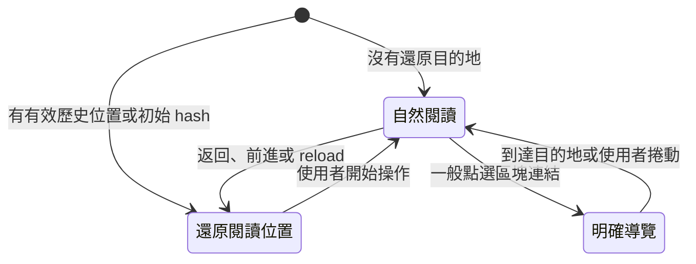
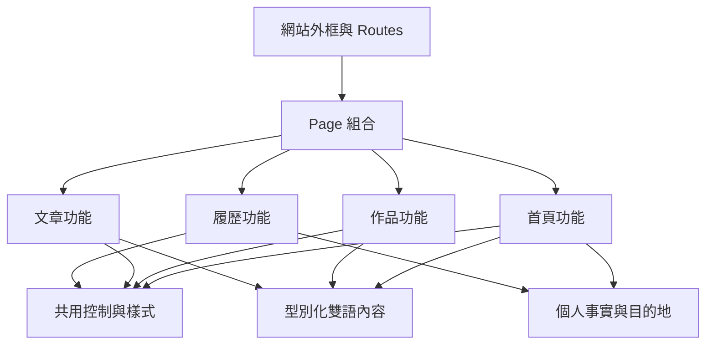
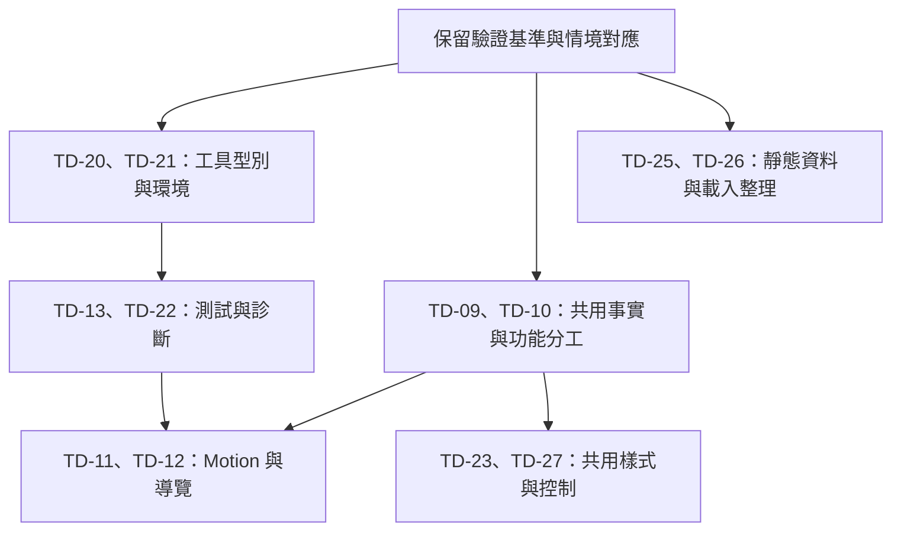

# 計劃 0001：全面檢查與改善技術債

## 目標

讓網站能持續更新內容、依賴與互動，降低跨檔案同步與測試維護的成本。本計劃列出目前待處理的技術債、證據、調整方案及完成條件。

## 核准紀錄

- 2026-11-08：使用者核准 TD-04，授權完成 Tooltip 的互動與定位改善，並指定不建立 commit。未列於核准紀錄的項目尚未核准。
- 2026-11-08：使用者核准 TD-18，授權改善圖片尺寸、responsive sources 與載入策略，並指定不建立 commit。
- 2026-11-09：使用者核准 TD-07、TD-08、TD-24，授權一併完成工作與作品的資料約定、英文 fallback 與測試隔離。
- 2026-11-09：使用者核准 TD-15、TD-16，授權一併改善 PDF 結構與文字驗證、共用靜態服務及 Prerender 的職責與失敗處理。
- 2026-11-09：使用者核准 TD-19，授權移除停用的 Workbox 程式與依賴、精確清理歷史 registration，並完成相關規格與驗證。

## 範圍

檢查涵蓋 `src/` 的 React、TypeScript、Sass、內容資料與雙語字典，`scripts/`、`tests/`、`public/`、字型與圖片、npm 設定、lockfile、GitHub Actions、工程文件與規格對應。

建議維持 React、靜態 hosting、GitHub Pages、英文單頁 A4 履歷、既有首頁區塊順序與視覺方向。此次提案不增加 application server、CMS、全域狀態管理框架或新的公開頁面，也不重新撰寫職涯成果。

檢查結果分為以下種類，避免把推論寫成已重現的故障：

- 已重現：由 production build、瀏覽器操作或計算取得結果。
- 程式碼確認：可直接確認目前的結構、重複或失敗處理方式，尚未宣稱使用者已遇到故障。
- 待調查：現有資料不足以判定，例如舊 sitemap 目的地是否仍由其他 repo 提供。

### 優先順序

P2 處理會持續增加修改成本、資料缺漏風險或驗證成本的結構，以及已確認的操作問題；P3 處理可獨立安排的小型整理與調查。

<!-- prettier-ignore -->
| 編號 | 優先順序 | 調整主題 | 證據種類 |
| --- | --- | --- | --- |
| TD-09 | P2 | 集中聯絡資訊及可共用的職涯事實 | 程式碼確認 |
| TD-10 | P2 | 按實際功能拆分首頁與履歷 | 程式碼確認 |
| TD-11 | P2 | 分開 motion 計算與 DOM 操作 | 程式碼確認 |
| TD-12 | P2 | 整理導覽狀態與原生 anchor 行為 | 程式碼確認 |
| TD-13 | P2 | 採用 Playwright Test 管理瀏覽器測試 | 程式碼確認 |
| TD-20 | P2 | 補足 Node 工具與瀏覽器測試的型別檢查 | 程式碼確認 |
| TD-21 | P2 | 補上 Node 與 npm 的版本選擇方式 | 程式碼確認 |
| TD-22 | P2 | 補足安全更新與失敗診斷的 CI 流程 | 程式碼確認 |
| TD-23 | P2 | 整理樣式作用範圍與共用 token | 程式碼確認 |
| TD-25 | P3 | 校對靜態 metadata、manifest 與 sitemap | 程式碼確認、待調查 |
| TD-26 | P3 | 分開非公開履歷載入並明確記錄啟動方式 | 程式碼確認 |
| TD-27 | P3 | 簡化圖示及控制元件的介面 | 程式碼確認 |

## 設計稿

無。

## 檢查發現與調整方案

### TD-09：集中聯絡資訊與共用事實

證據：email、GitHub、LinkedIn、Cake、網站 URL 分散於 Home、Footer、ResumeSheet、QR code、HTML metadata。任職公司、職稱、日期也分散在兩份字典與 [`ResumeSheet.tsx`](../../src/pages/Main/Resume/ResumeSheet.tsx)。內容差異不一定是錯誤，但更改同一事實需要逐檔搜尋。

建議建立小型 `profile` 資料，維護聯絡資料、社群目的地與網站 URL。職涯共同事實依 ID 共用，首頁長段落與履歷 bullets 保留各自的編輯方式；服務清單與教育敘事不為了共用而改成通用 schema。新增對照檢查，確認兩種語言及履歷的公司、職稱與任職期間一致。

完成條件：更新 email 或任職日期有明確的維護位置，相關畫面、QR code 與 PDF 連結同步。Metadata 若須留在靜態 shell，由 build 讀取同一份可轉為 JSON 的資料，不為這件事引入 CMS。此調整不驗證成果數字真偽，也不把 repo 內重複文案當成獨立證據。

### TD-10：按功能拆分首頁及履歷

證據：Home 同時管理頭像 pointer、QR code dialog、Hero、工作經歷、技能、教育及區塊組合。`components/` 混合只給首頁使用的 Blog、Projects 與一般控制；履歷 TSX 放在 `pages/Main/Resume`，列印 helper 卻在 `src/resume`。

建議首頁 page 只組合區塊，頭像與 dialog 在首頁功能內擁有各自狀態和樣式，作品與文章的私有元件放在各自功能旁。履歷的內容、預覽、列印 helper 與專用型別放在同一功能內，共用控制維持小而明確的介面。

下方是建議責任位置，不要求一次搬完所有檔案；只有實際依賴的方向改清楚後才搬移，避免為了目錄整齊製造無意義的 diff。

```text
src/
  app/              # 網站外框與 routes
  pages/            # HomePage、ResumePage 的組合
  features/
    home/           # Hero、Portrait、QR code、About
    projects/       # 作品分頁、素材、型別與內容組合
    blog/           # 精選文章與示意
    resume/         # ResumeSheet、列印與履歷專用內容
  components/       # Button、Tooltip 等共用控制
  data/             # 跨功能共用的個人事實與目的地
  i18n/
  navigation/
  motion/
  icons/
  styles/
```

完成條件：修改 QR code 不必同時理解整頁 Home，改履歷不必穿越 Main 的目錄層級，私有功能沒有透過全站 barrel 對外公開。單一 caller 的小函式可留在使用處，維持 co-located SCSS 及現有 token 規則，不額外建立 repository、service、adapter 等分層。

### TD-11：分開 Motion 計算與 DOM 操作

證據：[`useScrollMotion.ts`](../../src/motion/useScrollMotion.ts) 的單一 layout effect 包含收集元素、讀取 CSS 參數、量測、進度計算、style 寫入、多個 observer 及清理。幾何公式主要靠 browser tests 間接驗證；`MotionKind` 和 `MOTION_KINDS` 重複列舉，參數以任意字串查找，CSS 的錯名可能到 runtime 才失敗。

建議保留現有按捲動位置更新的設計，抽出無 DOM 的 pose、Hero 與 timeline 計算，再以一個 hook 管理量測及 browser lifecycle。以單一 kind 清單推導型別，明確列出 motion 參數名稱與單位，保留目前先讀後寫、requestAnimationFrame 合併與 reduced-motion cleanup 的優點。

完成條件：純計算涵蓋長短內容、閱讀區、上下界與反向捲動，browser tests 驗證整組位移、resize、字型載入、切換語言、卸載與列印。量測代表性桌面及手機的 frame 工作，不能從目前「停止時沒有 DOM 寫入」的測試推定快速捲動效能已達標。若沒有量測證明，暫不改用另一個動畫引擎。

### TD-12：讓導覽狀態與原生連結一致

證據：[`useSectionNavigation.ts`](../../src/navigation/useSectionNavigation.ts) 的 effect 同時以 `clickedHash`、`pendingDestination`、`restorationDestination`、frame 與 timer 描述導覽階段。Header 又維護 section ID 清單及焦點行為。

建議共用固定 section ID 與對應型別，明確區分自然閱讀、明確 anchor 導覽、歷史位置還原。把歷史資料解析與狀態轉換抽成可測函式，hook 負責事件及 DOM。



完成條件：保持 SITE-R2 的 hash、history length、讀取位置與焦點；新增非本網站 anchor 不介入，以及卸載後沒有還原 callback 操作 DOM 的驗證。不要用 IntersectionObserver 取代歷史還原，因為可見區塊判斷無法處理這整組需求。

### TD-13：採用 Playwright Test 管理瀏覽器測試

證據：[`tests/browser/site.test.mjs`](../../tests/browser/site.test.mjs) 包含共用 browser/context/page 變數、request interception、下載事件、CDP、字型、PDF parser、fixture 子程序與視覺幾何。Node test runner 可以執行這些測試，但隔離、等待、診斷及跨瀏覽器支援多由專案自行維護。

建議採用 Playwright Test，按導覽、內容與語言、Projects、QR code、motion、accessibility、PDF/build 拆分測試，使用 fixtures、語意 locator、可重試 assertion、trace 與失敗截圖。[官方測試建議](https://playwright.dev/docs/best-practices) 與 [多瀏覽器 projects](https://playwright.dev/docs/test-projects) 可替代目前多項測試基礎設施。

完成條件：原有情境逐項對應，沒有以重試掩蓋穩定失敗。Chromium 維持完整套件；Firefox、WebKit 至少涵蓋首頁、語言、anchor/history、tab、dialog 及 reduced motion。CDP 專用與 PDF 產生只在 Chromium 執行，真實 Safari、手機及 OS 列印仍保留人工驗證。平行執行前移除共享 page 狀態，失敗時可取得 trace、screenshot 與 console。

[`check-scenarios.mjs`](../../scripts/check-scenarios.mjs) 目前只接受直屬 `tests/browser/*.test.mjs`。採用新的 `.spec.ts` 路徑時，runner、checker、checker fixtures、lint、typecheck、README 與驗證文件必須同時更新，明確處理 Playwright 的 `skip`、`fixme`、`only`，不能只改 npm script。

### TD-20：補足 Node 工具與瀏覽器測試的型別檢查

證據：[`tsconfig.json`](../../tsconfig.json) 涵蓋 `src/` 與 `vite.config.mts`，但 `.mjs` 腳本和 browser tests 沒有型別檢查，`checkJs` 也未啟用。Puppeteer callback、fixture 回傳與檔案 I/O 的型別錯誤無法由目前的 `typecheck` 發現。

建議為 Node 工具與 browser tests 提供獨立的 tsconfig。腳本可使用 TypeScript，或先以 `checkJs` 和必要 JSDoc 檢查，選擇能覆蓋上述程式的方式。

完成條件：故意在工具或 browser tests 中放入型別錯誤會阻止共同檢查，並保留既有應用程式的型別檢查。先保留 `skipLibCheck`，待相容性驗證後再決定是否調整，避免把所有上游型別問題納入本次工作。

### TD-21：補上 Node 與 npm 的版本選擇方式

證據：[`package.json`](../../package.json) 已宣告 Node 的相容範圍，[README](../../README.md) 與 CI 使用 Node 22，Node 型別也使用 22.x。不過 repo 沒有 `.nvmrc` 或其他版本選擇檔案，也未指定 npm 版本，全新環境仍需自行選擇實際使用的版本。

建議提供一致的 Node 版本選擇入口，npm 版本透過工程文件或 `packageManager` 明確記錄，保留 `npm ci` 與 lockfile 作為安裝依據。

完成條件：全新環境能依文件選到可執行工具的 Node 與 npm，CI 與本機重現同樣的 compile、測試與 PDF 字型檢查。套件版本在實作時向官方 registry 取得相容版本。

### TD-22：補足依賴安全更新與失敗診斷

證據：[部署 workflow](../../.github/workflows/deploy.yml) 已有最小權限、檢查成功後發布及 main ref 限制，這些應維持。不過目前沒有獨立的依賴安全檢查，瀏覽器失敗時也沒有 trace、screenshot 等 artifact。

建議在獨立維護流程檢查安全公告與過時依賴，使用 Dependabot 等既有服務建立供審查的更新，依 React、工具鏈及瀏覽器工具分組。安全處置保留引入鏈與使用情境，不只追求統計歸零。一般 `npm run check` 維持不依賴即時 registry，避免 registry 故障阻止離線驗證。

完成條件：CI 失敗時上傳有保存期限的診斷 artifact，失敗輸出仍不部署；main 與其他 ref 的發布條件維持。實作時依官方發布資訊確認既有 workflow 的 Node 與 Actions 版本相容性，並在 browser database 更新時檢查 CSS 輸出與支援環境。依賴維護流程不改變本 repo 直接在 main 工作的規則。

### TD-23：整理樣式作用範圍及共享 Token

證據：已有 [`styles/README.md`](../../src/styles/README.md)、semantic tokens、section/focus/control mixins，架構方向合理。剩餘問題是 Home 對所有 section 內的 `h2`、`h3` 套樣式，再由 Projects、Blog 覆寫；部分共用間距與圓角仍寫成 10、15、25、30 px 或 100 px，Button 與 Header 的相同角色沒有完全使用共用規則。

建議將 About 標題等規則放在實際元件根 class，避免父層控制子功能的標題；整理時只把角色相同且多處使用的值移到 token。圓形使用既有 circle token，控制範圍沿用現有 control mixin。履歷印刷幾何、品牌示意構圖、陰影與光學微調仍留在局部。

完成條件：重排 Home 區塊或獨立 render Projects、Blog 時，字級與留白不受不相關的父層規則影響；相同角色共用 token，不因相同數字強制合併。按 DOM 順序整理 module 巢狀規則，保留既有 breakpoint，檢查兩種語言、focus、forced colors 與 PDF。

### TD-25：校對 Metadata、Manifest 與 Sitemap

證據：根目錄 HTML shell 的 `<noscript>` 宣告必須啟用 JavaScript，實際 prerender 已提供主要內容及 PDF 連結，兩種說法不一致。Manifest 在同一個 WebP icon 上宣告多個尺寸，需核對真實尺寸。Sitemap 列出 8 個其他專案路徑，但這個 repo 不提供這些頁面，可能由其他 GitHub Pages repo 提供，尚不能判定失效。

建議 noscript 只說明互動功能需要 JavaScript；manifest 使用真實 icon 尺寸與必要欄位。先建立 sitemap 目的地的歸屬及 response 紀錄，再移除確認失效的項目。Metadata 的任職與教育事實依 TD-09 維護，不以 SEO 名義堆疊圖片 alt 或關鍵字。

完成條件：停用 JavaScript 時的提示與可用內容一致，manifest 的 icon 宣告與檔案相符；sitemap 的每個 URL 都有可追溯的保留或移除理由，非公開 `/resume` 維持不列入。這是待調查工作，不能從本 repo 沒有檔案直接推論外部專案不存在。

### TD-26：分開履歷載入並記錄啟動方式

證據：[`router.tsx`](../../src/router.tsx) 直接 import 非公開 Resume，首頁也載入履歷相關 JS 與 CSS。Production HTML 是 browser snapshot，啟動時卻以 `createRoot` 重建，沒有 hydration。這不是 hydration mismatch 的現存錯誤，因為目前沒有執行 hydrate。

建議先以 route-level lazy loading 分開非公開履歷，確認首頁不再帶入履歷內容與專用字型 CSS。保留可穩定完成的 client 啟動，將目前固定的 DOM 重建成本記在工程文件；本輪不直接換成 `hydrateRoot`。若後續量測顯示有必要，另行設計語言、useId、時間、路徑與樣式一致的 render/hydration 流程，不能只換一個 API。

完成條件：首頁主要 bundle 不含履歷全文，`/resume` 本機預覽與 build PDF 能等待 lazy route 完成，prerender 仍產出完整靜態內容。記錄分割前後的 gzip bytes。後續設計 hydration 流程時，可參考 React 的 [client API 說明](https://react.dev/reference/react-dom/client)。

### TD-27：簡化圖示及控制元件介面

證據：[`IconLayout.tsx`](../../src/icons/IconLayout.tsx) 用 HOC 包裝每個 SVG，暴露少量自訂 props，沒有完整的原生 SVG 屬性。RoundButton 重複宣告原生 props，並強制要求 `className` 和 `onClick`；ResumeSheet 的 forwarded ref 目前主要由測試使用。公司 logo 與技能圖示的 alt 又重複旁邊相同文字，學校圖示的 alt 堆疊多個關鍵字。

建議保留現有 SVG paths，整理成標準 SVG props 與明確的裝飾預設；需要 accessible name 的圖示才提供 title。RoundButton 延用原生 button props，必要參數只保留有產品意義的 hint。移除沒有實際 caller 需求的包裝與樣式選項時，順便處理重複 accessible text；學校替代文字以圖片實際資訊為準。

完成條件：共用控制仍提供原生 button/anchor 語意、名稱與 focus，沒有重複讀取旁邊公司及技能名稱。少量靜態 SVG 不值得為了統一 import 改用整套 icon library；React context 也不因這次整理加入狀態管理套件或無量測依據的 memo。

## 決策

### 現成工具與保留自製程式的取捨

<!-- prettier-ignore -->
| 項目 | 建議 | 原因及決策保存位置 |
| --- | --- | --- |
| Browser runner | 改用 Playwright Test | Fixtures、等待、跨瀏覽器與診斷由現成工具提供；保存於 README、測試設定及驗證文件。 |
| QR code | 保留 `qrcode.react` 與原生 dialog | 目前已用現成 QR code encoder 與 browser modal，沒有重造這兩項功能。 |
| 區塊導覽 | 保留原生 anchor，加上小型網站狀態管理 | Hash 與閱讀位置是本站既有需求；不以另一個 scroll library 取代 browser history。保存於 SITE-R2 與 navigation 模組。 |
| Motion | 保留網站公式，分開計算與 DOM | 現有動畫有具體的可逆、整組及長內容規則；先降低耦合，沒有證據支持整套換引擎。保存於 SITE-R13 及 design system。 |
| 雙語 | 保留型別化 context 與兩份字典 | 只有兩種語言與靜態內容，未使用複數、遠端載入或大量插值；先修資料約定，暫無導入 i18next 的必要。 |
| 情境 checker | 保留專案格式與 TypeScript AST | 規格 ID、manual 對應及測試限制是專案流程，沒有可直接替換的通用工具；只調整 runner adapter，避免寫成通用 Markdown 或 JavaScript 解譯器。 |
| Icon 與設計系統 | 保留靜態 SVG、CSS Modules 與 Sass tokens | 現有規模不需要元件庫、CSS 框架或完整 monorepo。 |

### 模組依賴方向



功能私有的素材、型別與 render helpers 隨功能維護，只有真正跨功能共用的資料與控制放到共用位置。這項理由記錄在 README 的模組分工，避免後續把所有內容再次集中到 `components/index.ts` 或 `types.ts`。

## Spec 變更

此節為待核准的提案。沒有產品行為變化的重構沿用既有 scenario IDs；工具設定與資料完整性由工程驗收檢查，不為內部檔案搬移建立產品規格。

### 其他需求的修訂原則

SITE-R2、R6、R7、R9、R10、R11、R13、R16、R17 的現有結果維持。TD-25 的 noscript 若更新，新增說明「無 JavaScript 仍可閱讀主要內容及取得 PDF；需操作狀態的功能需要 JavaScript」，連結到 SITE-R14.2 的既有情境，不把舊 sitemap 是否存活寫成已確認需求。

## 做法要點

### 建議的工作批次與依賴

以能獨立驗證及回復的工作批次安排實作，不將全站搬檔、工具設定、測試 runner 與畫面修正合成一次難以判斷的重寫。下圖表達依賴，並非要求逐行執行的 checklist。



Playwright 取代 runner 時逐項移交既有情境；可以短期同時保留兩組 runner，確認對應後刪除舊的測試基礎設施，避免長期維護重複套件。

### 需要特別保留的規則

- `/resume` 是非公開 client route，build 內部使用該 route 產 PDF 不代表公開 hosting 應提供 SPA fallback。
- 作品所有 panels 保留最大自然高度，圖片載入策略不得使切換時頁面縮短或更動 focus。
- 首頁 prerender 保留完整內容、原 shell metadata 與 PDF 下載，不能擷取 browser portal、motion 暫存狀態或 loading placeholder。
- PDF 字型及內容規則有跨平台原因，不能以移除檢查的方式讓 build 通過。
- Native dialog、anchor、文字選取與 reduced motion 已有明確規格，重構時保留對應 browser/manual 情境。

## 驗證方式

### 工程驗收

以下是改善工作本身的驗收，不新增產品 scenario ID；各 TD 的詳細完成條件仍以對應段落為準。

<!-- prettier-ignore -->
| 工作範圍 | 工程驗收 |
| --- | --- |
| 工具與環境 | 工具及 browser tests 的型別錯誤會阻止共同檢查；依文件選擇 Node 與 npm 後，乾淨安裝及既有檢查通過。 |
| 內容與模組 | 共用事實有單一維護位置，雙語與履歷共享事實保持一致；沒有循環 import 或功能私有模組對外公開。 |
| Motion 與導覽 | 純函式驗證與既有 browser 情境通過，桌面及實機快捲、反轉、歷史還原、focus、resize、reduced motion 另有實測紀錄。 |
| 資源及載入 | 記錄履歷 route 分割前後的 bundle gzip 差異，prerender 仍保留完整靜態內容。 |
| 測試與 CI | Runner 和 checker 接受相同檔案與測試宣告，主要跨瀏覽器流程有結果，失敗時有診斷 artifact，失敗輸出及非 main ref 均不發布。 |
| 文件 | 同一批實作更新 design context、spec、manual checks、README 及 design system 的相關規則，完成並驗證的 Roadmap 項目才移除。 |

### 文件檢查

交付前執行 Markdown/frontmatter 解析、Prettier、中文 lint 與 `npm run check:scenarios`。另由不帶規劃對話脈絡的 reviewer 檢查工程規範與核准範圍，中文稿再依專案採用的寫作規範審查。

## 還沒定案的問題

沒有阻止本提案審閱的問題。TD-25 的 sitemap 歸屬及各 library 的實作版本屬於已界定的調查與相容性驗證，不以未查證的結果承諾刪除目的地或指定未來版本。
