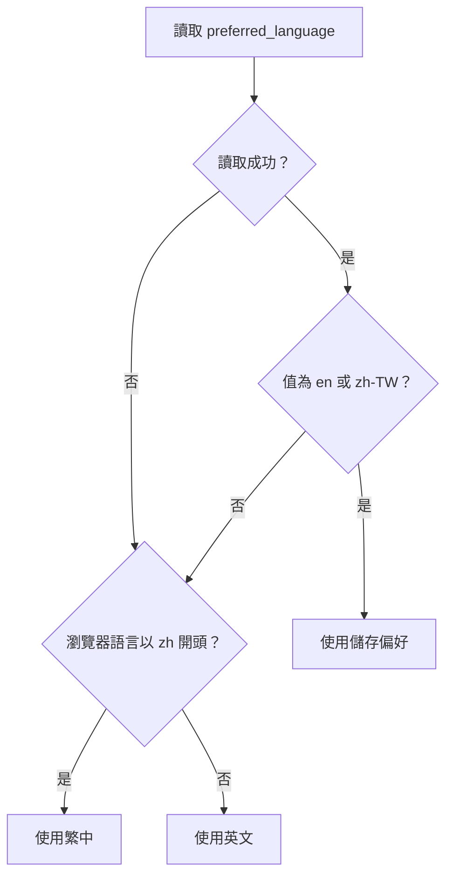
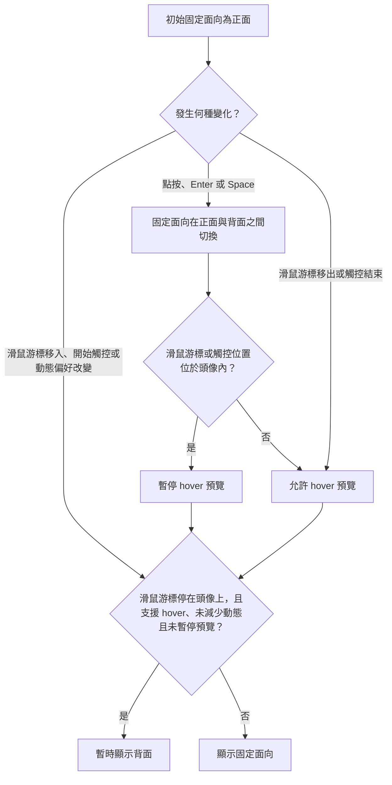
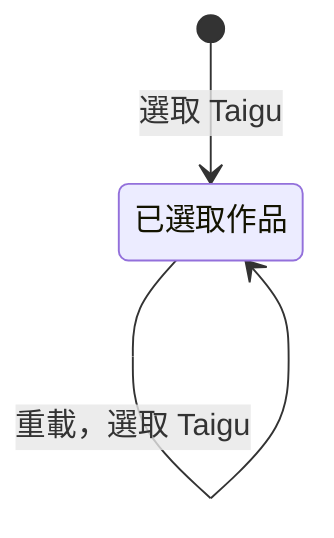
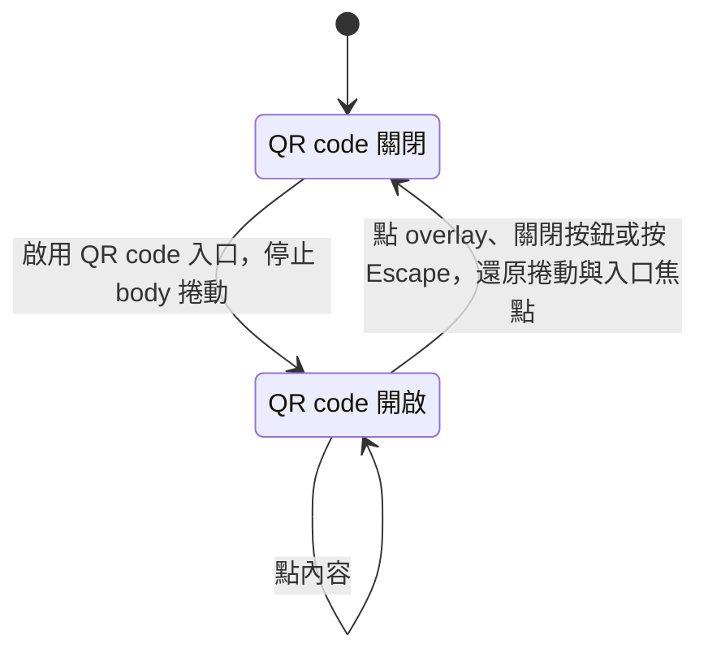
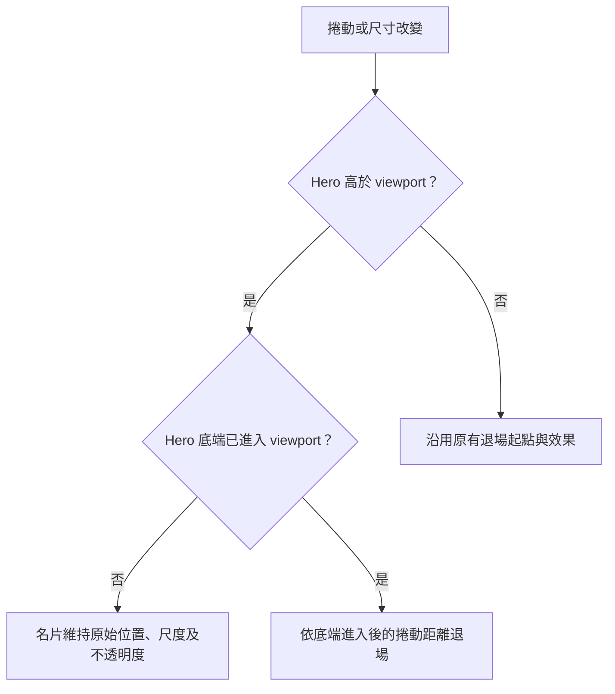
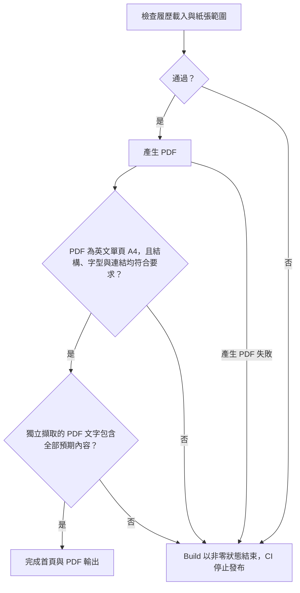

# 網站行為規格

本檔記錄網站現行行為。產品、受眾、語氣與視覺原則見 [設計方向](../design.md)，工程限制與驗證入口見 [README](../../README.md)。內容資料、逐字文案與 CSS 數值以負責檔案為準。

正常使用情境以 localStorage 可讀寫、JavaScript 可執行為前提，另有說明者除外。驗證方式為 `unit`、`browser` 或 `manual`，有多種時需分別建立對應。手動步驟見 [驗收文件](../../tests/manual/site.md)，執行結果記在 commit 說明與交付回報，不記在本檔。

既有問題與待調查、待決策事項見 [Roadmap](../roadmap.md)。驗證對應完整不表示所有行為都已符合設計方向，也不把目前限制當成應維持的產品效果。

## 首頁、導覽與語言

### SITE-R1 頁面與公開範圍

公開首頁以 Home、About、Projects、Blog 的順序呈現個人專業背景與作品，使用共用 Header、Footer 與語言切換器。部落格內容由外部網站提供。

`/resume` 是非公開預覽 route，保留程式中的 client route 與共用履歷功能，但不列入公開導覽或 production prerender。前端 wildcard 導向不能當成靜態 hosting 的 fallback 保證。

<!-- prettier-ignore -->
| 情境 | 條件、動作與結果 | 驗證方式 |
| --- | --- | --- |
| SITE-R1.1 公開首頁 | 直接開啟 production build 的 `/`，回傳首頁文件，依序找到四個區塊。 | browser |
| SITE-R1.2 共用外框 | 首頁載入後有 Header、主要內容、Footer 與語言切換器；同一內容不因 prerender 與 React 啟動而重複。 | browser |
| SITE-R1.3 非公開履歷 Route | 檢查 build 與公開導覽，沒有為 `/resume` 產生靜態文件或新增公開連結；嚴格靜態 server 不替它回首頁 shell。 | browser |
| SITE-R1.4 非公開預覽 | 在有 client routing 的本機環境開啟 `/resume`，能檢視英文履歷與列印入口。 | browser |

### SITE-R2 區塊導覽與瀏覽器歷史

首頁導覽使用 `#home`、`#about`、`#projects`、`#blog`。Header 的 Logo 回到首頁，三個內容連結前往 About、Projects、Blog；Footer 保留 Logo 回首頁的入口。明確點選 anchor 保留瀏覽器原生的導覽、修飾鍵、新分頁及歷史行為。自然捲動結束後以 replaceState 更新目前區塊的 hash，避免在明確導覽的過程中改寫目的地。

Header 從初始畫面起常駐，讓內容入口與語言切換的位置固定。桌面版 Header 與 Projects 共用置中容器及留白，背景與底線滿版；Logo 連結提供回首頁操作，輔助工具可取得目前語言的作者名稱。目前區塊以可見樣式及 aria-current 識別，anchor 落點避開 Header，直接開啟 hash 時也在初始內容尺寸變動後維持落點，直到使用者操作。

Header 使用半透明白色底與背景模糊，讓下方白色及灰色背景自然影響材質，並以淡底線分隔內容。Header 在以下情況使用實色背景：

- 窄版選單展開時。

  展開的選單也使用實色背景。

- 瀏覽器不支援背景模糊時。
- 瀏覽器支援並收到減少透明度偏好時。
- 瀏覽器支援並收到提高對比偏好時。

  Header 與選單的分隔線也會加深。

窄版以 disclosure 按鈕展開內容連結與語言控制，保留原生連結及一般 Tab 順序。選單不視為 modal，也不限制頁面捲動；選取連結後收起，焦點移到目標內容，後續 Tab 從目標內容接續。Escape 關閉並還原焦點至選單按鈕；若有 Tooltip 顯示，第一次 Escape 先關閉提示並保留控制焦點，再次按 Escape 才關閉選單。點擊外部、焦點離開 Header 或切換至桌面寬度時也會收起。選單在短螢幕中可捲動。

頁面使用獨立的主要內容 main landmark、具名稱的導覽及鍵盤跳過連結，控制均提供可見焦點。

<!-- prettier-ignore -->
| 情境 | 條件、動作與結果 | 驗證方式 |
| --- | --- | --- |
| SITE-R2.1 首頁區塊連結 | 由 Hero 的 About、Projects、Blog 或 Header 連結導覽，網址 hash 與落點指向所選區塊，內容未被 Header 遮住。 | browser |
| SITE-R2.2 自然捲動 | 捲動跨越區塊時更新目前區塊提示，結束後同步 hash；history length 不因自然捲動增加。 | browser |
| SITE-R2.3 返回與前進 | 明確點選區塊連結後使用返回與前進，URL 與閱讀位置依對應歷史紀錄恢復，包含區塊中途的位置；前一次 scroll 結束不會改寫目的地。 | browser、manual |
| SITE-R2.4 Hash 直接開啟 | 新分頁開啟各首頁 hash 時，目標區塊避開 Header；reload 有紀錄的頁面時保留閱讀位置，目前區塊提示與內容一致。 | browser、manual |
| SITE-R2.5 Logo 回頂端 | 點 Header 或 Footer 的 Logo，回到首頁頂端。 | browser |
| SITE-R2.6 常駐 Header | 初始畫面及捲動後均能使用 Header；桌面直接操作內容連結，窄版可開啟選單。 | browser、manual |
| SITE-R2.7 目前區塊 | 捲動或點選連結後，只有目前區塊帶有 aria-current 與可見提示，語言切換後仍維持。 | browser |
| SITE-R2.8 窄版選單 | 用滑鼠及鍵盤開關選單；Escape 關閉選單並將焦點還原至選單按鈕，提示顯示時則先關閉提示，選取連結後焦點從目標內容接續，外部點擊、離開 Header 及桌面寬度都能收起，隱藏連結不保留鍵盤焦點。 | browser、manual |
| SITE-R2.9 Header 組成 | 在兩種語言及窄版到寬螢幕中檢查 Logo、置中、與 Projects 對齊、控制不重疊及至少 44px 的操作高度；白灰背景下的材質維持清晰，支援的透明度及對比偏好可切換至實色。 | browser、manual |
| SITE-R2.10 跳過導覽 | 頁面只有一個主要內容 landmark；第一個 Tab 顯示跳過連結，啟用後焦點移到主要內容，導覽具有目前語言的名稱。 | browser |

### SITE-R3 初始語言選擇

網站支援 `en` 與 `zh-TW`，初始語言依下圖選擇。`localStorage` 無法存取或讀取失敗時，首頁仍可啟動。

<!-- prettier-ignore -->
| 情境 | 條件、動作與結果 | 驗證方式 |
| --- | --- | --- |
| SITE-R3.1 儲存英文優先 | 儲存值為 `en`、瀏覽器語言為中文，仍顯示英文。 | unit |
| SITE-R3.2 儲存繁中優先 | 儲存值為 `zh-TW`、瀏覽器語言非中文，仍顯示繁中。 | unit |
| SITE-R3.3 中文瀏覽器 | 沒有有效偏好且瀏覽器語言為 `zh-TW` 或 `zh-CN`，顯示繁中。 | unit |
| SITE-R3.4 非中文瀏覽器 | 沒有有效偏好且瀏覽器語言為 `en-US` 或其他非中文值，顯示英文。 | unit |
| SITE-R3.5 無效偏好 | 儲存值不在支援範圍時，依瀏覽器語言選擇，不能用該無效值選字典。 | unit |
| SITE-R3.6 儲存讀取失敗 | 存取 localStorage 或呼叫 getItem 時發生例外，首頁仍啟動並依瀏覽器語言選擇；中文使用繁中，其餘使用英文。 | unit、browser |

### SITE-R4 語言切換與持久化

語言按鈕在英文與繁中之間切換，顯示下一個語言，並以目前語言提供操作名稱。切換後更新頁面字典、`html.lang` 與儲存偏好。開著的作品詳情保留選取，內容依目前語言顯示；履歷內容政策見 SITE-R10。

QR code 的網址不隨語言改變，dialog 只提供掃描內容與關閉操作。需要切換語言時，先關閉 dialog，再使用 Header 的語言控制，重新開啟後顯示目前語言的姓名與提示。

語言切換先更新本次頁面的選擇，再嘗試儲存。儲存失敗時不顯示提示或產生未處理的例外，仍可繼續切換與瀏覽；重載時依 SITE-R3 重新選擇，沒有可讀的有效偏好時使用瀏覽器語言。

<!-- prettier-ignore -->
| 情境 | 條件、動作與結果 | 驗證方式 |
| --- | --- | --- |
| SITE-R4.1 雙向切換 | 在兩種語言各按一次切換，姓名、導覽與區塊文案改成另一語言，按鈕標示同步。 | unit、browser |
| SITE-R4.2 儲存與重載 | 切換後 `preferred_language` 與 `html.lang` 對應所選語言；reload 後仍使用該偏好。 | browser |
| SITE-R4.3 作品詳情中切換 | 開著作品時切換語言，選取仍保留，描述、標籤與進行中期間文字更新。 | browser |
| SITE-R4.4 QR Code 關閉後切換語言 | 開啟並關閉 QR code，透過 Header 切換語言後重新開啟，姓名、掃描提示與關閉按鈕名稱使用目前語言，QR code 維持相同，dialog 內只有關閉操作。 | browser |
| SITE-R4.5 鍵盤切換語言 | 使用 Tab 找到原生語言按鈕，以 Enter 或 Space 切換；不需要滑鼠。 | browser、manual |
| SITE-R4.6 儲存寫入失敗 | 存取 localStorage 或呼叫 setItem 時發生例外，字典、html.lang 與按鈕仍同步切換，本頁導覽保留選擇且沒有錯誤提示或未處理的例外；新選擇未儲存，重載後依初始語言規則選擇。 | unit、browser |

## 個人內容與外部目的地

### SITE-R5 Hero 與聯絡資訊

Hero 呈現姓名、頭像、問候、目前職務、教育背景、email、社群與區塊導覽。職務取工作資料第一筆及其目前語言內容；頭像提供 QR code 入口。Email 供選取與複製，現行頁面沒有點擊寄信或複製按鈕。

頭像的固定面向與 hover 預覽依下圖決定：

啟用減少動態時，換面不播放旋轉過場。

頭像使用原生按鈕，提供目前語言的操作名稱及固定背面的切換狀態，支援觸控、滑鼠、Enter 與 Space，兩張圖片保留原有的人名替代文字。QR code 入口獨立操作，不切換固定狀態；關閉 dialog 後立即用鍵盤換面，仍以該次操作結果為準。

<!-- prettier-ignore -->
| 情境 | 條件、動作與結果 | 驗證方式 |
| --- | --- | --- |
| SITE-R5.1 個人摘要 | 在兩種語言載入首頁，姓名、第一筆工作對應的職稱與公司、教育 badge 均與負責資料一致。 | unit、manual |
| SITE-R5.2 問候文字 | 載入或切換語言後，問候最終顯示目前語言的完整文字，文字不因逐字動畫遺失。 | browser |
| SITE-R5.3 Email 複製 | 選取 Hero email，能複製完整字串；不能將它驗成現有 mailto 或 clipboard 操作。 | manual |
| SITE-R5.4 社群與學校 | 操作 Hero 的 GitHub、LinkedIn、Cake 與學校連結，新分頁目的地符合負責來源。 | browser、manual |
| SITE-R5.5 頭像翻面 | 一般模式保留 Hover 暫時換面與移出還原；以滑鼠、觸控及鍵盤固定背面後保持，再次操作翻回正面，同一次 Hover 不覆蓋點按結果。QR code 不切換固定狀態，圖片保留人名替代文字。頭像按鈕在兩種語言下均提供操作名稱及切換狀態；啟用減少動態設定時，頭像只在點按時直接換面。 | browser |

### SITE-R6 About、Footer 與部落格

About 顯示工作經歷、技能與教育。工作內容按資料順序，以固定 ID 取得目前語言翻譯，缺少或空白翻譯時取對應英文內容；技能列呈現技能名稱與圖示，學歷連結到對應學校頁面。

Hero、工作經歷與教育的品牌圖片隨網站提供，預留圖片尺寸；圖片載入失敗時保留空間並隱藏失敗圖示，旁邊的職稱、公司與教育文字仍可閱讀。

Footer 提供主要聯絡入口、三個專業平台連結、作者識別與當年度姓名版權資訊，不再呈現服務清單。聯絡說明依目前語言顯示，完整 Email 不因語言改變，地址與操作箭頭共用一個原生 `mailto:` anchor。作者姓名與版權姓名依目前語言顯示。

Blog 提供精選文章與外部完整筆記列表入口，詳細行為見 SITE-R17。

<!-- prettier-ignore -->
| 情境 | 條件、動作與結果 | 驗證方式 |
| --- | --- | --- |
| SITE-R6.1 工作與翻譯 | 工作順序與資料一致，各欄位使用目前語言內容；缺少或空白翻譯的欄位回到對應英文內容，第一筆工作仍提供 Hero 摘要的職稱與公司。 | unit |
| SITE-R6.2 技能與教育 | 技能名稱及圖示與技能資料一致，教育連結指向經濟學系與金融科技學程。 | unit、manual |
| SITE-R6.3 Footer 內容 | Footer 顯示目前語言的聯絡說明、完整 email、GitHub、LinkedIn、Cake、作者識別與版權，不再顯示服務清單；年度顯示執行當年的年份，姓名依目前語言顯示，平台目的地保持既有 URL。 | unit、manual |
| SITE-R6.4 外部部落格 | Blog 的完整筆記入口以新分頁開啟 `https://blog.byc1999.com/list`。 | browser、manual |
| SITE-R6.5 本機品牌圖片 | 雙語、窄版與桌面的品牌圖片使用本機來源並預留尺寸，正常載入時顯示正確品牌；載入失敗時沒有失敗圖示或版面位移，相關文字仍可閱讀。 | browser、manual |
| SITE-R6.6 Footer 郵件入口 | 兩種語言均以同一個原生 anchor 顯示完整 email 與操作箭頭，href 指向既有 email 的 mailto URL，accessible name 包含寄信動作與完整地址；沒有額外的箭頭按鈕，鍵盤可到達入口。 | unit、browser、manual |

### SITE-R7 作品選取與詳情

Projects 以作品分頁控制單一展示區，依資料順序提供 Taigu、Noads、Leechai。初始顯示第一個作品，頁面上持續有一份展示內容。切換時更新名稱、用途、說明、圖片、標籤、期間及外連，並保留頁面捲動位置。

分頁採原生 button 與 tab 語意，選取者有 `aria-selected=true` 並進入 Tab 順序。左右方向鍵切換並循環，Home 與 End 選取首尾作品；Enter、Space 及點擊可選取所在分頁。Tab 從選取的分頁進入展示區，再到作品外連。焦點保持在操作的分頁，不因切換移到標題。此處沒有開啟、收合、關閉或 dialog 狀態。

內容以固定作品 ID 取得目前語言字典，缺少或空白翻譯時使用同一份英文內容；標籤缺少、沒有內容或含空白項目時也使用英文標籤。圖片保留真實介面，期間依資料顯示目前語言的進行中文字，同年起迄合併為一個年份。分頁及展示區具可辨識名稱。

作品大圖只隨目前選取的作品載入，各面板的文字與展示框持續保留最大自然高度。圖片提供不同尺寸的 WebP；小於或等於 512 px 時，第二張 App 畫面使用內嵌預覽來源，不下載桌面大圖。切換後立即提供目前作品的小型預覽，完整圖片載入後取代預覽；直接開啟 `#projects`、resize 與無 JavaScript 的初始作品仍有可讀取的靜態圖片來源。

選取狀態依下圖切換：

<!-- prettier-ignore -->
| 情境 | 條件、動作與結果 | 驗證方式 |
| --- | --- | --- |
| SITE-R7.1 初始作品清單 | 首次載入有三個作品分頁，順序及 Logo 符合資料，第一個作品已選取，只有其展示區可見且可操作，其餘內容不進入輔助工具或鍵盤順序。 | unit、browser |
| SITE-R7.2 開啟詳情 | 點擊任一作品分頁，即時顯示該作品內容，更新分頁選取狀態；不另開視窗或自動捲動。 | browser |
| SITE-R7.3 替換選取 | 選取另一作品後，內容、素材、外連與選取提示一致；再次選取相同作品保持展示，只有一份可見且可操作的展示區，焦點與捲動位置維持，頁面不因作品內容較短而縮短。 | browser |
| SITE-R7.5 內容與翻譯 | 用途、描述、圖片說明、目的地名稱及標籤依固定作品 ID 取得目前語言內容，缺少或空白時取對應英文內容；標題、Logo、圖片與 URL 不因語言改變。 | unit |
| SITE-R7.6 期間顯示 | 起迄不同年時顯示兩個年份，同年時只顯示該年，無結束年時使用目前語言的進行中文字。 | unit |
| SITE-R7.7 重載後狀態 | 切換作品後 reload，回到第一個作品；作品選取不寫入 URL 或持久儲存。 | browser |
| SITE-R7.8 鍵盤操作作品 | 以 Tab 進入目前作品分頁，以左右方向鍵循環切換、Home 及 End 選取首尾，以 Enter 或 Space 選取；Tab 可進入展示區及外連，分頁與外連有可辨識焦點提示。 | browser、manual |
| SITE-R7.9 作品展示層次 | 在兩種語言及三個作品檢查名稱、用途、真實介面與操作的主次，日期及分類維持次要，選取提示不只靠顏色；圖片沒有周邊宣傳背景殘留或介面被意外裁切。 | manual |
| SITE-R7.10 圖片載入 | 首次載入不請求未選作品的大圖，窄版不下載第二張 App 大圖；切換作品先顯示目前作品的預覽再顯示完整圖片，直接 hash、resize 與無 JavaScript 的初始圖片均可載入，切換保持頁面高度、焦點及捲動位置。 | browser |

### SITE-R8 外連目的地與操作

社群、學校、部落格與作品目的地由現有來源維護，驗收區分本網站操作與外站可用性。作品目的地與「原始碼」使用原生 anchor，以 `target=_blank` 及 `rel=noopener noreferrer` 在新分頁開啟原有 URL。依作品顯示網站或商店名稱；外連箭頭只用於外連，作品分頁使用 Logo、名稱及選取提示。

<!-- prettier-ignore -->
| 情境 | 條件、動作與結果 | 驗證方式 |
| --- | --- | --- |
| SITE-R8.1 作品展示 | 逐一選取作品，操作主要 anchor，在新分頁開啟現有 demo URL，名稱能辨認網站或商店。 | unit、manual |
| SITE-R8.2 作品程式碼 | 逐一選取作品，操作「原始碼」anchor，在新分頁開啟現有 source URL。 | unit、manual |
| SITE-R8.3 新分頁隔離 | 作品及一般新分頁 anchor 提供 noopener 與 noreferrer 隔離，不讓目的地控制來源頁面。 | unit |
| SITE-R8.4 可辨識外連 | 在兩種語言檢查社群、學歷、作品與部落格入口，名稱或相鄰內容能辨識目的地與動作。 | manual |

## QR Code 與履歷

### SITE-R9 QR Code 顯示與關閉

QR code dialog 顯示個人網站的 QR code、姓名與目前語言提示，狀態依下圖切換。

入口是原生按鈕，按鈕名稱依目前語言顯示，並提供 dialog 提示與可見的鍵盤焦點。開啟後焦點移至 dialog 內的關閉按鈕，背景內容暫停操作及鍵盤聚焦；關閉後還原至入口，Tab 從入口接續。關閉按鈕的名稱依目前語言顯示，兩個按鈕均至少 44 px 高。

使用原生 `dialog.showModal()`，由瀏覽器處理 modal 的背景停用與輔助工具語意，避免自行維護背景元素的焦點狀態，做法依 [W3C H102](https://www.w3.org/WAI/WCAG22/Techniques/html/H102)。關閉及卸載時還原開啟前的 body 捲動設定。

<!-- prettier-ignore -->
| 情境 | 條件、動作與結果 | 驗證方式 |
| --- | --- | --- |
| SITE-R9.1 開啟 QR code | 點頭像旁 QR code 入口，出現一份具名稱的 modal dialog，焦點移至關閉按鈕，body 不再捲動。 | browser |
| SITE-R9.2 點內容與背景 | 點 dialog 內容不關閉；點 overlay 關閉，還原捲動設定及入口焦點。 | browser |
| SITE-R9.3 關閉按鈕 | 點原生關閉按鈕，dialog 消失並還原捲動設定及入口焦點；再次開啟仍可使用。 | browser |
| SITE-R9.4 Escape 關閉 | QR code 開啟時按 Escape，dialog 消失，還原捲動設定及入口焦點。 | browser |
| SITE-R9.5 QR Code 目的地 | 以實機掃描 QR code，辨識為個人網站 URL；姓名與提示對應目前語言。 | manual |
| SITE-R9.6 QR Code 鍵盤入口 | 以兩種語言分別在桌面與窄版視窗中，用 Tab 到達入口並以 Enter 或 Space 開啟，焦點移至關閉按鈕；按鈕名稱符合目前語言，焦點可見且操作區域至少 44 px 高。 | browser、manual |
| SITE-R9.7 Dialog 焦點與卸載清理 | 開啟後以 Tab 及 Shift+Tab 操作，背景控制不取得焦點；輔助工具取得 modal 的姓名與提示，背景內容暫停操作。關閉後 Tab 從入口接續，卸載也會解除 modal 並還原原有捲動設定。 | browser、manual |

### SITE-R10 履歷來源與下載入口

公開首頁以原生同源 anchor 取得 `/resume.pdf`，提供 `download="Bing-Yang Chen - 陳秉洋.pdf"` 作為檔名建議。所有尺寸與介面語言使用同一份英文檔案，入口沿用既有下載文案，不另外標示檔案格式、語言、紙張與頁數。實際儲存、開啟或分享由瀏覽器及作業系統決定。

PDF 在 build 時以目前的 ResumeSheet 與 print CSS 產生，等待字型及履歷圖片完成載入。產生 PDF 時使用英文文件語言、A4、背景列印及 CSS 紙張設定。檔案直接由靜態 hosting 提供，首頁不呼叫列印，也不掛載供列印的隱藏履歷。首頁下載連結保留在 prerender HTML 中。

`/resume` 保留非公開 client route、可見的英文 ResumeSheet 與瀏覽器列印入口，不產生對應的公開 HTML。只有預覽列印使用既有字型等待 helper；沒有 `fonts.ready` 時直接列印。預覽列印期間將文件語言設為英文，結束、取消或卸載時還原介面語言。履歷及英文預覽標示 `lang="en"`，履歷中的中文姓名標示 `lang="zh-TW"`。

<!-- prettier-ignore -->
| 情境 | 條件、動作與結果 | 驗證方式 |
| --- | --- | --- |
| SITE-R10.1 首頁下載入口 | 在兩種語言與桌面、窄版 viewport 操作首頁原生下載連結，目的地與建議檔名符合規則，取得同一份有效 PDF，首頁不呼叫 window.print。 | unit、browser、manual |
| SITE-R10.2 非公開預覽列印 | 在本機預覽操作 Download PDF，等待字型後使用瀏覽器列印目前的共用履歷。 | unit、manual |
| SITE-R10.3 預覽字型等待 | 預覽列印有 fonts.ready 時等待 promise；缺少該能力時直接列印。 | unit |
| SITE-R10.4 英文履歷 | 主網站使用英文或繁中時，下載檔案及預覽列印皆為英文履歷，PDF 文件語言為英文；預覽列印結束、取消或卸載後還原介面語言。 | unit、browser、manual |
| SITE-R10.5 共用履歷來源 | Build 產生的 PDF 與非公開預覽使用同一個 ResumeSheet；首頁沒有隱藏履歷，進入預覽時只有一份可見履歷，返回首頁後不遺留。 | browser |
| SITE-R10.6 首頁焦點順序 | 在兩種語言及桌面、窄版首頁使用 Tab、Shift+Tab，PDF 下載連結可聚焦且焦點可見，沒有隱藏履歷連結進入順序；非公開預覽的可見履歷連結仍可聚焦。 | browser、manual |
| SITE-R10.7 靜態下載 | 停用 JavaScript 或直接請求 PDF URL，嚴格靜態 server 回傳同一份 PDF 及 application/pdf，prerender 首頁仍提供可操作的下載 anchor；不依賴 SPA fallback。 | browser |

### SITE-R11 PDF 內容與版面

英文、分隔符號與項目符號使用 Georgia，PDF 包含 regular、bold 與 italic。中文姓名使用專案內附、固定為 700 字重的開源 Noto Serif TC 靜態字型子集，CSS unicode range 限於陳、秉、洋，PDF 字型名稱為 `NotoSerifTC-Bold`。固定字重與內部名稱可避免可變字型在不同作業系統下輸出不同的 PDF 字型名稱，中文也不依賴作業系統字型或瀏覽時的外部字型服務。

Production 維持 Ubuntu，在 CI 校驗 repo 內的 Georgia TTF 後直接安裝並註冊字型；TTF、SHA-256 校驗檔與 EULA 保留於 `vendor/corefonts/`，不發布到網站。

等待字型載入不代表指定的系統字型存在，因此產生 PDF 後另核對實際字型，避免 Liberation Serif 等替換與中文字缺失。

職稱與公司以較淡的中點「·」分隔，任職年資放在日期後的括號中。成就使用原生圓點清單與懸掛縮排，正文使用 12 px 字級、1 px 字距、1.8 倍行高、兩端對齊及自動斷字；工作經歷間距為 16 px。聯絡資訊保留定位與信封圖示，使用 11 px 尺寸、5 px 圖文間距及微量垂直校正。

履歷維持英文單頁 A4。公開下載與非公開預覽列印只保留履歷，文字可選取與擷取，保留 email、GitHub 與個人網站連結。改動履歷相關行為時，依 [resume-writer skill](../../.agents/skills/resume-writer/SKILL.md) 檢查紙張、頁數、完整內容、閱讀順序、字型與連結。

<!-- prettier-ignore -->
| 情境 | 條件、動作與結果 | 驗證方式 |
| --- | --- | --- |
| SITE-R11.1 A4 與完整內容 | 檢查 build 的下載檔案與本機預覽列印均為單頁 A4，全部履歷文字可見，沒有裁切或額外空白頁。 | browser、manual |
| SITE-R11.2 僅輸出履歷 | 下載 PDF 與預覽列印均不出現網站 Header、Footer、語言切換器或重複履歷。 | browser、manual |
| SITE-R11.3 文字與連結 | 檢查 PDF 實際擷取文字涵蓋全部履歷段落及聯絡資訊，並核對 email、GitHub 與個人網站的 link annotations；人工確認可讀性及閱讀順序。 | browser、manual |
| SITE-R11.4 共用結果 | 下載 PDF 與預覽列印使用相同 ResumeSheet 及 print CSS，內容、頁數、紙張、字型與連結相同，中文姓名、分隔符號、項目符號與換行完整，沒有因使用不同的輸出方式而漏印。 | browser、manual |

## 響應式、動態與執行環境

### SITE-R12 響應式組成

版面依 viewport 調整，各區域遵循以下規則：

- Hero 在小於 720 px 時直排，720 px 起左右分區。卡片寬度依可用畫面決定，高度隨內容延伸；問候不使用巢狀捲動。各尺寸可透過頁面捲動閱讀全部內容，QR code、社群、履歷下載與區塊導覽均可達，不產生水平溢出或被卡片裁切，操作區域至少 44 × 44 px。
- 學歷在小螢幕直排。
- 技能清單只顯示一份內容，依可用寬度自然換行；兩種語言及所有尺寸均能以頁面捲動讀到完整技能。
- 作品在所有尺寸保留三個可見分頁。
- 作品在大於 720 px 時採左文右圖，其餘採名稱、用途、圖片、說明、外連及期間的單欄順序；小於或等於 512 px 的 App 展示使用單一主畫面。
- 展示區保留所有作品需要的最大自然高度，以頁面捲動閱讀，沒有巢狀或橫向捲動。
- Footer 大於 720 px 採左右分區，其餘採單欄；512 px 以下的作者識別與版權各自成列。兩種語言均保留完整資訊，沒有水平溢出。
- 互動目標至少 44 px 高。
- 語言切換整合在 Header，窄版由選單開啟；Header 與選單考慮 safe area。
- 本機履歷預覽的固定紙張使用容器捲動閱讀。

首頁的姓名、問候、工作經歷、技能、教育、作品說明、文章標題與摘要、Footer 正文均可原生選取與複製。按鈕、導覽與純操作文字不可選取；文章卡片內的正文保留選取能力。Hero email 維持整段選取。

正文採瀏覽器預設的選取行為，再針對控制設定不可選取，避免新增正文時漏設選取能力；標準與 WebKit 選取屬性並用。

文章卡片明確允許文字選取並停用連結拖曳，只攔截當次拖選結束時的點擊，讓放開滑鼠時保留選取範圍。辨識拖選時容許 4 px 以內的滑鼠游標移動，避免一般點擊的微小移動被當成拖選；後續點擊、修飾鍵點擊與鍵盤操作仍使用原生外連。

<!-- prettier-ignore -->
| 情境 | 條件、動作與結果 | 驗證方式 |
| --- | --- | --- |
| SITE-R12.1 Hero 分支 | 在兩種語言及一般／減少動態設定下，檢查 320 × 568、390 × 568、390 × 844、568 × 320、719 × 568、720 × 568、844 × 390、1440 × 900；組成符合 breakpoint，內容完整、沒有水平或巢狀捲動，所有入口可透過頁面捲動到達且操作區域至少 44 × 44 px。 | browser、manual |
| SITE-R12.2 清單與學歷分支 | 檢查 512 與 513 px 的學歷、技能及作品區塊；三個作品分頁均可見，完整技能自然換行且只有一份，學歷維持既有 breakpoint，字級跨過 breakpoint 時立即套用。 | browser、manual |
| SITE-R12.3 作品詳情分支 | 在 320、390、512、513、720、721、1024、1025 及 1440 px 切換各作品，核對排列順序、無水平溢出、素材取景、文字完整及操作可達性；互動目標至少 44 px 高。 | browser、manual |
| SITE-R12.4 語言與預覽容器 | 窄畫面能在 Header 選單中切換語言；本機履歷紙張可在專用容器捲動，不把紙張縮到不可讀。 | browser、manual |
| SITE-R12.5 正文選取與複製 | 在兩種語言及桌面、窄版畫面，工作經歷、作品說明、文章正文等文字可選取與複製；Hero email 維持整段選取，Footer email 可選取。 | browser、manual |
| SITE-R12.6 控制文字不可選取 | 在兩種語言及桌面、窄版畫面，按鈕及其內文、Header 與 Hero 導覽、作品外連與文章閱讀操作文字不可選取，原有滑鼠、鍵盤及觸控操作保持可用。 | browser、manual |
| SITE-R12.7 問候樣式分界 | 在兩種語言分別以 719 與 720 px 檢查首頁，問候的 computed font size 與 line height 符合各自樣式，文字完整。 | browser |
| SITE-R12.9 Footer 操作尺寸 | 在兩種語言的 320、390、512、513、720、721、1024、1440 px，量測 Footer 的 email、三個平台及 Logo anchor，均至少 44 px 高；排列符合 breakpoint，控制與 focus 不重疊、不裁切，沒有水平溢出。200% 文字放大後地址與姓名仍完整。 | browser、manual |

### SITE-R13 動態與 Reduced Motion

首頁使用可往返的滾動動態，相同 viewport、內容與捲動位置得到相同畫面；停止捲動就停止變化，反向捲動沿原路還原，沒有首次播放狀態或重新進場的等待時間。保留原生捲動速度與方向，方便招募者與合作對象快速檢索內容。

問候在首次載入與切換語言時立即完整顯示。頭像自動翻轉、打字游標、背景、下滑箭頭及技能輪播的定時動畫停用；頭像依 SITE-R5 保留 Hover 換面與點按固定面向。技能完整換行並依各項位置分別進退場，校徽與學位分別進場。

內容從頂端位於 viewport 高度的 104% 處開始進場，在頂端抵達 42% 高度時完成；高度超過 viewport 的 65% 時，提前在 62% 高度完成。直到整組內容的底端接近 Header 下方 24% viewport 高度，才開始退場，並在底端通過 Header 上方 8% viewport 高度時完成。進度使用 smoothstep 曲線；在進場完成與退場開始之間維持不透明度 1、位移 0 與尺度 1。

Projects 與 Blog 各以完整區塊為單位進退場，區塊標題、外連、作品分頁、圖片、說明與文章共用外層的位移、尺度及不透明度，內部元素維持相對位置。進退場依各區塊完整高度計算，因此窄版長內容在頂端進入閱讀區後保持清楚，直到整個區塊的底端接近退場範圍。

Hero 退場依目前捲動位置重新計算，反向捲動也使用同一規則：

延後退場的進度分母使用 viewport 與 Hero 較小的高度扣除 Header 高度。背景與下滑提示使用相同的閱讀延遲，其他區塊動態維持原有規則。

- 首頁名片與背景：名片離開首頁時最多上移 160 px、縮小至 86%、後傾 4 度、不透明度降至 0.22；背景最多上移 64 px，下滑提示在離開前 25% 進度內淡出。720 px 以下，位移使用桌面的 60%。
- 標題、一般文字與 Projects、Blog 整組內容：位移最多 96 px，退場最多 67.2 px；不透明度由 0.18 到 1。About 標題由 92%、一般文字及整組內容由 96.5% 恢復原始尺度，退場分別縮小至 97.5%、98%。720 px 以下，位移最多 56 px，退場最多 39.2 px。
- 技能與校徽：由 82% 尺度進場；技能同一列最多錯開 7.5% viewport 高度的進場距離。720 px 以下，使用窄版位移，保留完整清單。
- 時間軸：3 px 橄欖綠線依各段實際高度及 viewport 高度 62% 的閱讀位置延展；節點由 75% 尺度增至 110%，外環依同一進度顯示，向上捲動時縮回。720 px 以下，依每段實際高度計算。

這些幅度與可視區的下半部進場範圍，讓正常速度捲動時能看出動態；長段落提前完成進場，讓閱讀區保持清晰穩定。Header 與 Footer 保持原位，作品分頁隨 Projects 整組進退場。

作品選取維持立即反映與 260 ms 圖片進場回饋；捲動使用區塊外層，切換作品時依當下位置呈現，保留原有高度、URL、焦點及捲動行為。元件及其內部控制取得或失去焦點時，位移、尺度、傾斜與不透明度均維持當下捲動位置的狀態；聚焦期間繼續捲動，動態仍依位置更新。

Reduced-motion 下停用首頁全部非必要動畫及過場，完整顯示問候、技能及目前作品，時間軸直接完成，anchor 立即定位。偏好在頁面開啟中改變時立即生效，切回一般模式依當下位置呈現。使用 IconArrowUpRight 的連結在有 Hover 能力及一般模式時，箭頭向右上各位移 3 px，以 220 ms 過場；移出後還原，減少動態時維持原位。

首次載入、hash 直達、reload、前後頁與語言切換定位完成後，依當下幾何位置顯示正確狀態；內容高度、字型、圖片或 viewport 改變時重新計算。動畫只改視覺，不以 aria-hidden 或 inert 隱藏目前可用內容。列印、JavaScript 尚未啟動或無 JavaScript 時仍完整顯示內容。

<!-- prettier-ignore -->
| 情境 | 條件、動作與結果 | 驗證方式 |
| --- | --- | --- |
| SITE-R13.1 完整問候 | 首次載入與切換兩種語言時立即顯示目前完整問候，沒有打字等待或游標；卸載後沒有問候動畫計時器。 | unit |
| SITE-R13.2 Hero 動態 | 名片超過 viewport 時，捲到 Hero 底端進入畫面前，保持原始位置、尺度及不透明度；繼續下捲才退場，往上捲到相同位置時還原，閱讀期間社群、QR code 與履歷操作持續清楚可用。 | browser、manual |
| SITE-R13.3 完整減少動態 | 初次以 reduce 開啟及瀏覽中切換偏好，所有首頁非必要動態與過場停用，名片、完整問候、時間軸、技能及選取的作品完整可讀；切回一般模式直接使用當下位置。 | browser、manual |
| SITE-R13.4 作品動態偏好 | 一般模式選取三個作品立即反映，圖片進場與捲動圖層不互相覆蓋；reduce 下沒有位移、縮放或過場。各模式維持分頁焦點與頁面位置，展示高度不縮短。 | browser、manual |
| SITE-R13.5 導覽動態偏好 | 減少動態設定下 anchor 立即定位，Header 選單圖示與目前區塊提示沒有過場動畫，操作結果與一般模式相同。 | browser、manual |
| SITE-R13.6 外連箭頭一致性 | Projects 與 Blog 中所有使用 `IconArrowUpRight` 的連結，在整個連結 Hover 時提供相同位移與過場，移出後回到原位；無 Hover 能力或啟用 reduced-motion 時，箭頭保持原位。 | browser、manual |
| SITE-R13.7 往返進退場 | 在兩種語言、桌面與窄版畫面往返捲動工作經歷、Projects 與 Blog 至少三次；Projects 與 Blog 各自整組同步進退場，內部元素的相對位置保持不變，相同位置還原相同畫面，停止捲動後保持不變。 | browser、manual |
| SITE-R13.8 閱讀與焦點 | 短內容、長於 viewport 的工作段落與 Projects、Blog 整組內容在閱讀區維持不透明度 1 及原始位置；聚焦或離開部分進退場的元件時，維持當下捲動位置的視覺狀態，聚焦期間捲動仍依位置更新。 | browser、manual |
| SITE-R13.9 直達與重新定位 | 分別直接開啟各 section hash、reload、使用前後頁、切換語言及調整 viewport；定位後內容依當下位置正確呈現，沒有從頁頂重播或改動歷史紀錄。 | browser、manual |
| SITE-R13.10 捲動與效能 | 用觸控板、滾輪、觸控及鍵盤捲動，頁面保留原生速度及方向，沒有額外等待、強制定格或新增水平溢出；指定桌面與實機手機檢查快捲、反轉及停住時的連續性。 | browser、manual |
| SITE-R13.11 靜態與列印 | 新 production build 在停用 JavaScript 時仍顯示完整問候、主要內容與 PDF 下載連結；啟動後沒有隱藏閃爍，非公開預覽列印保持單頁 A4、完整文字與連結。 | browser、manual |

### SITE-R14 靜態輸出與 Prerender

Production build 在前端 compile 成功後執行首頁 prerender，使用繁中、台北時區及減少動態設定擷取 `#root` 的內容，保留原 shell head，排除 body portal。HTML 不包含滾動動態的啟用標記或暫存視覺狀態，首頁產生可在 JavaScript 啟動前讀取的文字；需要操作的功能仍依賴 JavaScript。

Prerender 與 PDF 輸出只允許 loopback HTTP 資源及頁面內的 data、blob URL，阻擋並回報非預期外連。資源的 HTTP 錯誤、載入或圖片解碼失敗，以及 console error 或未處理的 JavaScript error，均使 build 失敗。外部網站僅作為訪客主動開啟的目的地。

Prerender 在檢查時載入延後的圖片，逐一驗證作品及其 responsive sources，再還原第一個作品。輸出的 HTML 保留原本的延後載入屬性與可見預覽，不保存檢查時的選取或圖片載入完成狀態。

前端 compile 完成後，接續執行首頁 prerender 並產生履歷 PDF。產生 PDF 時可在內部使用 `/resume` 的 client route，但公開輸出仍只有首頁 HTML 與 PDF，不新增 `/resume/index.html`。共同檢查必須使用當次 compile 的乾淨輸出，不依賴上次殘留的 HTML 或 PDF。

履歷檢查要求只有一份 ResumeSheet、字型與圖片載入成功，以及文字與連結位於紙張範圍內。檢查或輸出檔案失敗時，由現有 CI 流程阻止發布：

<!-- prettier-ignore -->
| 情境 | 條件、動作與結果 | 驗證方式 |
| --- | --- | --- |
| SITE-R14.1 完整 Build | 從乾淨的前端 compile 輸出完成 build，產生首頁靜態內容與當次 ResumeSheet 的 PDF；不能以既有 HTML 或 PDF 代替當次輸出。 | browser |
| SITE-R14.2 靜態首頁內容 | 讀取 build 的 HTML，或停用 JavaScript 開啟首頁，仍有主要區塊文字；不要求 QR code 或語言切換在無 JavaScript 時可操作。 | browser |
| SITE-R14.3 擷取範圍 | HTML 保留 shell metadata，root 內有繁中內容及下載連結，root 外沒有 print portal；首頁啟動後沒有隱藏履歷或重複內容。 | browser |
| SITE-R14.4 失敗回報 | 空 root、JavaScript 或 console error、錯誤 HTTP、非預期外連、資源載入或圖片解碼失敗、不足的內容、履歷載入失敗、超出紙張、字型缺漏或替換、PDF 缺字、缺少連結 annotation、缺少或無效 PDF 使 postbuild 失敗，不上傳該次失敗輸出。 | browser |

### SITE-R15 Service Worker 與執行環境

網站沒有 first-party API 或 application server。現行入口停用 service worker 註冊，保留的 Workbox 檔與 manifest 不代表已提供離線 cache 或更新 UI。

<!-- prettier-ignore -->
| 情境 | 條件、動作與結果 | 驗證方式 |
| --- | --- | --- |
| SITE-R15.1 新瀏覽器環境 | 在新的 browser context 開啟 production build，不建立 service worker registration，也沒有 controller。 | browser |
| SITE-R15.2 既有 Registration 清理 | 啟動時呼叫現有 unregister helper，針對 ready registration 執行 unregister；不能把這個動作宣告成同步清空 cache 或立即卸除 controller。 | unit |

### SITE-R16 Metadata 與發布

首頁提供 title、description、canonical、社群預覽、圖示與 manifest，robots 指向 sitemap；HTML shell 由根目錄的 `index.html` 維護，其餘公開靜態檔案由 `public/` 維護。

由 `main` push 或手動觸發的 workflow 均在 Ubuntu 執行，從 repo 準備 Georgia 後執行包含 build 的共同檢查；Pages artifact 上傳與部署只允許 `refs/heads/main`。驗證失敗時不發布。

<!-- prettier-ignore -->
| 情境 | 條件、動作與結果 | 驗證方式 |
| --- | --- | --- |
| SITE-R16.1 首頁 Metadata | Build 後保留 public shell 的首頁 title、canonical、description、OG 與圖示連結，沒有意外改成非公開 route。 | browser |
| SITE-R16.2 Robots 與 Sitemap | 靜態輸出保留 robots 與 sitemap，robots 指向正確的 sitemap 位置；不加入 `/resume`。 | browser |
| SITE-R16.3 主分支發布 | `main` push 或對 `main` 手動觸發時，共同檢查通過後才以 `build/` 上傳與部署。 | manual |
| SITE-R16.4 非主分支不得發布 | 對其他 ref 手動觸發時，不上傳 Pages artifact，也不執行 production deploy。 | manual |

### SITE-R17 精選文章與閱讀入口

Blog 顯示人工挑選的一篇主打文章與兩篇延伸閱讀，每篇提供分類、原文標題、符合文章內容的摘要及閱讀動作。主打文章另有與內容相關的示意。文章選擇維護於本站資料，與目前語言的介紹及摘要共同在 build 時輸出；瀏覽時可直接操作，不等待 GitBook 回應。

兩種介面語言都保留文章原文標題。介紹、分類、摘要與閱讀動作依全站語言切換，英文介面在文章之前提示主要內容使用繁體中文，並在閱讀連結標示 GitBook。

每篇文章以單一原生 anchor 開啟對應 GitBook 文章的新分頁，提供 `noopener noreferrer`。連結名稱包含文章標題與閱讀動作，目錄示意不重複加入輔助工具的連結名稱。

大於 720 px 時，主打文章左文右圖，延伸閱讀並排；720 px 以下改為單欄，保留全部文章及完整筆記入口。各尺寸可用頁面捲動讀完內容，文章區塊不產生水平或巢狀捲動，互動區域至少 44 px 高。

區塊標題、副標題、完整筆記外連與容器留白沿用 Projects 的響應式尺度。文章主要摘要、分類與閱讀動作的文字及圖示大小對齊對應的作品內容元素，文章標題保留主打與延伸閱讀的層級。

<!-- prettier-ignore -->
| 情境 | 條件、動作與結果 | 驗證方式 |
| --- | --- | --- |
| SITE-R17.1 精選內容 | 載入首頁時，顯示一篇主打文章與兩篇延伸閱讀，各篇標題、摘要及目的地符合本站維護的文章資料；示意對應主打文章內容。 | unit、manual |
| SITE-R17.2 文章外連 | 用滑鼠、鍵盤與修飾鍵操作三篇文章，原生 anchor 指向各自 GitBook 文章，提供新分頁隔離，連結名稱包含標題與閱讀動作。 | unit、browser |
| SITE-R17.3 雙語與原文 | 在兩種語言切換，文章選擇、順序、原文標題與目的地保留，介紹及摘要等介面文案更新；英文介面的語言提示出現在文章之前，繁中介面隱藏該提示。 | unit、browser、manual |
| SITE-R17.4 各尺寸組成 | 檢查 320、390、512、720、721、1024 及 1440 px 的兩種語言，排列符合規則，共同元素的字級、字重、行高、連結尺寸與容器留白對齊 Projects；文字不裁切、沒有水平或巢狀捲動，全部入口可達且至少 44 px 高。 | browser、manual |
| SITE-R17.5 互動回饋 | 鍵盤能依序到達完整筆記及三篇文章，焦點清楚；有 Hover 能力時閱讀動作提供回饋，reduced-motion 停用箭頭位移動畫。 | browser、manual |
| SITE-R17.6 靜態可讀 | 檢查 production build 的首頁文件，包含精選標題、摘要及目的地；停用 JavaScript 或阻擋 GitBook 網路連線，仍可讀取並操作原生連結。 | browser |

### SITE-R18 一致的鍵盤焦點外觀

螢幕上的鍵盤焦點使用既有中性色與橄欖色系的實線框，依所屬區域及外框相鄰背景選色，同類情境共用配色：

- Header、主要內容 landmark 與履歷預覽使用深灰。
- Hero、About、Projects、Blog、QR code dialog 與各 section 目的地使用深橄欖綠。
- 深灰 Footer 使用淺橄欖綠。

一般連結、按鈕、作品分頁及展示區、QR code dialog 控制與鍵盤導覽目的地，都遵循相同的 `:focus-visible` 顯示條件；具體色值及尺寸由共用樣式維護。

焦點框的粗細共用，一般連結與按鈕共用外距，文章卡片與作品展示區則使用較寬的共用外距。按鈕填色不改變所屬區域與外框相鄰背景的判斷，淺底上的填色按鈕沿用該區域的焦點色。

滿版導覽目的地使用內框，因為滿版容器的正外距會把側邊框線移到 viewport 外，並讓頂邊落在固定 Header 下方。

焦點框在不透明閱讀狀態下，與網站現有白色、淺灰、淺橄欖及深灰背景的對比至少為 3：1。系統啟用強制色彩時，使用系統焦點色，保留可見外框。焦點顯示沿用既有控制圓角，與目前區塊及已選作品的提示同時存在。

<!-- prettier-ignore -->
| 情境 | 條件、動作與結果 | 驗證方式 |
| --- | --- | --- |
| SITE-R18.1 依情境共用焦點框 | 在兩種語言、桌面及窄版畫面，以鍵盤操作 Header、Hero、About、三個作品、Blog、Footer、QR code dialog 與非公開履歷預覽，Header、主要內容 landmark 與履歷預覽共用深灰，內容區及 dialog 共用深橄欖綠，Footer 共用淺橄欖綠，粗細一致；一般控制、文章卡片與作品展示區、滿版導覽目的地分別使用對應的共用留白規則，窄版選單展開後也遵循相同規則。 | browser、manual |
| SITE-R18.2 深淺背景辨識 | 在不透明閱讀狀態下，中性導覽、淺色內容與深灰 Footer 的焦點框均可辨識，與相鄰背景對比至少為 3：1；淺底上的填色按鈕沿用該區域的焦點色，外距隔開按鈕與框線。圓形按鈕、文章卡片與導覽仍可辨認聚焦位置，沒有因調整樣式新增的裁切或水平溢出；鍵盤啟用跳過導覽及 Header 連結後，滿版目的地的側邊框線仍在 viewport 內可見。 | browser、manual |
| SITE-R18.3 系統強制色彩 | 啟用系統強制色彩後，以鍵盤操作導覽、作品控制、dialog 與 Footer，焦點框使用系統色且持續可見。 | browser、manual |
| SITE-R18.4 操作狀態與列印 | 在一般及 reduced-motion 設定下，Tab、Shift+Tab、作品方向鍵、dialog 開關及導覽落點維持原有結果，目前區塊與作品選取提示仍存在；滑鼠操作依瀏覽器的 focus-visible 判斷顯示焦點框，焦點框設定只作用於螢幕。 | browser |

### SITE-R19 一致且可關閉的 Tooltip

Header 首頁 Logo、語言切換、Hero 的社群連結，以及 QR code 入口共用 Tooltip，沿用原有的深底、白字與圓角。支援 hover 的裝置在游標移入時立即顯示，鍵盤聚焦時也立即顯示；提示預設置中並優先放在入口下方，靠近視窗邊緣時平移，空間不足時改放其他方向，保持全文可見。游標可跨過入口與提示之間的間距並移入提示；hover 提示在游標離開入口與提示後收起，鍵盤提示在入口失去焦點後收起。按 Escape 可關閉提示並保留原控制焦點，離開再進入入口可重新顯示。

Footer 的平台名稱直接顯示，不再提供重複名稱的 Tooltip。

Tooltip 使用 Radix 處理互動與定位，外觀使用本站 token。提示文字沿用各入口原有內容，依目前語言更新，只提供視覺提示，不新增可操作項目。控制保留原有 accessible name、description、操作及目的地，提示不重複朗讀。開啟 QR code dialog 時收起入口提示，背景提示不出現在 dialog 上方；關閉 dialog 後焦點返回入口，Escape 仍可關閉入口提示。

<!-- prettier-ignore -->
| 情境 | 條件、動作與結果 | 驗證方式 |
| --- | --- | --- |
| SITE-R19.1 共用提示 | 在兩種語言的桌面與窄版畫面，逐一 hover 及聚焦各提示入口，立即顯示一致且未裁切的提示，移出及移開焦點後隱藏；入口沒有 HTML title 提示，語言切換同步更新提示，控制名稱、描述、操作與連結目的地維持。 | unit、browser |
| SITE-R19.2 Escape 關閉提示 | 在一般及 reduced motion 設定下，入口 hover 或鍵盤 focus 顯示提示後，按 Escape 關閉提示，原控制焦點及操作不變；游標在入口內移動不會立即重開，離開再進入入口或移開焦點再聚焦可重新顯示。鍵盤焦點仍在入口時，移入再移出游標不會收起提示；窄版選單先關閉提示，再次按 Escape 才關閉選單。 | browser、manual |
| SITE-R19.3 游標移入提示 | 在雙語、一般及 reduced motion 設定下，游標從入口跨過間距移到提示文字時，提示維持可讀且不取得焦點，離開入口及提示後隱藏；靠邊提示保持在視窗內，QR code dialog 開關及焦點恢復符合上述規則，提示不重複朗讀。 | browser、manual |
| SITE-R19.4 Footer 文字入口 | 在雙語下 hover、聚焦 Footer 的平台文字連結時，名稱持續可見且沒有重複 Tooltip、title 或額外的 accessible description，原生連結目的地與鍵盤操作維持。 | unit、browser |

### SITE-R20 文字與操作圖示的對比

閱讀狀態的普通文字與背景至少為 4.5：1，符合大字條件的文字至少為 3：1。品牌按鈕使用與頭像色調協調的獨立橄欖綠操作色與白色文字，履歷下載文案以正文 UI 字級與正常字距呈現；日期、公司、技能及履歷次要資訊使用獨立的較淺文字 token，在既有白色與淺灰背景均達標，同時保留與正文的明暗層次。辨認操作所必要的圖示與相鄰背景至少為 3：1，focus 框沿用 SITE-R18。一般及 hover 狀態均須符合對比要求，捲動進退場的半透明狀態沿用 SITE-R13。

<!-- prettier-ignore -->
| 情境 | 條件、動作與結果 | 驗證方式 |
| --- | --- | --- |
| SITE-R20.1 正文與按鈕對比 | 在雙語的閱讀狀態、一般及 hover 狀態檢查工作日期、公司、技能、下滑提示、履歷下載及內容控制，普通文字達 4.5：1、大字達 3：1，必要操作圖示達 3：1。 | browser、manual |
| SITE-R20.2 履歷次要資訊 | 預覽與產生的 PDF 中，工作日期、職稱分隔及教育次要資訊維持至少 4.5：1 的對比，內容、字型、A4 及單頁規則保持。 | browser、manual |
