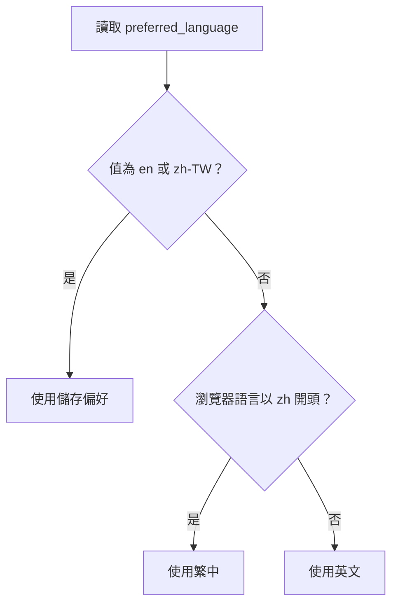
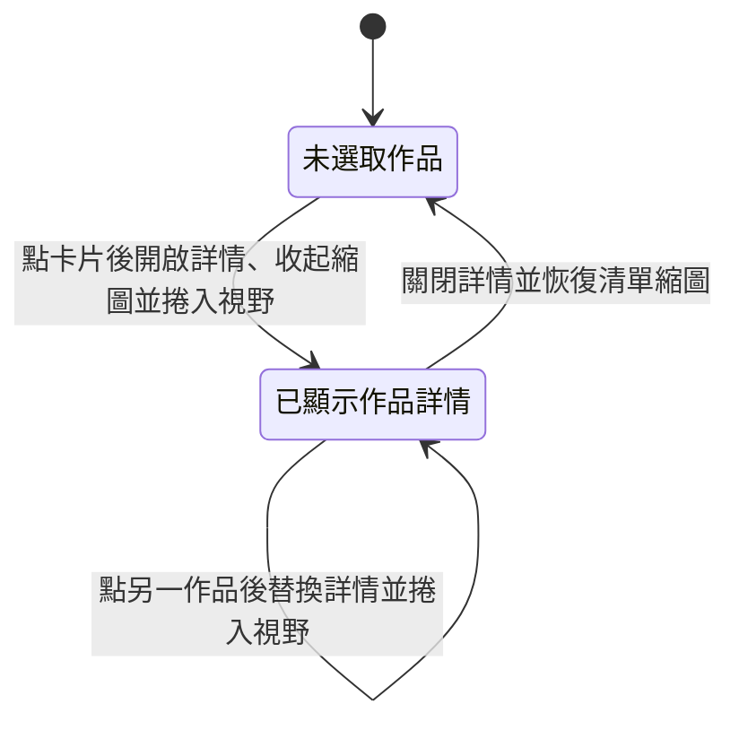
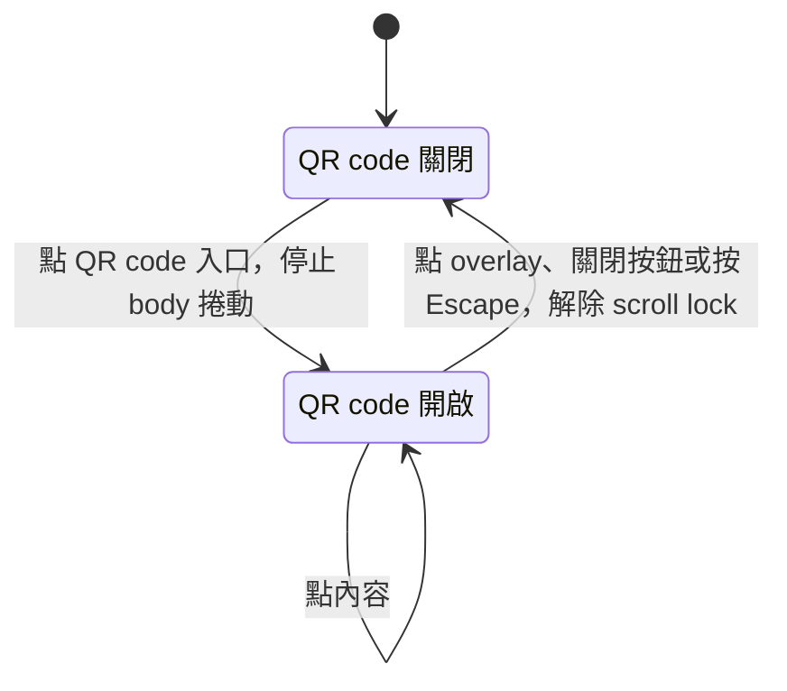

# 網站行為規格

本檔記錄網站現行行為。產品、受眾、語氣與視覺原則見 [設計方向](../design.md)，工程限制與驗證入口見 [README](../../README.md)。內容資料、逐字文案與 CSS 數值以負責檔案為準。

正常使用情境以 localStorage 可讀寫、JavaScript 可執行為前提，另有說明者除外。驗證方式為 `unit`、`browser` 或 `manual`，有多種時需分別建立對應。手動步驟見 [驗收文件](../../tests/manual/site.md)，執行結果記在 commit 說明與交付回報，不記在本檔。

既有問題與待調查、待決策事項見 [Roadmap](../roadmap.md)。驗證對應完整不表示所有行為都已符合設計方向，也不把目前限制當成應維持的產品效果。

## 首頁、導覽與語言

### SITE-R1 頁面與公開範圍

公開首頁以 Home、About、Projects、Blog 的順序呈現個人專業背景與作品，使用共用 Header、Footer 與語言切換器。部落格內容由外部網站提供。

`/resume` 是非公開預覽 route，保留程式中的 client route 與共用履歷功能，但不列入公開導覽或 production prerender。前端 wildcard 導向不能當成靜態 hosting 的 fallback 保證。

| 情境 | 條件、動作與結果 | 驗證方式 |
| --- | --- | --- |
| SITE-R1.1 公開首頁 | 直接開啟 production build 的 `/`，回傳首頁文件，依序找到四個區塊。 | browser |
| SITE-R1.2 共用外框 | 首頁載入後有 Header、主要內容、Footer 與語言切換器；同一內容不因 prerender 與 React 啟動而重複。 | browser |
| SITE-R1.3 非公開履歷 Route | 檢查 build 與公開導覽，沒有為 `/resume` 產生靜態文件或新增公開連結；嚴格靜態 server 不替它回首頁 shell。 | browser |
| SITE-R1.4 非公開預覽 | 在有 client routing 的本機環境開啟 `/resume`，能檢視英文履歷與列印入口。 | browser |

### SITE-R2 區塊導覽與瀏覽器歷史

首頁導覽使用 `#home`、`#about`、`#projects`、`#blog`。Logo 回首頁頂端。自然捲動更新目前區塊的 hash，使用 replaceState 避免每次捲動新增歷史紀錄；明確點選 anchor 則保留瀏覽器原生的導覽與歷史行為。

目前 Header 在捲動距離小於一個 viewport 高度時隱藏，超過門檻後顯示。這是現有門檻，不代表所有 viewport 的可用性都已通過；短螢幕問題見 [Roadmap](../roadmap.md#短螢幕裁切)。

| 情境 | 條件、動作與結果 | 驗證方式 |
| --- | --- | --- |
| SITE-R2.1 首頁區塊連結 | 由 Hero 的 About、Projects、Blog 或顯示中的 Header 連結導覽，網址 hash 與落點指向所選區塊。 | browser |
| SITE-R2.2 自然捲動 | 捲動跨越區塊時，hash 改成已通過頁面頂端的最近區塊；history length 不因這種更新增加。 | browser |
| SITE-R2.3 返回與前進 | 明確點選區塊連結後使用返回與前進，URL 與頁面落點依對應歷史紀錄恢復，不因 scroll 更新而連續新增紀錄。現行問題見 [Roadmap](../roadmap.md#hash-與歷史還原)。 | manual |
| SITE-R2.4 Hash 直接開啟 | 新分頁開啟或 reload 各首頁 hash，確認實際落點及 Header 是否遮擋區塊；不能只測 click。現行問題見 [Roadmap](../roadmap.md#hash-與歷史還原)。 | manual |
| SITE-R2.5 Logo 回頂端 | 點 Header 或 Footer 的 Logo，回到首頁頂端。 | browser |
| SITE-R2.6 Header 顯示門檻 | 在 viewport 高度前後捲動，Header 分別隱藏與顯示；顯示後四個區塊連結可操作。 | browser、manual |

### SITE-R3 初始語言選擇

網站支援 `en` 與 `zh-TW`，初始語言依下圖選擇。

| 情境 | 條件、動作與結果 | 驗證方式 |
| --- | --- | --- |
| SITE-R3.1 儲存英文優先 | 儲存值為 `en`、瀏覽器語言為中文，仍顯示英文。 | unit |
| SITE-R3.2 儲存繁中優先 | 儲存值為 `zh-TW`、瀏覽器語言非中文，仍顯示繁中。 | unit |
| SITE-R3.3 中文瀏覽器 | 沒有有效偏好且瀏覽器語言為 `zh-TW` 或 `zh-CN`，顯示繁中。 | unit |
| SITE-R3.4 非中文瀏覽器 | 沒有有效偏好且瀏覽器語言為 `en-US` 或其他非中文值，顯示英文。 | unit |
| SITE-R3.5 無效偏好 | 儲存值不在支援範圍時，依瀏覽器語言選擇，不能用該無效值選字典。 | unit |

### SITE-R4 語言切換與持久化

語言按鈕在英文與繁中之間切換，標示目前語言並提示下一個語言。切換後更新頁面字典、`html.lang` 與儲存偏好。開著的作品詳情與 QR code 保留狀態，內容依目前語言顯示；履歷內容政策見 SITE-R10。

| 情境 | 條件、動作與結果 | 驗證方式 |
| --- | --- | --- |
| SITE-R4.1 雙向切換 | 在兩種語言各按一次切換，姓名、導覽與區塊文案改成另一語言，按鈕標示同步。 | unit、browser |
| SITE-R4.2 儲存與重載 | 切換後 `preferred_language` 與 `html.lang` 對應所選語言；reload 後仍使用該偏好。 | browser |
| SITE-R4.3 作品詳情中切換 | 開著作品時切換語言，選取仍保留，描述、標籤與進行中期間文字更新。 | browser |
| SITE-R4.4 QR code 中切換 | QR code 開啟時切換語言，dialog 保留，姓名與提示更新。 | browser |
| SITE-R4.5 鍵盤切換語言 | 使用 Tab 找到原生語言按鈕，以 Enter 或 Space 切換；不需要滑鼠。 | browser、manual |

## 個人內容與外部目的地

### SITE-R5 Hero 與聯絡資訊

Hero 呈現姓名、頭像、問候、目前職務、教育背景、email、社群與區塊導覽。職務取工作資料第一筆及其目前語言內容；頭像提供 QR code 入口。Email 供選取與複製，現行頁面沒有點擊寄信或複製按鈕。

| 情境 | 條件、動作與結果 | 驗證方式 |
| --- | --- | --- |
| SITE-R5.1 個人摘要 | 在兩種語言載入首頁，姓名、第一筆工作對應的職稱與公司、教育 badge 均與負責資料一致。 | unit、manual |
| SITE-R5.2 問候文字 | 載入或切換語言後，問候最終顯示目前語言的完整文字，文字不因逐字動畫遺失。 | browser |
| SITE-R5.3 Email 複製 | 選取 Hero email，能複製完整字串；不能將它驗成現有 mailto 或 clipboard 操作。 | manual |
| SITE-R5.4 社群與學校 | 操作 Hero 的 GitHub、LinkedIn、Cake 與學校連結，新分頁目的地符合負責來源。 | browser、manual |

### SITE-R6 About、Footer 與部落格

About 顯示工作經歷、技能與教育。工作內容按資料順序，以 id 取得目前語言翻譯，缺少或空翻譯時取資料值；技能列呈現技能名稱與圖示，學歷連結到對應學校頁面。

Footer 提供聯絡文字、服務項目、社群與當年度姓名版權資訊。

Blog 區塊連到外部文章列表。

| 情境 | 條件、動作與結果 | 驗證方式 |
| --- | --- | --- |
| SITE-R6.1 工作與翻譯 | 工作順序與資料一致，各欄位使用目前語言內容；測試缺少翻譯的資料時回到對應資料值。 | unit |
| SITE-R6.2 技能與教育 | 技能名稱及圖示與技能資料一致，教育連結指向經濟學系與金融科技學程。 | unit、manual |
| SITE-R6.3 Footer 內容 | Footer 顯示完整 email、服務與三個社群入口，版權年度依執行時間，姓名依目前語言。 | unit、manual |
| SITE-R6.4 外部部落格 | Blog CTA 開啟外部部落格列表，不產生站內文章閱讀或發表流程。 | browser、manual |

### SITE-R7 作品選取與詳情

作品清單依資料順序呈現標題、標籤、期間、圖示與縮圖。期間沒有結束年時使用目前語言的進行中文字。選取狀態依下圖切換。

| 情境 | 條件、動作與結果 | 驗證方式 |
| --- | --- | --- |
| SITE-R7.1 初始作品清單 | 首次載入沒有展開詳情，作品順序、圖示、縮圖、標籤與期間對應來源。 | unit、browser |
| SITE-R7.2 開啟詳情 | 點作品卡後，顯示該作品詳情並捲入視野，清單縮圖收起。 | browser |
| SITE-R7.3 替換選取 | 詳情已開啟時點另一作品，內容與外連都換成新的選取，不累加多份詳情。 | browser |
| SITE-R7.4 關閉詳情 | 點詳情關閉圖示，詳情收起且全部清單縮圖恢復。 | browser |
| SITE-R7.5 內容與翻譯 | 描述與標籤依作品識別取得目前語言內容，缺少時取資料值；標題、圖示與 URL 不因語言改變。 | unit |
| SITE-R7.6 期間顯示 | 同時有起迄年度時顯示兩個年度，只有開始年度時顯示目前語言的進行中文字。 | unit |
| SITE-R7.7 重載後狀態 | 展開作品後 reload，不保留選取，也不從 URL 還原作品詳情。 | browser |

### SITE-R8 外連目的地與操作

社群、學校、部落格與作品目的地由現有來源維護。作品 Visit 與 Source Code 分別開啟展示與程式碼 URL；一般外連使用新分頁。新視窗不得保留可控制來源頁面的 opener。驗收檢查本網站的名稱、URL 與操作，不承諾第三方服務持續可用。

| 情境 | 條件、動作與結果 | 驗證方式 |
| --- | --- | --- |
| SITE-R8.1 作品展示 | 逐一選取作品並操作 Visit，在新分頁開啟該作品的 demo URL。 | unit、manual |
| SITE-R8.2 作品程式碼 | 逐一選取作品並操作 Source Code，在新分頁開啟該作品的 source URL。 | unit、manual |
| SITE-R8.3 新分頁隔離 | 一般新分頁 anchor 具有相應隔離屬性；作品 window.open 成功時 opener 被清空。 | unit |
| SITE-R8.4 可辨識外連 | 在兩種語言檢查社群、學歷、作品與部落格入口，名稱或相鄰內容能辨識目的地與動作。 | manual |

## QR Code 與履歷

### SITE-R9 QR Code 顯示與關閉

QR code dialog 顯示個人網站的 QR code、姓名與目前語言提示，狀態依下圖切換。

| 情境 | 條件、動作與結果 | 驗證方式 |
| --- | --- | --- |
| SITE-R9.1 開啟 QR code | 點頭像旁 QR code 入口，出現一份具名稱的 dialog，body 不再捲動。 | browser |
| SITE-R9.2 點內容與背景 | 點 dialog 內容不關閉；點 overlay 關閉且恢復捲動。 | browser |
| SITE-R9.3 關閉按鈕 | 點原生關閉按鈕，dialog 消失並恢復捲動；再次開啟仍可使用。 | browser |
| SITE-R9.4 Escape 關閉 | QR code 開啟時按 Escape，dialog 消失並解除本次 scroll lock。 | browser |
| SITE-R9.5 QR Code 目的地 | 以實機掃描 QR code，辨識為個人網站 URL；姓名與提示對應目前語言。 | manual |

### SITE-R10 履歷來源與列印入口

公開首頁的履歷匯出與非公開預覽共用同一份英文 ResumeSheet，主網站切換語言不翻譯履歷。公開頁面以瀏覽器列印匯出，等待字型載入完成後呼叫 `window.print()`；不承諾自動下載檔案或指定瀏覽器儲存名稱。

首頁的 print sheet 在 mount 後放到 body portal，螢幕上不顯示；非公開預覽則直接顯示紙張。重掛載或切換 route 不能遺留重複 print sheet。

| 情境 | 條件、動作與結果 | 驗證方式 |
| --- | --- | --- |
| SITE-R10.1 首頁列印入口 | 在目前可見履歷按鈕的桌面 viewport，點擊按鈕並等待字型，呼叫瀏覽器列印。 | unit、manual |
| SITE-R10.2 非公開預覽列印 | 在本機預覽點 Download PDF，使用同一個列印 helper 與相同履歷內容。 | unit、manual |
| SITE-R10.3 字型等待與替代路徑 | 有 fonts.ready 時等待 promise；缺少該能力時直接列印，不呼叫其他下載服務。 | unit |
| SITE-R10.4 英文履歷 | 主網站使用英文或繁中時，兩個入口的履歷內容仍為英文。 | browser、manual |
| SITE-R10.5 單一 Print Sheet | React 啟動後及首頁與本機預覽切換後，各入口都只有一份 print sheet；prerender HTML 不包含 body portal。 | browser |

### SITE-R11 PDF 內容與版面

履歷使用 A4，匯出時只保留履歷，不包含網站 Header、Footer 與語言切換器。內容需可選取與擷取，保留聯絡與社群連結。改動履歷內容、版面或列印行為時，依 [Resume Skill](../../.agents/skills/resume-writer/SKILL.md) 檢查來源事實、紙張、頁數、裁切、文字與連結。

| 情境 | 條件、動作與結果 | 驗證方式 |
| --- | --- | --- |
| SITE-R11.1 A4 與完整內容 | 從公開匯出及本機預覽匯出 PDF，核對預期 A4 單頁、全部內容可見，沒有裁切或額外空白頁。 | browser、manual |
| SITE-R11.2 僅列印履歷 | PDF 不出現網站導覽、Footer、語言切換器或重複履歷。 | browser、manual |
| SITE-R11.3 文字與連結 | 檢查擷取文字涵蓋所有區塊，人工確認可讀性及閱讀順序，並核對 email、GitHub 與個人網站連結。 | manual |
| SITE-R11.4 共用結果 | 兩個入口使用相同內容與 print CSS，匯出結果沒有因 portal 或外框不同而漏印。 | browser、manual |

## 響應式、動態與執行環境

### SITE-R12 響應式組成

版面依 viewport 調整，各區域遵循以下規則：

- Hero 在窄畫面直排，較寬時改左右分區。
- 學歷與作品清單在小螢幕直排。
- 作品詳情在中小畫面改成上下排列，最小畫面使用自然高度。
- 語言切換器保留在右下，並考慮 safe area。
- 本機履歷預覽的固定紙張使用容器捲動閱讀。

| 情境 | 條件、動作與結果 | 驗證方式 |
| --- | --- | --- |
| SITE-R12.1 Hero 分支 | 檢查 719 與 720 px 邊界的直排及左右組成，核對目前各元素的可見性；現行裁切問題見 [Roadmap](../roadmap.md#短螢幕裁切)。 | manual |
| SITE-R12.2 清單與學歷分支 | 檢查 512 與 513 px 的學歷及作品清單，直排與橫排按既有 breakpoint 切換。 | manual |
| SITE-R12.3 作品詳情分支 | 在 512、513、1024、1025 px 開啟各作品，檢查圖片、內部捲動、關閉與動作按鈕可達性。 | manual |
| SITE-R12.4 語言與預覽容器 | 窄畫面仍能找到語言切換器；本機履歷紙張可在專用容器捲動，不把紙張縮到不可讀。 | manual |

### SITE-R13 動態與 Reduced Motion

問候在載入與文字改變時逐字顯示，完成後移除游標；Hero 入場與下滑提示提供視覺引導。目前 reduced-motion 分支會停用部分 Hero 入場與下滑提示，其他動態的待處理事項見 [Roadmap](../roadmap.md#reduced-motion)。

| 情境 | 條件、動作與結果 | 驗證方式 |
| --- | --- | --- |
| SITE-R13.1 完整問候與清理 | 問候文字改變或元件卸載時清理前一次 timer；最終只顯示目前完整文字，完成後游標消失。 | unit |
| SITE-R13.2 Hero 動態 | 一般 motion 設定下，入場與下滑提示不阻止正常閱讀與操作。 | manual |
| SITE-R13.3 已有 Reduce 分支 | 模擬 reduced-motion，Hero 入場與下滑箭頭的停用分支生效；其餘動態的待處理事項見 [Roadmap](../roadmap.md#reduced-motion)。 | browser、manual |

### SITE-R14 靜態輸出與 Prerender

Production build 在 CRA compile 後執行首頁 prerender，使用繁中與台北時區擷取 `#root` 的內容，保留原 shell head，排除 body portal。首頁產生可在 JavaScript 啟動前讀取的文字；需要操作的功能仍依賴 JavaScript。

| 情境 | 條件、動作與結果 | 驗證方式 |
| --- | --- | --- |
| SITE-R14.1 完整 Build | 從乾淨的 CRA 輸出完成 build 與 postbuild，產生首頁靜態內容；不能以獨立 prerender 已處理過的 HTML 代替。 | browser |
| SITE-R14.2 靜態首頁內容 | 讀取 build 的 HTML，或停用 JavaScript 開啟首頁，仍有主要區塊文字；不要求 QR code 或語言切換在無 JavaScript 時可操作。 | browser |
| SITE-R14.3 擷取範圍 | HTML 保留 shell metadata，root 內有繁中內容，root 外沒有擷取到的 print portal；啟動後也不重複。 | browser |
| SITE-R14.4 失敗回報 | 空 root、擷取期 JavaScript error、錯誤 HTTP 或不足的內容使 prerender 失敗，不上傳該次失敗產物。 | browser |

### SITE-R15 Service Worker 與執行環境

網站沒有 first-party API 或 application server。現行入口停用 service worker 註冊，保留的 Workbox 檔與 manifest 不代表已提供離線 cache 或更新 UI。

| 情境 | 條件、動作與結果 | 驗證方式 |
| --- | --- | --- |
| SITE-R15.1 新瀏覽器環境 | 在新的 browser context 開啟 production build，不建立 service worker registration，也沒有 controller。 | browser |
| SITE-R15.2 既有 Registration 清理 | 啟動時呼叫現有 unregister helper，針對 ready registration 執行 unregister；不能把這個動作宣告成同步清空 cache 或立即卸除 controller。 | unit |

### SITE-R16 Metadata 與發布

首頁提供 title、description、canonical、社群預覽、圖示與 manifest，robots 指向 sitemap，這些內容由 public 檔案維護。

`main` push 與手動觸發執行共同檢查；Pages artifact 上傳與部署只允許 `refs/heads/main`。驗證失敗時不發布。

| 情境 | 條件、動作與結果 | 驗證方式 |
| --- | --- | --- |
| SITE-R16.1 首頁 Metadata | Build 後保留 public shell 的首頁 title、canonical、description、OG 與圖示連結，沒有意外改成非公開 route。 | browser |
| SITE-R16.2 Robots 與 Sitemap | 靜態輸出保留 robots 與 sitemap，robots 指向正確的 sitemap 位置；不加入 `/resume`。 | browser |
| SITE-R16.3 主分支發布 | `main` push 或對 `main` 手動觸發時，共同檢查通過後才以 `build/` 上傳與部署。 | manual |
| SITE-R16.4 非主分支不得發布 | 對其他 ref 手動觸發時，不上傳 Pages artifact，也不執行 production deploy。 | manual |
